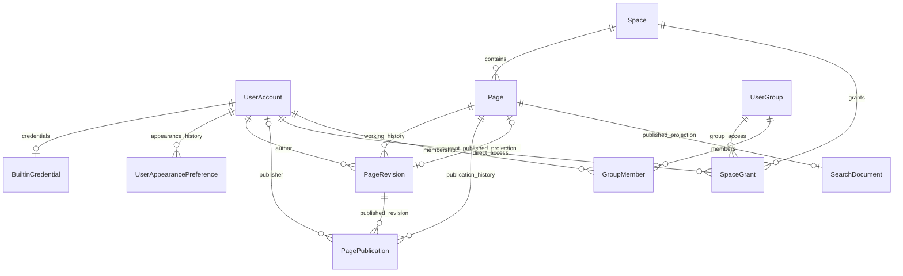

# Atlas: architektura a technická rozhodnutí

Aktualizace: 2026-09-07. Stav: přijatá architektura .NET 11/Vue, NHibernate/PostgreSQL a Wolverine s lehkým CQRS a vertical slices. Existuje spustitelná wiki s obsahovými operacemi, importem/exportem a spoluprací; tento dokument rozlišuje jeho skutečné chování od cílového MVP. Builtin a obecný OpenID Connect přes OpenIddict 7.6.1 jsou implementované jako dva startup moduly se společnou session; protokolové bezpečnostní testy běží proti skutečné PostgreSQL a lokálnímu testovacímu IdP. Přejímka proti firemnímu Hubu a druhému nezávislému provideru zůstává otevřená. Registrace serverových modulů probíhá při startu. Produkční kvalita je požadovaná úroveň dokončení, nikoliv prohlášení, že už je celé MVP připravené do produkce.

Toto je hlavní technický dokument Atlas. Obsahuje i dosavadní rozhodnutí o oprávněních. Produktové chování a přejímka patří do [MVP specifikace](mvp-specification.md). Starší rozvaha v projektu editoru zůstává historickým kontextem; pro Atlas má přednost tento dokument.

## 1. Technologický základ a hranice MVP

| Oblast | Rozhodnutí |
| --- | --- |
| Host | ASP.NET Core na .NET 11, jeden produkční aplikační proces včetně Vue a onboarding wizardu |
| Frontend | Vue.js, vlastní editor Atlas.Markdown jako balíček |
| Aplikační operace | Wolverine, lehké CQRS, vertical slices podle uživatelských funkcí |
| Persistence | NHibernate; QueryOver jako výchozí dotazovací API, ne povinnost pro každý dotaz |
| Identity | OIDC / OpenIddict; poskytovatel přihlášení oddělený od oprávnění wiki |
| Autorizace | Lokální Reader/Writer/Admin na prostor a globální WikiAdmin; úplná pravidla níže |
| Data | PostgreSQL 19 s pgvectorem (oficiální image, kolace builtin `C.UTF-8`, [Kolace databáze](operations.md#kolace-databáze)); NHibernate mappingy a FluentMigrator 8.0.1 v témže hostu |
| Asynchronní práce | Outbox a idempotentní zpracování přes Wolverine po ověření NHibernate integrace |
| Rozšíření | Důvěryhodné serverové moduly sestavené s aplikací a zapínané při startu |
| Spolupráce | Existující Atlas.Markdown.Sync v témže .NET hostu, protokol V1 relay, PostgreSQL provozní stav; jeden aktivní host |
| Hledání | První implementace: PostgreSQL fulltext + pg_trgm/unaccent nad publikovanou projekcí; přejímka relevance a výkonu stále platí |

CQRS nevyžaduje event sourcing ani oddělenou read databázi. Pro MVP nezavádíme broker, mikroservisy, dynamické nahrávání DLL, marketplace ani paralelní Hangfire pro stejné úlohy. RAG zůstává pozdější funkcí nad povoleným publikovaným obsahem.

Rozhodnutí o vydáních 2026-09-25: po přejímce 1.0 následuje verze 1.1: prostor jako rámec samostatných dokumentových a trezorových oprávnění, časově omezené granty a sdílení, KeePass/SMB, vlastní druhý faktor a audit vydání hesel. Verze 2.0 naváže po přejímce 1.1 s RAG/chatem a převezme její autorizaci. Plné obsahové jádro, tabule, autoritativní synchronizace, Flutter a Projector zůstávají ve verzi 3.0. Jde o plán, nikoli popis již implementovaných funkcí; číslo produktu nemění označení synchronizačního protokolu V2.

Níže uvedené Reader/Writer/Admin na prostor popisují současnou 1.0. Cílová 1.1 zachová jejich dokumentová oprávnění, ale přístup k trezoru ani samotný vstup do prostoru nezamění za čtení všech stránek. Tajemství nejsou obsahem dokumentu nebo Yjs; vložená komponenta obsahuje pouze referenci. Rozsah 1.1 nevyžaduje zavést celý ContentResource/ContentNode/Placement model.

### Konvence kódu

Celý server je v tomto tvaru; vzor je `Features/SpaceSettings` a `Platform/`.

- Jeden typ na soubor, namespace odpovídá složce. Feature má podsložky `Contracts` (wire DTO), `Domain` (entity, hodnotové objekty), `Persistence` (`ClassMapping<T>`), `Queries`, `Commands` a soubor `*Endpoints.cs`.
- Aplikační operace jsou Wolverine handlery: instanční třída `XxxHandler` s konstruktorem, metoda `Handle(command, ct)`. Endpoint je tenká Minimal API lambda, která složí zprávu a zavolá `IMessageBus.InvokeAsync`.
- Handler dostává z DI scoped `ISession`, `ICurrentActor`, `IContentAccess`, `IAtlasLocks`. Transakci vlastní `NHibernateTransactionMiddleware`; handler ji nikdy nezačíná ani necommituje. Stránku otevírá `PageGate` (`Platform/Identity`); které handlery tudy procházejí a které si stránku otevírají samy, říká odrážka o bráně stránky u pořadí zámků níže.
- Dotazy píšeme QueryOverem nebo `GetAsync` s `LockMode`. Surové SQL (`CreateSQLQuery`, `NpgsqlCommand`) je výjimka,
  kterou musí nést jedna z těchto kategorií; důvod patří do komentáře u dotazu (cesty jsou relativní k `src/Atlas.Server`):
  1. **Databázové funkce a nastavení dotazu.** Logika žije v SQL, aby ji všichni volající sdíleli:
     `Features/Search/SearchSql.cs` (`atlas_search_*`, `set_config` plánovače), `Features/Auth/CredentialAudit.cs`
     (`atlas_record_credential_audit`), `Features/Security/Reauth/ReauthProofs.cs` (`atlas_record_reauth_audit`).
  2. **Zámky a proměnné transakce.** Advisory a řádkové zámky i `scaleatlas.actor_id` jen v
     `Platform/Persistence/AtlasLocks.cs`. Výjimky jsou tři. První je session-level advisory lock běhu zálohy (ZIP i Git) na
     vlastním spojení v `Features/Backups/BackupRunLock.cs`, protože přesahuje několik transakcí žurnálu. Druhý je
     session-level advisory lock exportu jedné stránky do PDF na vlastním nepoolovaném spojení v
     `Features/PagePdfExports/PagePdfExportRunner.cs`, aby vykreslení a zápis do úložiště nedržely transakci stránky. Třetí jsou
     řádkové zámky zapsané jako text SQL, které smějí být jen v metodách vyjmenovaných v
     `tests/Atlas.Server.Tests/Platform/RowLockTextConventionTests.cs`: vlastní řádky úložiště konverzací asistenta a AI indexu
     (včetně dávek `SKIP LOCKED`, které `IAtlasLocks` nenabízí) a řádek `Page` `FOR SHARE`, který zamyká index worker, protože
     běží bez účtu požadavku mimo bránu stránky. Seznam je přesný oběma směry; test nevidí SQL z migrací ani klauzuli složenou
     z kusů.
  3. **Kód bez NHibernate session nebo mimo ORM.** `Features/ModuleSettings/OidcRuntimeLoader.cs` běží před
     `WebApplication.Build()`; `Platform/Persistence/DatabaseStatistics.cs` spouští `ANALYZE`, které ORM nevyjádří.
  4. **Atomické a množinové zápisy.** Jeden příkaz tam, kde by čtení a zápis přes entity otevřely souběh nebo načítaly
     zbytečně řádků: `INSERT … ON CONFLICT DO NOTHING` katalogu štítků (`Features/PageTags/PageTagStore.cs`),
     podmíněný `INSERT … WHERE NOT EXISTS` zobrazení (`Features/PersonalLibrary/Commands/RecordPageVisitHandler.cs`),
     hromadné ukončení odkazů (`Features/ExternalSharing/Commands/SaveSharingPolicy.cs`) a přístupů účtu při „Odebrat vše“
     (`Features/Access/Commands/RevokeAllAccessHandler.cs`).
  5. **Autorizované a výkonově kritické čtecí projekce.** Přístup se vyhodnocuje v SQL před stránkováním nebo v jediném
     snímku a dotaz potřebuje CTE, `LATERAL`, `json_agg` či `jsonb_path_query_array`:
     `Features/PageAccess/Queries/PageAccessHandler.cs`, vyhledání a procházení štítků v `PageTagStore`,
     `Features/PersonalLibrary/AnalyticsHandler.cs`, `Features/ContentExport/Queries/RevalidateContentExportHandler.cs`
     (grant i token jedním příkazem) a `Features/ExternalSharing/ShareLinkReader.cs` (stav odkazu z pěti tabulek).
     Jednodušší read-only projekce patří do `Subselect` mapování.
  6. **Migrace a testovací seed**, v seedu jen tam, kde pro tabulku neexistuje entita.

  Mimo tyto kategorie se `CreateSQLQuery` ani `NpgsqlCommand` nepoužívá; nový výskyt bez kategorie je chyba review.
  Známé odchylky k převodu na QueryOver (stav 2026-09-26):
  - `PageTagStore`: `ReadAsync`, dohledání `Id` po upsertu v `ResolveAsync` a `PreviousBoundariesAsync` – prosté
    dotazy nad mapovanými `Tag`/`PageTag`.
  - `Features/Backups/Archive/WikiBackupArchive.cs`: seznam revizí pro token obsahu, název z `Workspace` a součet
    `octet_length` obsahu (`Projections.SqlFunction`).
  - `Features/Administration/Commands/SetSpaceGrantHandler.cs`: samostatné `SELECT statement_timestamp()`; databázový
    čas patří do sdíleného helperu v `Platform/Persistence` nebo přímo do porovnávajícího dotazu.
  - `Features/PageAccess/PageAccessAudit.cs` a `Features/PageAccess/Queries/GetPageAccessHistory.cs`: tabulka
    `PageAccessEvent` nemá entitu; zápis nahradí insert-only entita, historii pak QueryOver s entity joiny.
- Zámky bere kód výhradně přes `IAtlasLocks` (advisory, `FOR SHARE`/`FOR UPDATE`/`FOR KEY SHARE`, `set_config`). Řádkové zámky vrací `bool`; hlášku 404 formuluje volající. Řádek `Page` `FOR UPDATE` se načítá výhradně přes `ISession.GetForUpdateAsync`: vrátí řádek tak, jak je pod zámkem, i když ho session už drží. Prosté `GetAsync(id, LockMode.Upgrade)` takovou instanci vrací v podobě před zámkem, takže souběžná změna projde kontrolou verze. Jiné volání NHibernate se zámkem nad `Page` odmítá `PageLockingLoadConventionTests` (Smoke); `PublishPageHandler` a `CommitImportHandler` jsou v něm připnuté jako výjimky s důvodem.
- Zápisy jdou přes entity a dirty checking; historii řádku píše v téže transakci C# (`ContentRowEffects`) a aktéra bere z `TransactionActor`, který nastaví `IAtlasLocks.SetActorAsync`.
- Styl: klasický konstruktor, `private readonly` fieldy s prefixem `m_`, jeden příkaz na řádek, složené závorky na vlastním
  řádku, file-scoped namespace. Pojmenování fieldů a konstant a file-scoped namespace vynucuje build
  (`EnforceCodeStyleInBuild` a `.editorconfig`), porušení je chyba překladu. Formátování (`IDE0055`) je pinnuté na
  `suggestion` a kontroluje se samostatným průchodem `dotnet format`; důvod je v komentáři v `.editorconfig`.
- Kompozici vlastní `Platform/Hosting`: `AddAtlasServer` (registrace), `UseAtlasPipeline` (middleware),
  `MapAtlasEndpoints` (routy). `Program.cs` obsahuje jen větev `--database-script`, builder, tato tři volání a `Run`.
  Feature registruje své služby v `<Feature>Module.cs` a routy v `<Feature>Endpoints.cs`.
- Očekávaná `ApiException` není chyba serveru: Wolverine loguje selhání zprávy jako `Error` pod kategorií typu zprávy,
  a `AtlasMessageLogging` tyto kategorie tiší. Neočekávané selhání loguje `RequestErrorHandling` s `TraceId`.
  Handler si vlastní diagnostiku loguje přes `ILogger<XxxHandler>`, kterou filtr nezasahuje.
- Aktéra pro autorizaci se čte pod zámkem: `LockActorAsync` zapíše očekávaný `SecurityStamp` do lokální proměnné
  **před** `RefreshAsync`, protože identity map může vrátit tutéž instanci, kterou drží volající. Kdo si účet
  znovu čte sám (build exportu, PersonalApi, YouTrack), dělá totéž a má na to probe test.
- Návratový typ handleru nesmí implementovat `IDisposable` ani `IAsyncDisposable`: JasperFx generuje volání
  v `using` bloku a výsledek by zlikvidoval, než ho endpoint zapíše do odpovědi.
- Pořadí zámků při čtení i zápisu obsahu: advisory shared `731145012`, řádek prostoru, účet s proměnnou aktéra (`set_config`),
  řádek stránky. Prostor se bere `FOR SHARE`; kdo stránku vkládá nebo mění strom, bere řádek prostoru nejdřív `FOR UPDATE` a
  teprve potom `FOR SHARE`, nikdy opačně (vložení pod prostorem drženým jen `FOR SHARE` ho musí povýšit a dvě taková vložení se
  vzájemně zablokují, 40P01). Prostor stránky se zjišťuje až po advisory zámku. Stránka se čte `FOR SHARE`, mění `FOR UPDATE`.
  Zkoušky pořadí zámků (`PageGateLockTraceTests`) nenašly povýšení řádku prostoru ani stránky v žádné ze sledovaných zpráv, s jedinou
  výjimkou: `CreateMcpDraft` ze šablony s připojeným textem čte stránku, kterou vložil, zpět `FOR SHARE` a sdílené uložení ji hned
  zamkne `FOR UPDATE`. Řádek je do commitu vidět jen té transakci, takže na něm nemůže nikdo čekat a povýšení nemůže skončit
  zablokováním (40P01); test ho eviduje jako výjimku.
- Stránku otevírá `PageGate` (`Platform/Identity`, scoped jako session, jedna instance na zprávu). Bere obsahové zámky v pořadí
  výše, načte stránku tak, jak je pod zámkem jejího řádku, a rozhodne o ní pro účet požadavku (`IContentAccess.AuthorizePageAsync`).
  - `ReadAsync(id, operace)`: prostor i stránka `FOR SHARE`; stránka se rozhoduje pro zadanou operaci (historie, návrhy editoru
    a čtení pro AI psaní čtou s `EditContent`). Prostor stránky, kterou session už drží, vezme z této instance bez dotazu, jak
    čte zpět odpověď po vytvoření nebo obnově stránky `PageReader`; `EditAsync` ho zjišťuje vždy dotazem.
  - `EditAsync(id, operace)`: stránka `FOR UPDATE` pod prostorem `FOR SHARE`, jen `EditContent` nebo `ManageAccess` (uložení,
    obnova z historie, náhrada zdroje).
  - `RestructureAsync(id, operace)` (stránka `FOR UPDATE` pod prostorem `FOR UPDATE`) a `EnterSpaceForChangeAsync(prostor)` (totéž
    pro prostor bez stránky) jsou pro vkládání stránek a změny, které serializuje řádek prostoru. Žádný handler je nevolá, ověřují
    je jen testy (`PageGateTests`, `PageGateLockTraceTests`).
  - `EnterSpaceAsync(prostor)`: jen zámky prostoru a účtu; vrací `LockedSpace`, z něhož se další stránky téhož prostoru otevírají
    jen zámkem svého řádku (`ReadPageAsync`, `FOR SHARE`). Kdo otevírá víc stránek, řadí je podle id sám.

  Výjimkou `ApiException` brána odpoví jen u zámku účtu (401, neplatné přihlášení) a u chybějícího prostoru (404). O stránce
  výjimku nevyhazuje: vrací `PageOpening` se stavem `Missing`, `Moved`, `Trashed`, `Hidden`, `Forbidden` nebo `Open`; platí první
  stav v tomto pořadí a chybějící, přesunutá a smazaná stránka se pro účet vůbec nerozhodují (nestojí dotaz na granty). Odpověď
  volí volající: `Require()` dává standardní 404/403 (přesunutá stránka je z editační brány 409 `space_changed`, ze čtecí 404),
  `RequireHidden()` dává 404 pro vše kromě `Open` a `Require(text)` vlastní text 403.
- Důkazem, že zámky jsou vzaty a stránka rozhodnuta, jsou `LockedSpace`, `LockedPage` a `EditablePage`. Jejich konstruktor, stejně
  jako konstruktor `PageOpening`, smí volat jen `PageGate` (hlídá `PageGateCapabilityConventionTests` čtením IL). Vážou se na
  transakci, která zámky vzala; po jejím konci je `RequireHeld()` odmítne jako programátorskou chybu (`InvalidOperationException`,
  nikdy `ApiException`). Důkaz platí jen u brány, která ho vydala: kdo ho přebírá a pracuje na vlastní session, ptá se brány svého
  scope (`PageGate.RequireOwn`; tak čte `PageReader.ReadEditedAsync` a tak brána čte další stránku prostoru), takže stránka nebo
  prostor z jiného scope neprojde, ani když jeho transakce ještě běží. Kdo vkládá stránku, ptá se stejně své brány, zda byl prostor
  otevřen pro změnu (`PageGate.RequireOwnForChange`). `RequireHeld()` a `RequireHeldForChange()` se ptají brány, která důkaz
  vydala, a proto je mimo důkazy samotné smí volat jen `PageGate.RequireOwn…` (hlídá týž test). Zpětné čtení na důkaz zamyká prostor z důkazu, ne
  ten, který nese instance stránky; řádek, který pak najde v jiném prostoru, přesunul sám příkaz po bráně, a to je stejná
  programátorská chyba, ne 404. Stránka se před bránou nikdy nemění: opětovné načtení držené instance zahodí nezapsané změny, proto
  příkaz, který stránku po změně čte zpět, nejdřív zapíše (`FlushAsync`), jako to dělá `PageReader`. Pořadí zámků a počet příkazů
  každé operace jsou připnuté testy (`PageGateLockTraceTests`, `PageGateStatementCountTests`).
- Stav k 2026-10-10 (`859ae2be`). Přes bránu jdou:
  - souvislosti stránky (`GetPageConnections`), návrhy editoru (`AssistPageGuard`: kandidáti odkazů a řazení stránek) a čtení pro AI
    psaní (`WritingRead`: stránka i šablony prostoru, ty přes `LockedSpace`);
  - historie (`PageHistoryAccess`): seznam verzí a revize, kontrola publikace
    a úprava stránky při obnově z historie;
  - osobní stav stránky (`PersonalPageGuard`: návštěva, oblíbené, čtení štítků, dekorací a čtenářů). Obsahový zámek, zjištění
    prostoru a u zápisu zámek prostoru a výlučný advisory zámek osobního stavu si bere sám, protože musí předcházet zámku účtu;
    od zámku účtu dál vstupuje přes bránu (`EnterSpaceAsync`, `ReadPageAsync`);
  - rozhodující čtení v `PageReader`: otevření stránky (`GetPage`), čtení MCP (`GetMcpPage`, `GetMcpEditBase`, `PreviewMcpPublish`),
    karta přístupu a adresář lidí (stejnou čtečkou jdou i vysvětlení přístupu, historie přístupu a bezpečnostní centrum), čtení
    šablony a odpověď `CreatePage` a odpověď `RestorePage`;
  - uložení stránky (`SavePage`, tedy i `SaveMcpDraft` a uložení uvnitř `CreateMcpDraft`) a náhrada zdroje (`ReplacePageSource`)
    přes `EditAsync`; jejich odpověď čte `PageReader.ReadEditedAsync` na důkaz `EditablePage`.

  Mimo bránu zůstávají zejména tyto cesty, každá se svým žebříčkem zámků:
  - publikace (`PublishPage`) a označení šablony (`SetPageTemplate`) otevírají stránku samy a čtou ji zpět přes
    `PageReader.ReadEditedWithoutProofAsync`; jiného volajícího `PageGateCapabilityConventionTests` nepustí;
  - organizační zápisy přes `OrganizationLocks` (přejmenování, přesun ve stromu, koš a obnova z koše, štítky, dekorace, přístupy,
    režim přístupu) a čtení stromu a koše (`LockForReadAsync`);
  - přesun mezi prostory (`MovePageToSpace`, zámky obou prostorů přes `LockActorInSpacesAsync`);
  - žebřík prostoru a kontrola rodiče při vytvoření stránky (`CreatePage`, jeho voláním i `CreateMcpDraft`) a stráže importu
    (`ImportGuards`);
  - přílohy (`AttachmentPageGuard`), PDF export stránky, sdílení (`ExternalSharingAccess`) a spolupráce (`CollaborationAccess`);
  - vícestránkové cesty asistenta (`PageSourceAdapter` zamyká prostory najednou) a operace nad prostorem, které žádnou stránku
    neotevírají (nastavení prostoru, jeho AI nastavení a obálka); ty berou zámky prostoru a účtu přes `IContentAccess.LockActorAsync`.

K první kategorii surového SQL: `CredentialAudit` volá SQL funkci `atlas_record_credential_audit`
z migrace 022, protože tvar auditní události žije v SQL, aby ji všichni zapisovatelé psali stejně.

Z pravidla scoped `ISession` má výjimku `NHibernateOidcTokenStore` (surové SQL nepoužívá): drží vlastní
session a transakci na operaci, protože kontrakt `IOpenIddictTokenStore<T>` je generický queryable
a jeho operace nejdou vyjádřit zprávami s čistými daty. „Jedna transakce na operaci“ je přitom nosná —
zastaralý zápis musí skončit jako `OpenIddictExceptions.ConcurrencyException`.

Z pravidla scoped `ISession` má výjimku i `PersonalApiCredentials`: ověření bearer tokenu pro `/api/v1` běží
v autentizačním handleru a potřebuje `RepeatableRead` přes tři čtení, kterou transakční middleware nenabízí.

Z pravidla scoped `ISession` má výjimku i transportní část `SecurityConfigurationCache` (WP4 V4): middleware forwarded hlaviček běží pro každý požadavek mimo Wolverine, takže obnovu důvěryhodných proxy a jednorázový import `Http:TrustedProxies` dělá ve vlastní session a transakci. Rozhodnutí (vydání, diagnostika, ochrana) čtou konfiguraci v transakci handleru.

`OidcRuntimeLoader` běží před `WebApplication.Build()`, takže nemá session factory ani kontejner. Nedostupná
databáze jeho start nezastaví: vrátí konfiguraci ze souborů, zaloguje varování a o dostupnost databáze se dál
stará `AtlasDatabaseInitializer` s `/health/ready`. Nečitelný chráněný secret start naopak zastaví.
`/api/setup/status` u nedostupné databáze vrací 200 s `databaseReady: false` a hláškou `NotReadyMessage`;
text o selhané migraci se přes HTTP už neobjeví.

Cookie sign-in není zpráva: `ISignInService` vlastní odpověď a databázovou část posílá jako `RecordSignIn`.

### Jeden produkční runtime a první spuštění

Nasazuje se jeden .NET 11 server, který poskytuje API i sestavené statické Vue soubory na stejné origin. Produkce nepotřebuje vedlejší Node/Vite proces ani samostatnou instalační webovou aplikaci. PostgreSQL je jeho externí datová závislost. Aspire AppHost slouží lokálnímu vývoji a spuštění z Rideru; PostgreSQL vytváří přes Podman a připojení předává jako `ConnectionStrings:atlas-db`. AppHost není druhá produkční aplikace.

Správce nastaví připojení databáze a trvalé úložiště Data Protection klíčů (`DataProtection:KeysPath`; výchozí `.data/keys` pod content root). Klíče i databáze patří do provozního návrhu zálohování a omezení přístupu. Přihlašovací údaje ani instalační token se necommitují do konfigurace. V produkci cookie vyžaduje HTTPS. Server startuje i s nedostupnou databází: `AtlasDatabaseInitializer` opakuje inicializaci každých pět sekund, dokud databáze neodpoví, a každý neúspěch zaznamená jako varování. Restart aplikace po opravě připojení tedy není potřeba; bez nastaveného `ConnectionStrings:atlas-db` se neopakuje nic a průvodce hlásí chybějící konfiguraci.

Součástí stejného Vue rozhraní je wizard: stav databáze → název wiki → první lokální správce → nastavení modulů → otevření wiki. Chybějící či nedostupná databáze není pokyn k vytvoření jiného úložiště; aplikace vrátí bezpečný stav a správce opraví serverovou konfiguraci. Wizard nepřebírá databázová hesla do uživatelského profilu. Dokončení ověřuje instalační token, CSRF a validaci hesla. PostgreSQL advisory lock a jediný řádek `Workspace` zajistí, že souběžné požadavky vytvoří právě jednu wiki a prvního WikiAdmin v jediné transakci. Nejde o automatické povýšení prvního návštěvníka nebo OIDC uživatele.

Minimální builtin heslo má standardně 12 znaků (maximum 256). Jen současné `Development` a explicitní `Authentication:Builtin:AllowDevelopmentPasswords=true` snižují minimum na 4; vývojový Aspire tento přepínač předává. V produkčním prostředí samotný přepínač nic neuvolní. Stejná politika platí pro setup, aktivaci/reset, změnu hesla a serverovou obnovu. Krátké testovací heslo není produkční výchozí nastavení.

Aktuální builtin přihlášení používá ASP.NET Core PasswordHasher s PBKDF2, aplikační cookie, rate limiting a stejnou zprávu pro neznámý účet i chybné heslo. API ověřuje aktuální aktivitu účtu a security stamp, mutace kontrolují CSRF. Správa účtů, aktivace/reset a obecný OIDC adaptér jsou implementované. Aktivaci i reset vydává WikiAdmin jako jednorázový kód; pozvánka nového účtu, který si ještě nikdy nenastavil heslo, platí 7 dní (i když ji správce vydá znovu), reset hesla 30 minut (rozhodnutí vlastníka 28. 9. 2026, `AccountTokens`, účel `invitation`/`reset` se určí při vydání); v databázi je pouze SHA-256 otisk. Kód se předává mimo aplikaci, automatické zasílání e-mailu zatím není součástí. Reset okamžitě vypne staré heslo a zneplatní session; uživatel si nastaví nové heslo sám. Změna vlastního hesla vyžaduje staré heslo, odhlásí ostatní session a obnoví právě používanou. Posledního aktivního WikiAdmin nelze deaktivovat ani degradovat, a to ani souběžnými požadavky.

### Serverová instalace a záchranný přístup

`Setup:BootstrapToken` je volitelný vstup správce. Není-li dodán, server vytvoří náhodný 256bitový token v `Security:DataPath/bootstrap-token.txt`; existující token se zachová. Před dokončením instalace ho jednou za start vypíše zpráva `Atlas first installation token`, včetně skutečné cesty. Průvodce vrací a zobrazuje pouze zdroj/cestu/instrukce, nikoliv tajnou hodnotu. Pro Rider/Aspire uvádí přesně log prostředku `atlas`. Po existenci `Workspace` se instalační token neloguje ani nepřijímá pro další založení.

Záchranný přístup používá jiný token v `administrator-recovery.json`, vázaný na stabilní ID již existujícího WikiAdmin. Databáze uchovává pouze jeho otisk, vydání, expiraci a spotřebování v UTC. Token platí sedm dní, je jednorázový a při použití se atomicky spotřebuje, obnoví se builtin heslo daného správce a rotuje SecurityStamp. Po úspěchu vznikne náhradní token; chyba zápisu souboru nezvrací již potvrzenou změnu hesla a údržba obnoví soubor později. Záznam po deaktivaci lze použít k obnově téhož správce, po odebrání WikiAdmin nikoliv. Nový účet ani automatické povýšení se nevytváří.

Tokeny na disku mají omezená oprávnění a adresář musí přežít výměnu aplikace. Při vytvoření/rotaci obnovovacího tokenu log uvede účet, platnost a cestu k souboru, hodnotu tokenu ne (SEC-A-7). Tato konkrétní provozní výjimka se nevztahuje na obecné request logování, hesla, OIDC ani osobní API tokeny. Obnova vyžaduje zapnutý builtin modul, CSRF a limit pokusů; běžné API nevrací tajný token a obnova sama nepřihlašuje.

## 2. Moduly a vertical slices se doplňují

Modul vlastní funkční oblast a její veřejné kontrakty. Vertical slice uvnitř modulu provádí jednu funkci od vstupu přes pravidla až po výstup. CQRS odděluje čtení a změny stavu uvnitř těchto funkcí. Nejde o tři soupeřící organizační modely.

```text
Host / composition root
  Platform: persistence, messaging, čas, audit, aktuální aktér
  IdentityAccess: lokální uživatelé, skupiny, granty, autorizace
  Wiki: prostory, stránky, publikování, přílohy
    CreateSpace / GetPageTree / PublishPage / MovePage / RestoreRevision
  Search: Omnisearch / IndexPublishedPage
  Auth.Builtin: lokální přihlášení jménem a heslem
  Auth.OpenIdConnect: obecná federace, první provider JetBrains Hub
  Integrations.YouTrack: FindIssues / ResolveIssue / RefreshIssueSnapshot
```

Povinné jádro může začít jako feature složky a namespaces v jednom projektu. Volitelné serverové integrace a poskytovatelé autentizace mají vlastní assembly, aby šly skutečně vynechat z registrace a distribuce. Nevytvářet projekty Domain/Application/Infrastructure pro každý malý slice.

Ukázka uspořádání, nikoliv závazný seznam všech projektů:

```text
src/
  Atlas.Server/       host, povinné moduly, composition root
  Atlas.Contracts/    malé veřejné DTO a capability kontrakty
  Atlas.Auth.Builtin/ lokální přihlašovací metoda
  Atlas.Auth.OpenIdConnect/ obecný adaptér providerů
  Atlas.YouTrack/     samostatný modul povinný pro MVP
  Atlas.Web/          Vue shell a frontendové funkce
```

Slice drží request, validaci, handler, response a případně endpoint blízko sebe; jednoduchá funkce může být jeden soubor. Sdílená doménová pravidla a autorizace se neduplikují. Přes hranici modulu nepředávat NHibernate entity, proxy, `ISession` nebo rozpracované IQueryable/QueryOver dotazy.

## 3. Commands, queries a komunikace

- Commands mění stav a představují konkrétní úmysl: `PublishPage`, `ChangeSpaceAccess`. Úspěšná synchronní odpověď znamená dokončený commit, nikoliv pouhé přijetí do fronty.
- Queries vracejí DTO pro obrazovku a nemají doménové zápisové efekty. Query nesmí implicitně spustit import nebo publikaci; technická cache je oddělená infrastruktura.
- HTTP endpoint může přímo obsloužit Wolverine HTTP nebo delegovat přes Wolverine jako mediator. Pro jednoduchý endpoint nezavádět zároveň duplicitní HTTP handler, service a command handler se stejnou logikou.
- Pro okamžitou odpověď jiného modulu použít úzký veřejný query/service kontrakt. Nevytvářet řetězce handler → InvokeAsync → handler ani synchronní cykly modulů.
- Dokončené změny oznamovat stabilními integračními událostmi, například `PagePublished(PageId, RevisionId)`. Následná indexace nebo synchronizace běží asynchronně. Payload neobsahuje citlivý obsah, pokud stačí identifikátor.
- Vzdálené volání integrace nesmí být povinným krokem publikace běžného článku. YouTrack je povinný pro přejímku MVP, ale jeho dočasná nedostupnost nesmí zablokovat čtení ani ukládání již existující wiki.

Trvalé zprávy mají stabilní identitu, verzi kontraktu a plán kompatibility při upgradu; přejmenování namespace nesmí osiřit zprávy ve frontě. Retry neznamená exactly-once. Handler musí bezpečně zvládnout opakování a starší verzi události.

Autorizace použije aktuálního aktéra dodaného důvěryhodným hostem. UserId z HTTP těla není důkaz identity. Uživatelský command prováděný později znovu ověří aktuální oprávnění; interní indexační job má explicitní systémový účel a zkontroluje aktuální revizi/stav zdroje. HTTP, SignalR ani modulové endpointy nesmějí obcházet společná pravidla.

## 4. NHibernate, normalizace a časové verze

### 4.1 Jedna operace, krátká transakce

`ISessionFactory` je sdílená, `ISession` a transakce krátkodobé pro jednu operaci. Session se nesdílí mezi souběžnými handlery ani po dobu SignalR spojení. Zápis má jednoho vlastníka commitu; při retry vzniká nová session. První implementace používá explicitní transakce v aplikačních operacích, nikoli domnělou automatickou NHibernate integraci Wolverine.

Command ověří aktéra, současné oprávnění, stav obsahu a očekávaný concurrency token. Zamkne konkrétní stabilní řádek, uloží změnu a commitne. Queries vracejí DTO, nepřenášejí NHibernate proxy do Vue. QueryOver je výchozí pro entity a jednoduché projekce; parametrizované SQL je vhodné pro strom, aktuální granty a fulltext. Generický repository wrapper bez vlastní hodnoty nepřidáváme.

Správa účtů a skupin používá jednu krátkou NHibernate session a transakci na operaci. Běžná čtení používají readonly QueryOver projekce nad normalizovanými tabulkami; specializované parametrizované SQL pro zámky, časové zápisy a jednorázové tokeny je připojené k téže NHibernate transakci. Neexistuje druhá nezávislá transakce ani kopie dat pro read model. Změny znovu ověřují aktivitu, security stamp a oprávnění aktéra po získání zámků. Časový CAS je neprůhledný řetězec vrácený serverem; klient jej nesmí přepočítávat nebo přeformátovat.

### Migrace vlastněné FluentMigrator

FluentMigrator 8.0.1 s PostgreSQL runnerem je jediný vlastník schématu. Pomalé převody dat nejsou migrace, ale úlohy na pozadí, které migrace vyžádá ([Migrace dat mezi verzemi](background-jobs.md#migrace-dat-mezi-verzemi)). Typované migrace vykonávají očíslované embedded SQL; NHibernate SchemaUpdate se nepoužívá. Runner sdílí jednu transakci pro celý balík, včetně převzetí `SchemaVersion`, nastavení UTC a advisory locku 731145010. Dřívější `Version`/`AppliedAt` se zachovají, přidává se pouze nullable Description. Kontrola odmítá každou zaznamenanou neznámou migraci, nikoliv pouze vyšší maximum.

Použitá veřejná cesta `BeginScope` + `ApplyMigrationUp` je záměrná: vydaná 8.0.1 v `MigrateUp` při validaci spojení vrací aktivní transakci zpět, což by zrušilo držený zámek. Testy proti PostgreSQL ověřují skutečnou atomicitu balíku, souběžný start i opakování po chybě. [FluentMigrator in-process runner](https://fluentmigrator.github.io/runners/in-process.html).

`--database-script <nový-soubor.sql>` před startem hostu vygeneruje SQL ze stejných migrací přes offline preview runner. Nevyžaduje spojení ani další aplikaci. Skript patří na prázdné schéma v již existující PostgreSQL databázi; obsahuje migrační evidenci a transakční hranice. Jeho skutečné provedení a následné převzetí aplikací jsou integračně otestované. Aspire zakládá samotnou lokální databázi, produkční připojení připravuje provozovatel.

### 4.2 Přijatý časový model

Záměr: verzovat časem všude, kde to dává smysl, a současně zachovat velmi rychlé čtení. Platnost business verze určují sloupce přesně `ActiveFrom` a `ActiveTo`. Oba jsou PostgreSQL `timestamptz`, aplikace používá UTC. `ActiveTo IS NULL` označuje současnou verzi. Interval je polootevřený `[ActiveFrom, ActiveTo)`; předchozí verze končí ve stejném okamžiku, v němž následující začíná. Konečný interval musí splnit `ActiveTo > ActiveFrom`.

Časové verze mají vlastní ID a FK na stabilní identitu. Identita článku, odkazy a oprávnění se při editaci nemění. Integer `Version` u stránky slouží pouze jako explicitní CAS token proti ztracenému zápisu; pořadové číslo revize slouží diagnostice a API kompatibilitě. Ani jeden nenahrazuje `ActiveFrom/ActiveTo` jako platnost verze.

Změna zavře současný interval a vloží nový v jediné transakci. Starý obsah se nepřepisuje; na minulém řádku se doplní pouze konec platnosti. Zápis stejného obsahu nebo stejného vzhledu je no-op, nevytváří prázdnou revizi. `Temporal.NextBoundary` používá UTC a mikrosekundovou přesnost PostgreSQL; při shodném čase či posunu hodin zpět vytvoří následující platnou hranici. Business revize vzniká explicitním uložením nebo obnovou. Průběžné změny Yjs se ukládají do odděleného provozního logu a snapshotu, nikoliv jako PageRevision po každém stisku klávesy.

**Hodiny databáze a aplikace.** Obchodní platnost grantů (`StartAt`/`ExpiresAt` na `SpaceGrant` i `ResourceGrant`, začátek včetně, konec vyjma) určují hodiny databáze: pohledy `EffectiveSpaceGrant`, `EffectiveResourceGrant` a `EffectivePageAccess` i loadery `SpaceRoles` a `ResourceGrantSnapshots` filtrují podle `statement_timestamp()`. `ResourceAccessPolicy` hranice nad načteným snapshotem ověřuje znovu s aplikačním UTC časem; grant tedy platí, jen když platí podle obou hodin, a rozdíl hodin může přístup pouze zúžit. Hranice historie `ActiveFrom/ActiveTo` zapisované aplikací počítá `Temporal.NextBoundary` z aplikačního UTC; historie psaná při zápisu řádku v C# (`ContentRowEffects`, audit) bere hranice z hodin databáze. Nový kód nesmí rozhodovat o platnosti jen podle aplikačních hodin, když seznamy a hledání téhož grantu rozhodují podle databáze.

`PageRevision`, `PagePublication` a `UserAppearancePreference` mají filtrovaný unikátní index na stabilní FK s `ActiveTo IS NULL` a GiST `EXCLUDE` nad identitou a `tstzrange`, který databázově odmítá překryvy. Potřebný `btree_gist` je součástí verzované migrace. Historie má index `(FK, ActiveFrom DESC)`. Souběžné změny jednoho článku serializuje zámek jeho `Page`; změny vzhledu zámek konkrétního `UserAccount`. Ostatní články či uživatelé na tento zámek nečekají. Nevynucujeme integritu procházením celé historie v aplikačním kódu ani s plným skenem.

### 4.3 Datový slovník aktuálního základu

Fyzické tabulky i sloupce mají jednotné citované PascalCase názvy. Primární/foreign keys a omezení v migracích jsou součást návrhu, nikoli náhrada aplikační autorizace.

| Tabulka | Odpovědnost a vztahy | Aktuální časové chování |
| --- | --- | --- |
| `Workspace` | Jediná instance wiki, `Id = 1`, název, UTC `CreatedAt` | Založení při setupu; změnový endpoint ani historie metadat zatím nejsou |
| `UserAccount` | Stabilní identita, aktuálně unikátní lokální `Username`, jméno, aktivita, `IsWikiAdmin`, `SecurityStamp` | Aktuální projekce metadat; historie v `UserAccountRevision` s UTC intervaly, actor ID a právě jedním současným řádkem. SecurityStamp ani password hash se do historie nekopírují |
| `BuiltinCredential` | Jediný aktuální password hash, FK/PK `UserId` | Bez časových kopií hashů; bezpečnostní materiál není business historie |
| `BuiltinAccountToken` | Jednorázová aktivace/reset, FK na builtin credential, SHA-256 otisk, `Purpose` invitation (7 dní) / reset (30 minut), UTC expiry/consumption | Provozní tajný materiál bez kopií do business historie; nejvýše jeden pending token účtu. `Purpose` od 2026092831; starší kódy účtů bez `credential.reset_requested` jsou pozvánky |
| `ExternalIdentity` | FK `UserId`, přesný issuer/sub bez email autolinku | UTC `ActiveFrom/ActiveTo`, unikátní současná identita; odpojovací endpoint zatím není |
| `OidcStateToken` | Krátkodobý chráněný protokolový state OpenIddict, CAS pro redemption | UTC creation/expiration/redemption, pravidelný úklid; žádné provider access/refresh tokeny |
| `UserAppearancePreference` | Vlastní `Id`, FK `UserId`, `Layout`, `Accent`, `Mode` | Skutečná historie `ActiveFrom/ActiveTo`, právě jedna současná preference uživatele |
| `Space` | Stabilní prostor, současná projekce názvu, ikony, barvy, popisu a pravidla připnutí `PinPolicy` (None/Default/Required, od 2026092840) | Metadata mění Space Admin; historie a časový CAS v `SpaceMetadataRevision` od 023. `PinPolicy` záloha nenese (jako granty prostoru): prostor založený obnovou má None, existující si pravidlo ponechá. Založení prostoru ho připne zakladateli |
| `SpaceMetadataRevision` | FK SpaceId, metadata včetně `PinPolicy` a nullable ChangedBy | Neměnné verze s UTC ActiveFrom/ActiveTo; shodný zápis je no-op |
| `SpaceCover` | Obrázek prostoru: FK `SpaceId`, `Source` (`Auto`, `Catalog`, `Upload`, `None`), `CatalogKey` (kresba vestavěného katalogu, právě u `Catalog`), `FileId` (blob v úložišti příloh, právě u `Upload`), `MimeType` PNG/JPEG/WebP, `Size` do 5 MiB, `Sha256`, `Tinted`, nullable `ChangedBy` | Od 2026100910; `Source` a `CatalogKey` od 2026101142 s omezeními `CK_SpaceCover_Source`, `CK_SpaceCover_CatalogKey` a `CK_SpaceCover_Shape` (zdroj odpovídá souboru a klíči); starší řádky se souborem jsou `Upload`, bez souboru `Auto`. Interval jako `SpacePin`: nahrání, přepnutí `Tinted` i volba uzavře současný řádek a vloží nový s aktérem; odebrání je řádek `Auto`. Žádný současný řádek je také `Auto`; automatický výběr se neukládá, počítá se při čtení. Soubor má jen současný řádek `Upload`, předchozí se smaže po commitu změny. Bez kaskády: prostor se nemaže |
| `SpacePin` | Vlastní volba připnutí prostoru: FK `UserId`, `SpaceId`, `Pinned` (false = výslovné odepnutí) | Od 2026092840. Interval jako `PageFavorite`: změna volby uzavře současný řádek a vloží nový, shodný zápis je no-op; ztráta přístupu ani změna pravidla řádky nemaže. Efektivně připnuto: `Required`, jinak vlastní volba, jinak `Default` |
| `AccessAuditEvent` | Aktér, akce a odkaz na konkrétní změnu účtu/skupiny/členství/grantu/API povolení; od 2026092720 také na rozhodnutí o vydání hesla (`SecretReleaseEventId`: `secret.released`, `secret.release_denied`, `secret.client_report`) a přechod žádosti o přístup (`AccessRequestId`: `access_request.created/approved/rejected/cancelled`) | Append-only UTC událost od 022; bez zpětného domýšlení aktérů a bez tajného materiálu; jeden keyset pro globální audit i audit trezoru |
| `UserGroup` | Stabilní lokální skupina a název | Správa existuje; historie názvu v `UserGroupRevision` s UTC intervaly a actor ID |
| `GroupMember` | FK `GroupId`, `UserId` | Interval vztahu `ActiveFrom/ActiveTo`, unikátní současná dvojice, zákaz překryvu; přidání/odebrání s CAS |
| `SpaceGrant` | FK `SpaceId`; právě jeden z `UserId`/`GroupId`; role Reader/Writer/Admin | Interval vztahu, unikátní současný příjemce a zákaz překryvu; změna/odebrání s CAS, nejvyšší přímá nebo skupinová role |
| `ResourceGrant` | Položkový grant: právě jeden cíl – FK `PageId`, nebo trezor (`VaultId` + `VaultSpaceId`, složený FK na `Vault(Id,SpaceId)`), nebo heslo (`SecretId` se svým `VaultId`, složený FK na `VaultSecret(Id,VaultId)`); právě jeden z `UserId`/`GroupId`; `Role` stránky 1–3 = DocumentReader/Writer/Manager, u trezoru a hesla úroveň přístupu 10 Vidí, 20 Čte, 40 Spravuje (30 rezervováno pro budoucí Zapisuje); `StartAt`/`ExpiresAt` | Od 2026092601, trezory a hesla od 2026092702. Interval vztahu, jeden současný příjemce na cíli a zákaz překryvu; řádek je neměnný kromě uzavření, přidání a odebrání audituje kód (`resource_grant.added/removed`, `AccessAuditView` připojuje `VaultId`/`SecretId` a prostor trezoru). Grant stránky platí jen pro svou stránku; grant archivovaného trezoru nebo odebraného hesla zůstává v historii, ale nic nerozhoduje |
| `Page` | Stabilní ID, prostor, rodič, autor konceptu, CAS `Version`, současný `PublishedRevisionId`, režim přístupu `OwnAccess` | Stabilní routing/ACL kotva; published pointer je aktuální projekce vztahu `PagePublication`; historie rodiče, pořadí a koše v PageOrganizationRevision; historie `OwnAccess` v PageAccessModeRevision |
| `PageAccessModeRevision` | FK `PageId`, `OwnAccess` (false = výchozí přístupy prostoru, true = vlastní přístup), nullable `ChangedBy` | Od 2026092601. Neměnné verze zapisuje `ContentRowEffects` při změně `Page`, právě jedna současná verze stránky; skutečná změna příznaku zapíše aktéra, shodný zápis je no-op |
| `PageRevision` | FK `PageId`, název, rich `ContentJson`, Markdown projekce, `AuthorId`, pořadové `Version` | Neměnný obsah a skutečná platnost pracovní verze `ActiveFrom/ActiveTo` |
| `PagePublication` | FK `PageId`, FK na revizi stejné stránky, nullable `PublisherId` | Samostatná historie zveřejnění `ActiveFrom/ActiveTo`; právě jedna současná publikace článku |
| `SearchDocument` | Přesně jedna odvozená vyhledávací projekce publikovaného článku | Obnovitelný index bez vlastní business historie; není zdroj obsahu ani oprávnění |
| `PageCollaboration` | Jeden provozní stav stránky: generace, základní revize, sequence, Yjs snapshot, rich/Markdown projekce a UTC UpdatedAt | Bez business intervalů; chráněný transakčními zámky a resetem generace |
| `CollaborationUpdate` | Trvalý log binárních změn se sequence, ClientUpdateId, autorem a UTC přijetím | Idempotentní append; úklid pouze změn již pokrytých snapshotem při zachování omezeného okna potvrzení |
| `CollaborationSecretReference` | ID hesel, jejichž reference kolaborační guard připustil do živého Yjs stavu generace (`PageId`, `Generation`, `SecretId`) | Od 2026092710 (WP4 V6). Provozní data bez intervalů; FK na `PageCollaboration` s `ON UPDATE/DELETE CASCADE` (aditivní převod schématu je převezme), reset generace je smaže. Smazaná reference zůstává do resetu, což jen omezuje |
| `VaultLocation` | Složka se soubory KeePass: `Kind` local/smb, `Root`, přihlášení SMB a heslo jen jako Data Protection payload (`ScaleAtlas.VaultLocation.Password.v1`); spravuje WikiAdmin | Od 2026092701. Odebrání = `ArchivedAt`; historie v `VaultLocationRevision` (zapisuje kód, actor ID, bez hesla, jen `HasPassword`/`PasswordChanged`) |
| `Vault` | Soubor KDBX prostoru: FK `SpaceId`, `LocationId`, `FileName`, hlavní heslo jen jako Data Protection payload (`ScaleAtlas.Vault.KdbxPassword.v1`) pro automatické odemčení, `State` unlocked/locked/error, `LastFailure`, SHA-256 šifrovaného souboru | Od 2026092701. Aktuální stav bez historie; archivace smaže uložené heslo; unikátní současný soubor v umístění (bez ohledu na velikost písmen). Žádný otisk hesla ani klíče |
| `VaultSecret` | Stabilní Atlas `secretId` pro UUID záznamu KeePass: titulek, cesta skupin, bitmaska vyplněných polí; nikdy hodnota | Od 2026092701. Synchronizace z běžícího snímku: nový záznam, `RemovedAt` při zmizení nebo přesunu do koše, obnova pod stejným ID |
| `VaultAccessRequest` | Žádost účtu (`RequesterId`) o Čte (`Level` 20) na celý trezor (`SecretId` NULL) nebo jedno heslo, složené FK jako u `ResourceGrant`; povinný krátký `Reason` (≤ 500), `State` pending/approved/rejected/cancelled, `DecidedBy`/`DecidedAt`/`DecisionNote`, u schválení `GrantId` (FK na vytvořený nebo již pokrývající `ResourceGrant`) a `GrantExpiresAt` | Od 2026092720. Aktuální stav; jediná změna pending → konečný stav (vynucuje `IntegrityRules`, mazání zakázáno), každý přechod zapíše `AccessAuditEvent` s aktérem; nejvýše jedna čekající žádost účtu na cíl (`UX_VaultAccessRequest_Pending`) |
| `SecretReleaseEvent` | Neměnný fakt o vydání: `Kind` release/client_report, aktér, heslo, trezor, prostor, `Field` (userName/password/url/notes, řádek na pole), `Operation` reveal/copy, `Result` (released, forbidden, not_found, reauth_required, unsupported, unavailable; shown/copied u klientského hlášení), `Mode`/`ModeSource`/`MatchedNetwork` z `IReleasePolicy`, `ReauthUsed`, `SessionId` (claim `atlas_session`), `RequestId` (TraceIdentifier), `ClientIp` (adresa podle platformy) | Od 2026092720. Append-only (`atlas_access_audit_immutable`), zrcadlený do `AccessAuditEvent`; nikdy hodnota, bez FK kaskád |
| `SecurityConfiguration` | Jediný řádek (`Id = 1`): `Version` konfigurace zabezpečení, `ProxyHopLimit` (1–5, výchozí 1), `ProxiesImportedAt` (jednorázový import `Http:TrustedProxies`) | Od 2026092704. Každá bezpečnostní změna (režim na kterékoli úrovni, síť, proxy, počet hopů) drží řádek FOR UPDATE a zvýší `Version` o jedna v téže transakci, vyhodnocení ho drží FOR SHARE; `IntegrityRules` odmítnou změnu hopů bez nové verze i smazání řádku. Historie verzí v `SecurityConfigurationRevision` (zapisuje kód, actor ID) |
| `TrustedAddress` | Pojmenované pravidlo: `Purpose` network (`Kind` lan/vpn/other) nebo proxy, normalizovaný CIDR `Range` (jediná adresa /32 nebo /128), `IsActive`, `ArchivedAt`; nic přednastaveného | Od 2026092704. Odebrání archivuje, smazání odmítnou `IntegrityRules`. Historie v `TrustedAddressRevision` s verzí konfigurace, kterou změna aktivovala (zapisuje kód, actor ID, neměnná) |
| `ProtectionSetting` | Výslovný režim opakovaného přihlášení (never/outsideTrustedNetworks/always) instance (`VaultId` i `SecretId` NULL), trezoru nebo hesla (složený FK na `VaultSecret(Id,VaultId)`), `ConfigurationVersion`, `ChangedBy` | Od 2026092704. Interval `ActiveFrom`/`ActiveTo` jako `ResourceGrant`: neměnný kromě uzavření, jeden současný řádek na úroveň, zákaz překryvu; úroveň bez řádku dědí. Instance má vždy řádek, výchozí `always` |
| `ReauthChallenge` | Jedno čerstvé přihlášení: účet, SHA-256 bezpečnostního razítka, `SessionId` (claim `atlas_session`), operace security/reveal/copy/selftest, cíl instance/vault/secret/none, metoda password/oidc (`ProviderId`), `IssuedAt`/`ExpiresAt` (+5 min, hodiny databáze), `VerifiedAt`, `ConsumedAt`, `FailedAt`/`Failure`, `AuthTime` poskytovatele | Od 2026092704. Provozní stav bez hesla, tokenu i id_tokenu. Důkaz se spotřebuje nejvýše jednou do 120 s po ověření; spotřebu audituje `reauth.consumed`. Ověřená výzva (ne selftest) navíc otevírá 10minutové okno bezpečnostních změn své relace; změnu v okně audituje `reauth.window_used` s touto výzvou a odhlášení relace okno ukončí (`WindowClosedAt`, od 2026092830). Úklid starých výzev zatím není |
| `OidcFreshAuthStatus` | Poslední doklad čerstvé autentizace registrace OIDC: issuer, verdikt supported/unsupported, zda id_token nesl `auth_time` a zda byl čerstvý, self-test nebo skutečné přihlášení, kdy a kdo | Od 2026092704. Bez řádku (nebo pro jiný issuer) je stav unknown. Jen odvozené hodnoty |
| `SchemaVersion` | Provedené známé SQL migrace a UTC čas provedení | Provozní evidence, nikoli business časová tabulka |



Doménová data rozdělujeme podle odpovědnosti a vztahů, bez kopírování jmen uživatelů do článků nebo seznamů členů do tokenů. `Page.PublishedRevisionId` je explicitní úzká projekce současného `PagePublication` pro rychlé čtení a vyhledávací projekci; aplikace ji mění pouze spolu s časovým vztahem ve stejné transakci. Není druhým nezávisle editovatelným zdrojem publikace. `BuiltinCredential` nepatří do veřejného DTO uživatele. Hesla, historické password hashe, bootstrap tokeny, OIDC tokeny a Data Protection klíče nekopírujeme do časové historie ani auditních payloadů. Implementovaná `ExternalIdentity` je samostatná normalizovaná vazba `(Issuer, Subject) → UserId`. Přihlášení e-mailem není automatické linkování identit.

### 4.3.1 Audit přístupů a metadata prostorů

Od migrace 022 je audit změn přístupů append-only a zapisuje se ve stejné transakci jako změna. Událost odkazuje na konkrétní neměnnou verzi účtu/skupiny nebo interval členství, grantu či API povolení; payload těchto časových řádků již nelze přepsat, povoleno je pouze uzavření ActiveTo. Změna role ukáže odebrání starého a přidání nového grantu. Obnova, změna hesla a aktivace evidují pouze typ operace a uživatele, nikdy hesla či tokeny. Neznámý aktér zůstává null, například při anonymní aktivaci. Dřívější události se nebackfillují: odpověď uvádí CoverageStartedAt podle skutečného času provedení 022. Historická metadata účtů/skupin pocházejí z odkazované verze; současné zobrazované názvy aktérů nejsou tvrzením o jejich tehdejším jménu. Od 2026092601 audituje stejný mechanismus položkové granty (`resource_grant.added/removed`, `ResourceGrantId`); `AccessAuditView` k nim připojuje `PageId` a prostor odvozuje ze současného umístění stránky, takže po přesunu mezi prostory se starší události stránky ukazují pod novým prostorem.

`GET /api/admin/access-audit` je pouze pro současného WikiAdmin. Používá sestupný keyset beforeId, výchozí limit 50 a maximum 100; ID se přenášejí jako řetězce. Správcovský přehled neuděluje běžnému Readerovi přístup k auditu.

Od 023 upravuje současný Admin prostoru nebo WikiAdmin název, jednu z podporovaných ikon/barev a textový popis do 2 000 znaků přes `/api/spaces/{id}/settings`. Reader vidí popis ve své běžné navigaci, nemá přístup k nastavení. PUT vyžaduje ExpectedVersion rovnou UTC ActiveFrom načtené verze; zastaralý požadavek vrátí 409/space_settings_conflict a formulář zachová rozepsané hodnoty. Zámek prostoru a databázová historie chrání souběh. Změna popisu ani názvu nemění ID, odkazy, práva či publikace. Migrace vytvoří výchozí historii existujících prostorů bez domýšlení původního aktéra. Od 2026092840 je součástí nastavení i pravidlo připnutí `pinPolicy` se stejnou revizí a CAS. Vlastní připnutí mění `PUT /api/me/spaces/{id}/pin` pro prostor, který účet vidí (`ListedSpaces`, jinak 404); odepnutí povinně připnutého prostoru vrátí 409/space_pin_required. `GET /api/spaces` k prostoru přidá efektivní `pinned`, `pageCount` a `lastChangedAt` jedním seskupeným dotazem podle pravidla stromu (`EffectivePageAccess` + `PageListing`), s pracovní revizí jen tam, kde účet stránku upravuje.

Od 2026100910 (refresh 2.5) má prostor obrázek (feature `SpaceCovers`), od 2026101142 se zdrojem: `Auto` (výchozí: server vybere kresbu vestavěného katalogu podle názvu, popisu a ikony prostoru, nebo žádnou), `Catalog` (kresba, kterou někdo vybral), `Upload` (nahraný obrázek) a `None` (bez obrázku). `GET /api/spaces`, nastavení prostoru i odpověď `POST /api/spaces` nesou `cover: { source, catalogKey, version, tinted }`, nikdy null. U `Auto` je `catalogKey` výběr spočítaný při tomto čtení (nebo null) a neukládá se, takže přejmenování prostoru nebo nová kresba v katalogu výběr změní bez zápisu; klíč, který katalog běžící verze nezná, se čte jako `Auto`. Seznam prostorů počítá výběr z popisu, který účet vidí (při položkovém přístupu z prázdného), aby kresba neprozradila popis. Katalog (`catalog.json` s ručně laděnými `stems` a `icons`, generuje ho `tooling/space-covers`) je vložený do serveru (`CoverCatalog`), takže web i server znají stejné klíče; kresby jsou statické soubory webového buildu (`/assets/<klíč>-<hash>.svg`). U `Upload` je `version` prvních 16 znaků SHA-256 obsahu, takže se mění s každým jiným obrázkem. `GET /api/spaces/{id}/cover?v=<version>` vrací nahraný obrázek každému, kdo prostor vidí v seznamu (`ListedSpaces`, tedy i jen položkově), jinak 404 stejně jako bez nahraného obrázku; odpověď má ETag (SHA-256), `nosniff` a CSP `default-src 'none'; sandbox`, při shodné verzi `Cache-Control: private, max-age=31536000, immutable`, se zastaralou verzí `private, no-cache`. Měnit smí Admin prostoru nebo WikiAdmin se stejným pořadím zámků jako uložení nastavení: `PUT` multipart `file` (PNG, JPEG nebo WebP podle signatury, nikdy podle deklarovaného typu, SVG ne; nejvýše 5 MiB, jinak 413) nahradí obrázek, první je `tinted`, náhrada volbu zachová; `PATCH { tinted }` přepne sladění do barev prostoru (bez nahraného obrázku 404); `PUT /api/spaces/{id}/cover/choice` s `{ source: "Auto" | "Catalog" | "None", catalogKey? }` uloží volbu a vrátí `cover` (400 pro jiný zdroj, kresbu mimo katalog nebo klíč u jiného zdroje než `Catalog`; stejná volba znovu nic nezapíše); `DELETE` vrátí 204 a z jakéhokoli zdroje vrátí prostor na `Auto`. `POST /api/space-covers/match` s `{ name, description, icon }` vrátí `{ catalogKey }` pro živý náhled ve formulářích: jakýkoli přihlášený účet, nečte žádná data, vstupy nejvýše 200 / 2000 / 40 znaků (jinak 400), limit `interactive-search`. Každá změna je časový řádek `SpaceCover` s aktérem. Bajty leží v úložišti příloh (`Attachments:DataPath`); soubor nahrazeného či odebraného obrázku se maže až po commitu. ZIP záloha nese nahraný obrázek od formátu 5 (`spaces/<id>/cover.json` a `cover.png|jpg|webp`), vybranou kresbu a volbu „bez obrázku“ od formátu 6 (jen `cover.json` se `source` a `catalogKey`), a zahrnuje je do otisku obsahu; automatický výběr se nezálohuje. Obnova archivovaný obrázek nebo volbu nastaví jako změnu obnovujícího (kresbu mimo katalog běžící verze jako `Auto`), prostor bez obrázku v archivu si ponechá svůj. Git záloha metadata prostorů (ikonu, barvu, popis) nenese, a tedy ani obrázek.

### 4.4 Pracovní verze, publikace a rychlé čtení

`ContentJson` uchovává plný rich envelope editoru včetně neprůhledných pluginových dat. `Markdown` je odvozená projekce pro hledání/export, kterou píše server z `ContentJson` (viz „Markdown projekce patří serveru“); není alternativní zdroj pravdy. Server validuje každý zapisovaný dokument proti schématu pinovaného editoru (`EditorDocumentSchema`: typy uzlů a značek, atributy a jejich hodnoty, obsahové výrazy a verze pluginů; chyba je 400 `invalid_document` s JSON cestou prvního porušení; viz „Editor schema“ v AGENTS.md) a velikostní limity (2 M znaků JSON, 1 M znaků Markdownu); neznámé pluginové uzly nepřevádí destruktivně. Vazba Yjs/SignalR na trvalý provozní snapshot a explicitní uložení je implementovaná podle části 4.4.2; základní dvouklientový průchod souběhem, reloadem a obnovou prošel, úplná provozní přejímka zůstává otevřená.

Současná pracovní verze je `PageRevision` s `ActiveTo IS NULL`. Reader čte revizi určenou `Page.PublishedRevisionId`, Writer/Admin s potřebným přístupem pracovní verzi. Původní nepublikovaný koncept vidí jen jeho autor s právem Writer a WikiAdmin. Uložit není publikovat. Publikace mění odkaz na konkrétní již uloženou revizi; další editace tuto veřejnou kopii obsahu nemění.

`ActiveTo` publikované revize smí být uzavřené: interval popisuje její platnost jako pracovní verze, nikoli dobu zveřejnění. Dobu zveřejnění samostatně eviduje `PagePublication`. Publikace A → uložení konceptu B ponechá aktuální publikační interval A otevřený a Reader nadále čte A. Teprve publikace B uzavře interval A, otevře interval B a změní aktuální pointer ve stejné NHibernate transakci. Opakovaná publikace stejné revize je no-op. FK brání publikování revize jiné stránky. Migrace 011 ukládá změny rodiče, pořadí a koše do PageOrganizationRevision s UTC intervaly a aktérem. Migrace 024 rozšiřuje stejnou historii také o přesun mezi prostory; rekonstrukce úplného stavu wiki v libovolném okamžiku není samostatně vystavená funkce. Pouhá dvě časová pole bez skutečného uzavírání/vytváření verzí se nepovažují za splnění požadavku.

Strom načítá pouze ID, rodiče, název a stav z příslušných současných nebo publikovaných revizí. Nenačítá rich obsah ani celou historii. Čtení článku načítá obsah požadované revize; číslo odlišné publikované revize získává skalární projekcí bez načtení dalšího celého dokumentu. Historie se stránkuje samostatně kurzorem beforeVersion, bez načítání obsahu všech revizí. Výchozí seznamy jsou omezené; plné stránkování velkých prostorů je součást přejímky, nikoli důvod skrývat limity UI.

`SearchDocument` je vědomá výjimka z normalizovaného doménového modelu: uchovává obnovitelnou projekci publikované revize a indexovatelné normalizované texty. Projekci obnovuje C# (`SearchDocuments`) při změně publikace. Fulltext má GIN index, trigramy pokrývají názvy a text; `unaccent` pomáhá dotazům bez diakritiky. Dotaz ověřuje současná přímá/skupinová oprávnění před vrácením názvů, úryvků i informace o dalších výsledcích. Nepoužívá celou historii ani pracovní koncepty. Tato implementace musí projít měřením na reprezentativních českých dotazech a objemu firmy; samotná existence indexů není důkaz splnění cílové rychlosti/relevance.

Technické názvy nesmějí ztratit význam odstraněním interpunkce. Migrace `005_search_technical_identifiers.sql` zavádí stejné omezené mapování před normalizací dotazu i uložené projekce: `C#`/`C sharp`/`csharp` → `csharp`, `C++`/`cpp`/`cplusplus` → `cplusplus`. Tím zůstávají oba jazyky rozlišitelné a dvouznakový dotaz `C#` se neodmítne jako jedno písmeno. SQL normalizační funkce upravuje název, tělo i fulltextový vektor a migrace přepočítá existující odvozené řádky. Původní obsah ani zobrazované názvy se nemění. Aliasový seznam je záměrně malý, testovaný na shodu C#/PostgreSQL a neinterpretuje uživatelský text jako SQL nebo syntaxi tsquery; další jazyky přidávat podle skutečných dotazů.

### 4.4.1 Historie a obnova článku

Kdo smí stránku upravovat (EditContent na stránce: Writer/Admin prostoru, u stránky s vlastním přístupem přímý grant nebo správce prostoru, nebo WikiAdmin), načítá historii přes stejné současné ACL jako pracovní obsah. U dosud nepublikovaného soukromého konceptu platí navíc omezení na vlastníka nebo WikiAdmin; pouhá role Writer nezpřístupní cizí koncept. Reader nedostane ani seznam historie, ani obsah minulé revize. Nedostupná stránka a cizí revize vracejí 404; kdo stránku čte, ale upravovat ji nesmí, dostane od 4.0 (revize S3) 403 a z historie nic.

`GET /api/pages/{id}/history` používá sestupné pořadí Version, exkluzivní beforeVersion a limit 20 (nejvýše 50). Obsah se načte samostatným GET historie vybrané revize. UI zobrazuje autora, lokálně formátovaný čas z UTC ActiveFrom/ActiveTo a odlišuje současnou pracovní revizi, aktuální publikaci a dřívější publikaci. Velký modal se načítá líně; náhled používá veřejný readonly MarkdownRenderer, ne druhý aktivní editor. Procházení historie nemění rozepsaný editor. Escape a zavření vracejí fokus na spouštěč.

`POST /api/pages/{id}/restore` přijímá revisionId a expectedVersion. Pod zámkem stránky ověří současná práva a CAS, zavře pracovní interval a vytvoří novou pracovní revizi se skutečným autorem obnovy a sousední UTC hranicí. Původní historický obsah se nepřepisuje. Stejný obsah je business no-op. PublishedRevisionId a PagePublication zůstávají beze změny; obnovit není publikovat. Obnova také zneplatní starou generaci spolupráce, včetně případu stejného business obsahu. Neuložené živé úpravy jiných uživatelů přitom odmítne 409 `collaboration_unsaved` stejně jako uložení bez generace (viz níže); vlastní neuložené úpravy obnovujícího nahrazuje, protože jejich zahození web před obnovou potvrdil. Web tuto odpověď neukazuje jako CAS konflikt: zobrazí hlášku serveru a obnovu lze zopakovat bez načtení historie. Stejné operace existují ve v1 API; restore vyžaduje rozsah draft a skutečné právo Writer.

Rozhraní výslovně nabízí „Obnovit jako koncept“. Neuložené změny musí uživatel před obnovou potvrdit. CAS409 zachová výběr i náhled, vyžaduje načíst aktuální historii a znovu potvrdit. Teprve úspěšná obnova aktualizuje shell a explicitně remountuje editor s obnoveným dokumentem; změna tématu ani procházení historie toto nedělá. HTTP testy ověřují soukromí, Reader404, CAS a zachování publikace; dvouklientový prohlížečový průchod obnovou ověřil zachování publikace a odmítnutí staré generace. Prohlížečově prošel také skutečný restart hostu a offline/reconnect s odebráním Writer přístupu dvěma různým uživatelům; zbývající úplná revokační matice zůstává přejímkou.

`PUT /api/pages/{id}/source` (feature `PageSource`) je oprava stránky ze zdroje pro toho, kdo smí stránce spravovat přístup (ManageAccess: správce prostoru, WikiAdmin nebo DocumentManager stránky); kdo stránku čte, ale správu nemá (Reader i Writer), dostane 403, nepřístupná stránka a nepřístupný koncept 404. Přijímá contentJson, markdown (jen kvůli kompatibilitě; projekci píše server z JSON jako u uložení) a expectedVersion; název zůstává. Chová se jako obnova z historie: Rules.ValidateDocument, CAS409, nová pracovní revize autora úpravy s vazbou příloh, reset spolupráce na novou generaci a auditní fakt `page.source-edited` v `PageAccessEvent` s odkazem na vytvořenou revizi (migrace 2026092620). Neuložené živé úpravy jiných uživatelů (`Sequence > LastSavedSequence` s autorem mimo aktéra nebo nedohledatelným) odmítne 409 `collaboration_unsaved`; vlastní neuložené úpravy nahrazuje, protože je klient před otevřením i uložením zdroje uloží běžnou cestou. Stejný obsah je no-op bez revize a auditu. Publikace se nemění. Web nabízí zdroj jen v režimu úprav: nad upravovaným dokumentem je přepínač Dokument | Zdroj a „Zdroj“ otevře záložku v `MarkdownDetailWorkspace` (zdrojový editor `@atlas/markdown/source` je v editoru od 0.3.0). Samostatná akce stránky pro zdroj není a ukončení úprav zdroj zavře. Monaco se načítá až s otevřením záložky, prefetch jen na hover/focus volby „Zdroj“. Po úspěšném uložení web remountuje editor stejně jako po obnově.

Přesun do jiného prostoru od 024 vyžaduje současné právo Writer v cílovém i zdrojovém prostoru, EditContent na každé stránce podstromu (a na cílovém rodiči; do kořene cíle stačí Writer v cíli) a výslovné potvrzení změny přístupů. Pořadí kontrol: kořenová stránka, kterou účet nevidí, 404, její čtenář 403; potom cíl a zdroj: bez role v prostoru 404 prostoru, s rolí nižší než Writer 403 (§10.8). Server kontroluje verze obou stromů a verzi kořenové stránky; koš, nepřístupný soukromý koncept či podstrom nad 1 000 stránek operaci odmítne. Zdrojový a cílový prostor se zamykají v deterministickém pořadí. Jediná transakce přesune celý potvrzený podstrom, zachová ID, historii, publikace a přílohy, aktualizuje vyhledávací projekci i obě verze stromu a zapíše aktéra do časové historie. Oprávnění se od potvrzení řídí cílovým prostorem; předchozí granty se nekopírují.

Přesun nikdy neodhazuje neuložené potvrzené společné změny. Provozní LastSavedSequence označuje sequence ověřenou explicitním uložením včetně shodného obsahu; pouhé přejmenování tuto hodnotu nepotvrdí. Migrace neodhadne stav dřívějších rozepsaných dokumentů: u staré sequence > 0 ponechá značku null a vyžádá uložení. Přesun je povolen teprve při shodě LastSavedSequence se současnou sequence všech přesouvaných stránek. Poté atomicky vymění generace a obnoví spolupráci z uložených revizí; staří klienti nemohou zapisovat do nové generace.

### 4.4.2 Živá spolupráce a hranice její důvěry

Používáme existující .NET knihovnu `Atlas.Markdown.Sync` ze zdrojového ProjectReference do sousedního projektu editoru a veřejný SignalR adaptér editorového balíčku. Knihovna běží ve stejném ASP.NET Core procesu na `/hubs/markdown`. Vybrán je protokol **V1 relay**, nikoliv autoritativní V2 s Node reducerem. Produkční běh stále nepotřebuje Node službu. Pro tento režim je podporován **jeden aktivní aplikační host**; sdílená PostgreSQL sama nenahrazuje distribuovanou koordinaci živých dokumentů.

Před přechodem do editace získá Writer cookie/CSRF chráněným POST `/api/pages/{id}/collaboration` lease `{documentId,generation,currentVersion}`. Identifikátor má tvar `page:{PageId:N}:{Generation:N}`. Do dokončení joinu je editor readonly. Reader čte pouze publikovaný snapshot přes běžné API a do živého dokumentu se vůbec nepřipojuje. Historický náhled se také nepřipojuje. Hub vyžaduje aplikační autentizaci a kontrolu stejného originu; osobní bearer token není náhradou cookie pro hub.

Server uchovává v paměti vazbu ověřeného CollabUser na SecurityStamp z handshake; stamp není veřejná presence ani klientem deklarovaná role. Každá autorizace kontroluje aktivní účet, tento důkaz session, aktuální Writer přístup, soukromý koncept a generaci. Od Atlas.Markdown.Sync 0.3.1 provoz dokumentu (update, snapshot, awareness a jejich broadcast) oprávnění nevyhledává a používá poslední autorizaci účastníka; revaliduje ji Join, periodická obnova (60 s, `CollaborationModule`; rozhodnutí vlastníka 8. 11. 2026, dřív 5 s) a `DocumentAccessCoordinator.RefreshAllAsync`. Obnova vyhledá oprávnění mimo zámek dokumentu (Gate), takže pomalý dotaz nezdrží úpravy, a výsledky použije pod ním; výsledek dotazu, který doběhne až po novější obnově téhož účastníka, se zahodí (`Peer.AccessRevalidation`). Command, který mění přístup (grant prostoru, členství ve skupině, aktivita/WikiAdmin/SecurityStamp účtu, budoucí položkové granty a OwnAccess), volá `AccessChanges.Changed()`; `NHibernateTransactionMiddleware` po úspěšném commitu, nikdy před ním, počká na obnovu všech živých dokumentů (best effort: odpověď čeká nejvýše 5 s, pomalejší obnova doběhne na pozadí, chyba se jen zaloguje). Odpověď commandu tak přichází až po odebrání odvolaného účastníka a samotný starý Join nezaručuje další příjem změn. Uplynutí platnosti grantu (StartAt/ExpiresAt) commit nemá a řeší ho periodická obnova, tedy nejvýše do minuty; ta je jinak jen pojistkou za změny mimo commandy (ruční zásah do databáze). Databázový append navíc znovu ověřuje současné oprávnění při zápisu. Revokace již doručený obsah z prohlížeče neodstraní.

**Karty na pozadí.** Hub `/hubs/markdown` čeká na ping klienta 2 minuty (`ClientTimeoutInterval`, dřív výchozích 30 s) a sám posílá ping každých 15 s (`KeepAliveInterval`, s tím počítá klient editoru v `transport.ts`). Dokument bez účastníků zůstává v paměti 10 minut (`WarmKeep`, dřív 30 s): editor, který se vrátí po přestávce, se připojí k dokumentu v paměti bez nového načtení stavu z databáze. Paměť: dokument drží binární stav Yjs, log neuložených změn, projekci a okno posledních změn, typicky desítky až stovky kB, nejvýše jednotky MB (`MaxDocumentBytes` 4 MiB); deset minut tedy znamená zhruba tolik dokumentů, kolik stránek uživatelé za deset minut otevřou.

`PageCollaboration` a `CollaborationUpdate` jsou provozní data v PostgreSQL. Append změny je trvalý a idempotentní podle ClientUpdateId; potvrzená změna má sequence. Snapshot pokrývá konkrétní sequence a nese binární Yjs stav a rich projekci od klienta. Flush rich projekci nejdřív ověří jako dokument (`Rules.ValidateDocument` s pluginy připnutého editoru) a jinak ho odmítne chybou neplatného obsahu; Markdown ani prostý text se z ní neukládají (sloupce `ProjectionMarkdown` a `ProjectionText` odstranila migrace 2026110670). Vyjednané schéma (`SchemaJson`) se uloží, jen když je to profil rich se známou revizí a pluginy, které Atlas zná, každý jednou. Log po snapshotu umožní restart/reconnect, úklid neodstraní nepokryté změny. Běžný append nenačítá velký rich snapshot ani celou business historii. Odesílání znaků, flush snapshotu a změny presence nevytvářejí PageRevision ani publikaci. Záloha databáze zahrnuje i tento provozní stav a potvrzený log.

Explicitní Uložit zachytí název, rich obsah, Markdown, expectedVersion a collaborationGeneration. Server pod společným zámkem vyžaduje platnou generaci, kompletní trvalý snapshot až po současnou sequence a shodu zachyceného dokumentu s touto projekcí (Markdown z ní plyne, píše ho server). CAS chrání i název; novější version z lease se nesmí slepě použít k přepsání starého názvu. Uložení vytvoří jednu časovou business revizi a posune základ spolupráce. Pouze `collaboration_pending` dovoluje omezené opakování stejného zachyceného payloadu (250 ms, nejvýše tři sekundy); obsahový konflikt, jiný CAS409 či odebrané právo se automaticky neopakují. UI nepovolí uložení/publikaci během joinu, offline stavu nebo čekajících změn; novější lokální úpravy během odpovědi zůstávají označené jako neuložené.

Externí save bez collaborationGeneration (osobní API `PUT /api/v1/pages/{id}`, později MCP, nebo web bez lease) a historická obnova atomicky vymění generaci a provozní základ za novou pracovní revizi. Staré aktualizace, snapshoty i checkpointy tím ztratí oprávnění zasáhnout nový dokument. Reset maže log neuložených živých změn a `Page.Version` se při živém psaní nemění, takže volající bez generace by cizí rozepsanou práci nepoznal ani neviděl. Proto `CollaborationCheckpoints.RequireNoForeignUnsavedAsync` pod zámkem stránky odmítne 409 `collaboration_unsaved`, pokud má aktuální generace neuložené aktualizace (`Sequence > LastSavedSequence`) od kohokoli jiného než aktéra nebo od nedohledatelného autora (ořezaný log). Hláška nejmenuje, kdo stránku upravuje; klient má stránku znovu načíst a zkusit to později, ne opakovat v cyklu. Stejný guard používá oprava ze zdroje a přesun do koše, který resetuje každou stránku vybraného podstromu a kontroluje proto každou z nich (u podstromu hláška zmíní i podstránky; web ji ukáže jako hlášku serveru, ne jako konflikt stromu). Přísnější kontroly mají přesun mezi prostory (vyžaduje uložení všech změn včetně vlastních) a import Wiki.js (přepíše jen stránku bez jakékoli živé aktualizace aktuální generace); obě zůstávají beze změny. Bez cizích neuložených změn (nic neuloženého nebo jen vlastní aktualizace aktéra) zůstává chování beze změny a vlastní rozepsaný živý stav aktéra se zahodí; i business no-op resetuje generaci, aby explicitní externí návrat zahodil rozpracovaný živý stav. Publikace generaci nepřijímá ani nemění: ukazuje jen na explicitně uloženou PageRevision, neuvolňuje živé změny Readerovi a log nemaže, proto guard nemá. Případné odmítnutí publikace nad cizími neuloženými změnami pro MCP (spec 2026-10-04 §3.1) je samostatné rozhodnutí, protože by blokovalo i publikaci z webu.

Zápis Markdownu osobním API a MCP (`PageMarkdownCreate`, `PageMarkdownSaveRunner`, `McpDraftTools`) má pevné pořadí: nejdřív levné meze (délka nejvýše 1 000 000 znaků, `removeComponents` nejvýše 1 000), pak parse odkazů na stránky (`MarkdownLinks.Collect`) mimo transakci, krátká čtecí transakce s rozhodnutím práv (u založení odmítnutí `CreatePageHandler.PrepareAsync` pod sdíleným zámkem prostoru, u uložení brána stránky s EditContent) a rozlišením odkazů, převod mimo transakci a zámky a nakonec zápisová transakce s CAS, která práva rozhodne znovu. Parse odkazů tedy proběhne i u tokenu, který v prostoru právo nemá; je to přijaté, protože je mimo zámky a omezený délkou textu i souběžností (`PersonalApiConcurrency`: na `/mcp` 4 požadavky na token a 8 na účet, zápisy Markdownu přes REST 2 a 4).

**Omezení V1:** .NET relay neinterpretuje Yjs a neprovádí serverový Yjs reducer. Projekci dodává zvolený oprávněný Writer/snapshotter; kontrola hashů, schématu, pořadí a shody checkpointu s uloženou projekcí není nezávislým důkazem, že rich projekce odpovídá sémantice binárního Yjs stavu. Je to výslovná hranice důvěry v oprávněné editory, nikoliv záruka autoritativního V2. Přechod na V2 by byl nové provozní a bezpečnostní rozhodnutí. Implementace a cílené testy existují; základní dvouklientová přejímka souběhu/reloadu/obnovy prošla. Samostatné HTTPS scénáře ověřily restart hostu, zachování potvrzeného neuloženého obsahu a session, offline/reconnect dvou různých uživatelů a zastavení změn odvolanému Writerovi. Zbývající úplná matice a firemní pilot se nepovažují za automaticky přijaté; aktuální důkazy jsou souhrnně v implementačním plánu.

Schémata, která kdy vydání webu vázala, drží seřazený seznam `CollaborationSchema.KnownHostSchemas` (od nejstaršího, každé vydání pouze přidává pluginy). Dokument vázaný na kterékoli dřívější známé schéma `OpenCollaboration` při otevření pod zámkem líně převede na nejnovější schéma v nové generaci; FK `ON UPDATE CASCADE` atomicky převáže log a neprůhledné Yjs bajty, sequence, snapshot, odvozený obsah, deduplikační ID ani business revize se nemění. Neznámá schémata se nikdy nepřevádějí. Server a web, které registrují nový plugin, proto musí vyjít společně: klient se starým schématem dostane po převodu trvalé `SCHEMA_MISMATCH` a musí stránku znovu načíst.

#### Reference na hesla v dokumentu (WP4 V6)

Dokument nese jen referenci na heslo: uzel `secretReference` (karta) nebo `secretInlineReference` (v textu) pluginu `secrets` (schéma v4) s atributy `secretId`, `field`, `fields`, `showCopy`, `showDetails` a `autoHideSeconds`. Hodnota, cesta, poznámka ani režim ochrany v dokumentu nejsou; režim patří serverovému záznamu hesla. `SecretReferenceContent` vynucuje tuto smlouvu na každém vstupu (`Rules.ValidateDocument` při vytvoření, uložení, zdroji stránky a importu, projekce flushe, kolaborační guard): neznámý atribut (například vložená hodnota), obsah uzlu, nekanonické ID či chybná prezentace se odmítnou bez ozvěny vstupu (`invalid_secret_reference`). Oprávnění upravovat dokument nedává žádné právo k heslu; o tom, kdo referenci smí znát, rozhoduje jen úroveň Vidí z V3 (`SecretReferenceAccess` nad `VaultGrantSnapshots.ForAccountsAsync`, konstantní počet dotazů pro libovolný počet účtů a hesel, odebrané heslo či archivovaný trezor nezná nikdo včetně WikiAdmina). Taková mrtvá reference se nikomu neukazuje, ale ani nic neskrývá: stránku nezamkne pro úpravy a nikoho neodpojí ze živé relace; při dalším uložení z kopie bez ní zmizí.

- **Vstup:** autor smí přidat jen reference, které sám vidí (400 `secret_reference_unavailable`, zpráva heslo nejmenuje); reference, které obsah už měl, se znovu nekontrolují. Uložení, zdroj stránky a obnova z historie navíc odmítnou 403 `hidden_secret_references`, když uložený obsah obsahuje živou referenci, kterou autor nevidí: dostal kopii bez ní a přepsáním by ji potichu smazal.
- **Čtení:** stránka (`PageReader`), historie a export odeberou reference, které čtenář nevidí (kartu nahradí prázdný odstavec, reference v textu zmizí, bez žádné zbylé reference i požadavek pluginu); taková kopie má `canEdit=false`. Veřejné sdílení odstraní všechny reference (`SharedDocument`). Markdown a prostý text reference neobsahují vůbec (plugin je neserializuje), takže hledání ani `content.md` exportu je nikdy nenesou.
- **Kolaborace:** sdílený Yjs stav se nefiltruje po účastnících (spec 1.1 §6). `SecretReferenceNodeGuard` (`IReservedNodeGuard` managed validátoru Sync) připustí změnu rezervovaného uzlu jen v rámci smlouvy a jen když autor i všichni aktuální peeři vidí každé zapisované `secretId`, které generace ještě nemá (jedna dávka ve vlastním scope, jakákoli chyba = `[INVALID_CONTENT]`); úprava prezentace existujícího uzlu ID nezapisuje a reference, které generace už má (snapshot je opakuje všechny, i po odebrání hesla), prošly kontrolou při vstupu i joinem všech peerů. Připuštěná ID se zapíší do `CollaborationSecretReference`. `AuthorizeCollaborator` (join, periodická obnova 60 s i obnova po `AccessChanges`, tedy i po odebrání grantu trezoru) a `OpenCollaboration` (403 `hidden_secret_references`) vyžadují Vidí na všech živých referencích generace a základní revize, takže kdo o viditelnost přijde, je z živé relace odpojen a zůstane mu bezpečné čtení. Projekce flushe smí jmenovat jen připuštěné reference. Mezi odebráním práva a obnovou (po commitu grantu hned, u vypršení platnosti nejvýše do 60 s) může odvolaný peer ještě dostat změny dokumentu, nikdy však hodnotu.
- **API pro editor:** `GET /api/secrets/search?q=&spaceId=` (picker: jen hesla, která volající vidí, s titulkem, cestou, trezorem, dostupnými poli a úrovní) a `GET /api/secrets/{id}/reference` (metadata jedné reference, 404 bez Vidí); obě `no-store` na citlivé cestě `/api/secrets`. Vydání hodnoty (`POST /api/secrets/{id}/release`, 403 `reauth_required` s krokem opakovaného přihlášení), žádosti a audit jsou V5, čerstvé přihlášení V4.
- **Web:** plugin `secrets` je registrovaný ve všech kontextech dokumentu (`createDocumentWidgets`); hostitelské služby (`src/secrets/secretsHost.ts`) má jen editor a čtecí pohled stránky, historie a veřejný pohled reference vykreslí skryté. Odkrytí i kopírování jde po jednom poli přes vydání (titulek a cesta jsou metadata), 403 `reauth_required` s členem `reauth` otevře sdílený `ConfirmWithReauth` (heslo účtu nebo Hub v popupu) a vydání se jednou zopakuje s důkazem; `fresh_auth_unsupported` vydání zablokuje. 403 bez těchto kódů znamená chybějící Čte. Hodnota žije jen v textu elementů předaných pluginu, nejdéle `expiresInSeconds` ze serveru; nikdy v dokumentu, Yjs, konceptu, úložišti prohlížeče ani v konzoli. Událost `secretAccessRevoked` na vlastním kanálu účtu `user:{id}` jediného živého spojení `/hubs/live` (odebíraný s první referencí na stránce) vymaže vydané hodnoty, referenci okamžitě zakryje (`plugin.conceal(id, { immediate: true })`) a znovu ji vyhodnotí (`plugin.refresh(id)`), takže ukáže, co nová úroveň dovolí; 403/404 při vydání a každá změna žádosti (`accessRequestChanged`) referenci jen znovu vyhodnotí, bez přemountování. Žádost o přístup posílá důvod zadaný v panelu pluginu (`requestReason: 'optional'`) následovaný názvem stránky. Picker (lomítko, vkládání bloků, akce stránky) a dialog ověření se načítají až při použití; plugin se načítá s editorovým chunkem, eager bundle se nemění.

### 4.5 Rozsah časového modelu a ověření

Implementovaná změnová historie pokrývá pracovní obsah článku, publikace, osobní vzhled, metadata účtů/skupin a členství/granty. Administrační toky mají CAS, sousední UTC intervaly a integrační ověření souběhu; úplná produktová přejímka zůstává otevřená. Metadata prostoru mají od 023 skutečné časové verze s aktérem; metadata Workspace zůstávají pouze při prvním setupu, jejich změnový endpoint nevystavujeme. Změny rodiče, pořadí a koše již eviduje PageOrganizationRevision; historie publikace již existuje samostatně v `PagePublication`. Sessions, cache, indexy a provozní stav neobalujeme univerzálním temporal frameworkem.

Migrace `003_appearance_history.sql` zachová staré preference a otevře jejich známý interval časem migrace. Migrace `004_publication_history.sql` analogicky zachová existující published pointer jako první známý interval publikace od migrace; původní vydavatel není znám a `PublisherId` zůstane NULL. Nové publikace evidují skutečného aktéra. Dřívější časy ani vydavatele nevymýšlíme. PostgreSQL integrační testy ověřují souběžný setup, CAS zápisy, sousední UTC intervaly, databázové odmítnutí překryvu, neměnnost publikovaného obsahu, přechod A → koncept B → publikace B se dvěma intervaly a opakovanou publikaci bez duplicity, Reader/koncept autorizaci a souběžné změny preferencí včetně právě jednoho současného řádku. To je ověření konkrétního základu, nikoli celé matice budoucího MVP.

Zálohy pokrývají PostgreSQL včetně Yjs provozního stavu/logu, Data Protection klíče, soukromé OIDC certifikáty, serverové přístupové tokeny, přílohy a uchované zdrojové importy. Index je obnovitelný z publikovaných revizí. Dosavadní souborové/Git providery editoru nejsou databází wiki; nahrazení musí zachovat CAS, historii, idempotenci a trvalost.

### 4.6 Konzistentní obnova jednoho hostu

Podporovaná provozní jednotka je jeden aktivní .NET host, jeho PostgreSQL a soukromé souborové úložiště. DB dump a libovolně načasovaná kopie adresáře nejsou společný snapshot. Pro první verzi je doporučené zastavit host, dokončit zápisy a zazálohovat databázi i soubory před dalším startem. Zálohování za provozu vyžaduje externě zajištěnou konzistenci a uchování všech blobů referencovaných databázovým snapshotem. Obsahový ZIP export není náhradou provozní zálohy.

Inventář zálohy musí vycházet ze skutečných konfigurovaných cest: DataProtection:KeysPath, Security:DataPath, Attachments:DataPath, ContentImport:DataPath, Vaults:DataPath, OIDC CertificateDirectory i explicitní PFX mohou ležet mimo content root. Zachovat konfiguraci, přístup k jejím tajemstvím a odpovídající binárky. Dočasné exportní ZIPy nejsou zdrojem dat. Ztracený keyring se nesmí řešit tichým vygenerováním jiných klíčů pro již zašifrovanou konfiguraci.

Obnovu nejprve provést izolovaně a ověřit migrační verze, souborové hashe, publikovaný i pracovní obsah a neprázdný Yjs snapshot/log. Obnovený starý stav může obnovit také tehdy platné tokeny/session; před otevřením provozu je nutné rozhodnout o jejich revokaci a rotaci. Downgrade znamená obnovu celého ověřeného datového a aplikačního celku, nikoliv spuštění staršího serveru nad novějším schématem. Konkrétní výchozí cesty a postup jsou v README, výsledky skutečné izolované obnovy v implementačním plánu.

## 5. Wolverine a transakční outbox

Wolverine je přijat pro dispatch a messaging. Vyhledávací projekce (`SearchDocuments`) se zapisuje z C#; trvalé efekty po commitu (katalog entit, inbox, indexace) jdou přes vlastní outbox (3.0, plán Atlas 3 kap. 10).

Požadovaný průchod:

```text
PublishPage
  authorize + expected revision
  BEGIN NHibernate transaction
    uložit publikovanou revizi a audit
    uložit PagePublished do outboxu
  COMMIT
  odpovědět klientovi

dispatcher / Wolverine handler
  doručit PagePublished
  indexovat konkrétní revizi idempotentně
```

Doménový zápis a odchozí událost musí být ve stejné skutečné databázové transakci. Samostatný NHibernate commit následovaný `PublishAsync` tuto garanci neposkytuje. Nepředpokládat, že ji vyřeší samotný DI scope nebo middleware atribut.

První volba: ověřit podporovaný integrační bod pro NHibernate transaction/connection a Wolverine outbox. Pokud to není jednoduché a doložitelné, použít vlastní malou NHibernate outbox tabulku a dispatcher do Wolverine. Záznam označit za předaný až po potvrzeném trvalém převzetí či dokončeném zpracování, podle zvolené cesty. Pád mezi převzetím a označením může vytvořit duplicitu, kterou příjemce musí zvládnout. Neposílat jen do netrvalé fronty a poté mazat outbox záznam.

Síťová volání, dlouhá indexace a YouTrack API nepatří do otevřené NHibernate transakce. Používat omezené retry, timeout a viditelný stav selhání. Stará indexační událost nesmí přepsat novější revizi nebo znovu zveřejnit smazaný obsah.

### 5.1 Implementace: outbox na trvalé frontě Wolverinu (3.3; do 3.2 tabulka `OutboxMessage` a dispatcher)

Do 3.2 měl Atlas vlastní tabulku `OutboxMessage` a `OutboxDispatcher`, protože se trvalý outbox Wolverinu nedal doložitelně zapojit do NHibernate transakce. Ve 3.3 to umí jádro úloh (`NHibernateEnvelopeTransaction`, plán 3.3 §2), takže outbox běží na trvalé lokální frontě Wolverinu `outbox` (migrace `2026110421` tabulku zrušila). API zůstalo: `Outbox.Enqueue`, `ContentRevisions` a `outbox.Notify`.

- **Zápis:** handler zavolá `Outbox.Enqueue(message, orderingKey)`. `NHibernateTransactionMiddleware` těsně před commitem pošle zprávy jako obálky Wolverinu ve stejné transakci (job a import archivu mají vlastní transakci zapojenou stejně); rollback nezanechá nic, po commitu Wolverine obálky hned předá frontě. Kód, který zapisuje revizi, ji hlásí sám (`ContentRevisions`, migrace `2026110420`; hlídá `RevisionPublicationCoverageTests`); holé SQL nehlásí nic a požádá o úlohu přestavby katalogu.
- **Doručení a selhání:** alespoň jednou. Neúspěšný pokus čeká mimo frontu (10 s, 20 s … 640 s), po 8 pokusech je zpráva dead letter Wolverinu. Správce wiki ji vidí v Nastavení wiki → Přehled (`GET /api/admin/outbox`: čekající, mrtvé, poslední chyba) a „Zkusit znovu“ (`POST /api/admin/outbox/retry`) ji vrátí do fronty s novými pokusy. Opakované doručení nese stejné id obálky; schránka Oznámení podle něj započítá zprávu jednou (`Notification.LastMessageId`).
- **Příjemci:** událost s více příjemci (`ContentRevised`) se doručuje každému zvlášť. Příjemce deklaruje vlastní typ doručení (`IOutboxDelivery<TEvent>`, např. `EntityCatalogRevision`, `PageMentionRevision`) a jeho `Takes` v C# určí, které události bere (oznámení zmínek jen publikace a přestavby stránek). Outbox pošle doručení jen příjemcům, kteří událost berou a mají handler; vypnutý modul handler nemá, nedostane nic a po zapnutí přestavuje ze současného stavu. Selhání jednoho příjemce neopakuje ani neblokuje ostatní. Událost s příjemci nemá vlastní handler (hlídá test).
- **Pořadí:** zprávy jednoho klíče (id resource) sdílejí oddíl fronty (`PartitionProcessingByGroupId`, pět oddílů), takže běží po jedné v pořadí odeslání. Zpráva, která selhala, čeká na opakování mimo oddíl a pozdější zprávy klíče ji předběhnou; slučování nejnovější zprávy klíče skončilo. Příjemce proto vždy přestavuje ze současného stavu resource a starší zpráva nepřepíše novější stav.
- **Bez trvalého úložiště:** server bez databáze drží frontu v paměti; testovací host bez `durable: true` frontu nemá a outbox nic neposílá.
- **Záloha:** tabulky Wolverinu jsou provozní; obnova začíná prázdná a katalog entit si vyžádá úlohu přestavby.

### 5.2 Provozní logy a jejich retence (29. 10. 2026)

Pravidlo vlastníka: žádný provozní log ani žurnál neroste s používáním bez omezení. Jedna úloha na pozadí (`retention`, `OperationalRetention` v `Platform/Retention`, od 3.3 plán `Every(1 h)`, od 4.0 až v klidu, viz [Úlohy na pozadí](background-jobs.md#definice)) jednou za hodinu u každého logu smaže řádky starší než jeho věk a pak ty nad jeho počtem (nejstarší první), vždy po dávkách (`BatchSize`, výchozí 1000) v krátkých transakcích a nejvýše `MaxBatchesPerRun` dávek (výchozí 100) na log a běh; zbytek dojede příští hodinu. Meze se nastavují v konfiguraci, sekce `Retention` (`Retention:Logs:<log>:Days`, `Retention:Logs:<log>:MaxRows`, `Retention:BatchSize`, `Retention:MaxBatchesPerRun`).

- **Povinný** log čte funkce: stárne a ořezává se na počet, zapisuje se vždy.
- **Volitelný** log je jen statistika: stárne, a když dosáhne svého počtu, zapisovače ho přestanou plnit, dokud věk neuvolní místo (`OptionalLogGate`).
- **Audit** vyžaduje bezpečnost: zapisuje se vždy, nikdy se neořezává podle objemu, jen stárne.

| Log | K čemu je | Třída | Věk | Počet | Záloha |
|---|---|---|---|---|---|
| `BoardOperation` | synchronizační log tabulí; starší klient dostane `resync_required` | povinný | 30 dní | 500 dávek na tabuli (zapisovač dávek ořezává hned, migrace `2026102995` ořízla stávající) | ne, obnova začíná prázdná |
| obálky Wolverinu doručené | — | — | uklízí je Wolverine | — | ne |
| dead letters fronty `outbox` (`OutboxDead`, `wolverine_dead_letters`) | diagnostika pro správce, „Zkusit znovu“ | povinný | 30 dní | 10 000 | ne |
| `Notification` (`Notification`, `NotificationRead`) | schránka Oznámení | povinný | 365 dní, přečtená 90 dní | 1000 na účet | ne |
| `ProjectorCatalogEvent` | kdo označil katalog požadavků | audit | 5 let | — | ne (provozní) |
| `SearchQueryLog` | nenalezené dotazy (mezery v obsahu) | volitelný | 90 dní | 1 000 000, pak se nezapisuje | ne |
| `SearchGapResolution` | vyřešené mezery | povinný | 90 dní | — | ne |
| `AiUsage` | přehled využití AI | volitelný | 180 dní | 1 000 000, pak se nezapisuje | ne |
| `PageView` | čtenost stránek v Analytice (období nejvýše 366 dní) | povinný | 400 dní | — | ne |
| `AiInteractionDaily` | Kvalita AI: kolik návrhů se ukázalo, přijalo a odmítlo | povinný | 90 dní | — | ne |
| `AiDeletedDailyUsage` | odpovědi smazaných konverzací v denním limitu AI | povinný | 1 den (zůstane dnešek UTC) | — | ne |
| `PageVisit` | naposledy navštívené v Knihovně | povinný | — (účet si nechá poslední) | 100 na účet | ne |
| `UserSignIn` | přihlášení účtu, poslední z nich v přehledu účtů | povinný | — (i nečinný účet má poslední přihlášení) | 100 na účet | ne |
| `AccessAuditEvent`, `ApiActivity`, `ObjectPurgeEvent`, `BackupDestinationChange` | audit přístupů, zápisů přes API/MCP, trvalých smazání a cílů záloh | audit | trvale (rozhodnutí vlastníka O6) | — | ne (provozní) |
| `BuiltinAccountToken`, `ServerRecoveryToken` | pozvánky a obnovy hesla, obnovovací token serveru | povinný | 30 dní po vypršení | — | ne |
| `WikiImportBatch` | náhled importu z Wiki.js a jeho zpráva | povinný | 90 dní po vypršení | — | ne |
| `AiFeedback` | anonymní hodnocení odpovědí AI (přežije smazanou konverzaci) | povinný | 180 dní | — | ne |
| `AppLog` | log serveru (Správa wiki → Systémový log, `atlas_read_logs`); hesla a tokeny skryté už při zápisu, úroveň a kategorie v sekci `AppLog` | povinný | 14 dní | 200 000 | ne, obnova ho nechá (log běžícího procesu) |

Zapisovače tyto logy samy neořezávají (do 3.0 to dělaly `RecordPageVisit`, `RecordSignIn`, `RecordAiInteraction` a údržba konverzací); mezi dvěma běhy úkolu tak účet může mít na chvíli víc než 100 řádků. Mimo úkol zůstává jen `OidcStateToken`: stav přihlášení OpenIddict, který podle stavu a vypršení maže vlastní úloha `oidc.cleanup` (`OidcTokenCleanup`). Běhy úloh (`JobRun`) patří mezi logy úlohy: 30 dní a nejvýše 20 dokončených běhů na úlohu (`Retention:Logs:JobRun:*`), běh ve frontě ani běžící se nemaže.

Každá provozní tabulka (`BackupCoverage.Operational`) je buď log úkolu, nebo na seznamu `OperationalRetention.KeptForever` s důvodem; hlídá to test `InstallationBackupCoverageTests` (SEC-T-4), takže nová provozní tabulka nepřijde bez rozhodnutí. Na seznamu jsou: audit přístupů a co na něj odkazuje (O6, včetně spotřebovaných `ReauthChallenge`), historie revizí účtů, skupin a konfigurace zabezpečení, neměnné záznamy vedle auditu (`SecretReleaseEvent`, `PageAccessEvent`, `HubChange`, `VaultAccessRequest`, `RevokedBrowserSession`), o jejichž věku rozhodne vlastník, tabulky omezené bez věku (řádek na poskytovatele identity, identitu hubu, stránku, dvojici stránek, běh migrace kontaktů, jeden klíč) a tabulky s vlastním úklidem (`OidcStateToken`, konverzace asistenta, tabulky `wolverine_*`, které čistí Wolverine); `Job` je jedna řádka na úlohu.

`ApiActivity` a `ObjectPurgeEvent` (od migrace `2026102975`) jsou navázané cizím klíčem z `AccessAuditEvent`, který je neměnný (hlídají `IntegrityRules`); stárnout je jde jen spolu s auditem přístupů, což O6 nepovoluje. Rozhodne vlastník. Historie obsahu (`PageRevision`, `ObjectChange`) není provozní log: je to obsah a zálohuje se.


## 6. Kontrakt serverových modulů

Požadujeme serverové moduly pro integrace a adaptéry. Pro MVP to znamená sestavené a důvěryhodné balíčky/assemblies, explicitně registrované při startu. Modul není libovolný uživatelský kód a in-process izolace není bezpečnostní sandbox. Hot install/unload a upload DLL přes administraci nejsou součást MVP.

Host sestaví seznam povolených modulů a ověří jejich ID, verzi kontraktu, závislosti a konfiguraci. Každý modul může dodat:

| Část | Rozsah |
| --- | --- |
| Registraci služeb | Veřejné capability adaptéry a vlastní interní služby |
| Slices | Commands, queries, handlery a deklarované HTTP endpointy |
| Persistence | Vlastní NHibernate mappingy a verzované migrace vlastních tabulek |
| Background práci | Deklarované typy zpráv, consumers a plánované úlohy |
| Provoz | Kontrolu konfigurace, health a diagnostiku bez tajných hodnot |
| Frontend capabilities | Informaci o dostupnosti API a podporovaných funkcích, bez automatického stahování spustitelného JS |

Konkrétní malé registrační rozhraní se zavede podle prvního modulu; vlastní rozsáhlý plugin framework nevytvářet předem. Wolverine nabízí extension a assembly discovery mechanismy; host zajistí, že se handlery i HTTP endpointy zakázaného modulu neaktivují nepřímo. Nestačí skrýt jeho UI nebo vypnout jen jednu registrační cestu.

Aktualizované rozhodnutí podle požadavku na jeden spustitelný host: známé očíslované SQL migrace jsou součástí serveru a proběhnou automaticky při inicializaci databáze, před sestavením NHibernate session factory a obsluhou závislé operace. První readiness/setup požadavek může inicializaci vyvolat; souběžné procesy serializuje PostgreSQL advisory lock. Runner načte provedené `SchemaVersion`, aplikuje chybějící migrace v pořadí a commitne je s evidencí ve stejné transakci. Odmítne databázi z novější verze aplikace. Nejde o NHibernate `SchemaUpdate` ani odhad rozdílů schématu z entit. Každá nová migrace musí být reviewovatelná, zachovat data, být ověřená na kopii předchozí verze a mít popsaný provozní postup zálohy/obnovy; automatický start nenahrazuje tyto povinnosti. Připojení musí mít oprávnění k přijatým migracím a potřebným PostgreSQL extensions. Moduly používají jednu databázi a zpočátku jednu session factory; vlastní tabulky mají jednoznačné vlastnictví. Modul nezapisuje přímo do cizích doménových tabulek ani nepřebírá jejich entity. Rozdělení databází vyžaduje doloženou potřebu.

Povinný modul nebo chybějící bezpečná autentizace způsobí neúspěšný start/readiness, nikoliv anonymní fallback. YouTrack lze technicky vypnout pro test či údržbu; takové nasazení ale nesplňuje funkční přejímku MVP. Výpadek vzdálené služby neohrozí základ wiki a jeho dostupnost se sleduje samostatně od liveness hosta. Zakázání je v MVP změna konfigurace a restart: zastavit producenty, vyřešit pending zprávy (dokončení nebo uchování), nespouštět je bez handleru a neničit data. Opětovné zapnutí zachová konfiguraci a obsah.

### 6.1 Nastavení modulů v administraci a při instalaci

Jeden formulář modulu se používá ve **Správě wiki** (**Lidé → Přihlašování**, **AI a integrace**, **Provoz → Import z Wiki.js**) i v dokončovacích krocích úvodního wizardu. První transakce nejprve vytvoří wiki a lokálního správce. Teprve jeho ověřená session smí používat administrační API modulů; veřejný instalační token nenahrazuje oprávnění pro správu integrací. Nová instalace má záznam `ModuleOnboarding` s UTC `ActiveFrom`/nullable `ActiveTo`. Rozpracovaný průvodce se obnoví po reloadu a dalším přihlášení správce. Existující instalace se novými kroky automaticky neblokují.

Host skládá `ModuleSettingsCatalog` z registrovaných `ModuleSettingsDescriptor`: stabilní `Id`, název, popis, `SettingsUi`, pořadí a `ShowInSetup`. Duplicitní ID odmítne. Komponenty jsou explicitně zaregistrované v klientském registru `ModuleSettingsHost`; server nemůže poslat kód ani URL skriptu. Nový důvěryhodný modul zaregistruje descriptor v DI, vlastní konfigurační slice, validaci, migrace a formulář s událostí `dirty`. Host zajistí společný výběr modulu, kroky a ochranu rozepsaného formuláře. Žádný obecný EAV nebo JSON registr tajemství nenahrazuje normalizované tabulky vlastněné modulem.

Konfigurace používá admin-only cookie/CSRF API; obsahový osobní token pro `/api/v1` nemůže měnit OIDC ani integrační secrety. Zápisy znovu ověřují aktivního WikiAdmin a security stamp uvnitř transakce. Verze konfigurace slouží jako CAS token. Konflikt neprovádí automatické přepsání novějšího nastavení. Hesla a tokeny se po odeslání vyčistí z formuláře, nejsou v URL, browser storage ani odpovědi. Prázdné pole zachová existující secret; odstranění je samostatná volba. Změna protistrany vyžaduje nové tajemství nebo výslovné odstranění původního.

**OIDC:** `OidcSettingsRevision` obsahuje časovou revizi konfigurace; `OidcProviderSettings` a `OidcProviderScope` normalizují registrace a scopes. Client secret chrání Data Protection s účelovým klíčem modulu. Při startu se načte poslední konfigurace z DB před registrací OpenIddict klienta. Dokud uložená konfigurace neexistuje, použije se serverová konfigurace. Uložená DB konfigurace má přednost i tehdy, když je seznam poskytovatelů prázdný. Chybějící původní key ring nebo nedostupná DB při tomto načítání nevede k tichému přepnutí na jinou identitu.

Formulář zobrazuje přesnou callback adresu `{PublicOrigin}/signin-oidc/{ProviderId}`. Test discovery ověřuje dosažitelnost, shodu issueru a HTTPS endpointy. Neprohlašuje, že ověřil Client ID, secret ani skutečný login. Změny se uplatní až po restartu serveru; UI porovnává uloženou a skutečně načtenou verzi. JetBrains Hub je běžná OIDC registrace.

Produkční OpenIddict klient může použít explicitní dvojici privátních PFX. Bez ní host vytvoří oddělené interní RSA signing/encryption certifikáty v trvalém soukromém adresáři `Authentication:OpenIdConnect:CertificateDirectory` (výchozí `.data/oidc-certificates`). Jde o ochranu OIDC klienta, nikoliv TLS certifikát webu. ACL omezuje přístup k privátním klíčům; při startu probíhá obnova před koncem platnosti s překryvem starých platných klíčů. Záloha zahrnuje tento adresář, Data Protection key ring a databázi. Dvě oddělené produkční credentials odpovídají [doporučení OpenIddict](https://documentation.openiddict.com/configuration/encryption-and-signing-credentials.html).

**YouTrack:** `YouTrack:Enabled` určuje dostupnost modulu při startu, výchozí je zapnuto. Nevyplněné spojení zůstane neaktivní a neblokuje instalaci. Samostatná uložená konfigurace aktivuje spojení, chrání token a mapuje stabilní ID projektů na konkrétní prostory. Prázdná projektová množina znamená bez přístupu. Test používá uloženou konfiguraci, vrátí stav a dostupné projekty. Změny spojení platí bez restartu; cache i opožděná HTTP odpověď musí respektovat aktuální verzi konfigurace a oprávnění. Vložený název/stav úkolu je snímek sdílený podle práv článku, nikoliv trvalý přímý pohled do práv YouTracku.

**Import Wiki.js:** třetí volitelný krok používá stejný správcovský formulář jako administrace. Importuje ZIP se stránkami a soubory přes náhled/report a explicitní potvrzení. Původní archiv zůstává v soukromém úložišti; nepodporovaný obsah se reportuje a nezahazuje. Zdrojové cesty se mapují na stabilní Page.Id, opakování chrání checkpoint/obsahový CAS i živou generaci.

Wiki.js ukládá každou stránku ve formátu editoru, který ji psal, takže export obsahuje `.md` i `.html`. Identitou stránky je proto cesta bez přípony: `WikiHtmlToMarkdown` převede strukturální podmnožinu HTML na Markdown a dál pokračuje existující cesta `WikiMarkdownConverter` do rich JSON. Přepnutí editoru ve zdrojové wiki tím stránku aktualizuje, nikoliv zduplikuje, a Markdown má při obou podobách přednost. Interaktivní a prezentační značky (formuláře, skripty, vložené rámce, styly) obdobu v Markdownu nemají: vypisují se do reportu stránky a zůstávají v zachovaném originálu. Rozšíření GitHubu, Obsidianu a Wiki.js se mapují na uzly editoru (úkoly, přeškrtnutí, zvýraznění, vzorce, diagramy Mermaid, informační boxy, obsah, zarovnání sloupců tabulky; `<details>` je nadpis nad svým obsahem); nadpisy H4–H6 se snižují na H3, poznámky pod čarou tvoří oddíl na konci stránky. Wiki odkazy `[[Stránka]]` a `![[soubor]]` se hledají v importu podle cesty, jména souboru, titulku a aliasů; u `[[A|B]]` vyhrává čtení (GitHub `[[Text|Stránka#nadpis]]`, Obsidian `[[Stránka#nadpis|Text]]`), jehož cíl odpovídá lépe, a kotva se zachová. Stejně dobré shody v jiných složkách a obě čtení mířící na různé existující stránky hlásí report jako `wiki-link-ambiguous`. Kotvy míří na identitu odpovídajícího nadpisu cílové stránky; identita nadpisu se odvozuje ze slugu a pořadí jeho výskytu (jako kotvy GitHubu), takže úprava jiné části stránky ji při dalším importu nezmění. Titulek dává metadata, jinak úvodní H1, které se pak z těla vynechá; štítky z metadat dostane nově založená stránka (všechny štítky dávky se v katalogu založí jednou, seřazeně podle kontraktu `PageTagStore`). Report uvádí u každé stránky každou upravenou, ztracenou či nepřiřazenou konstrukci s počtem a prvním řádkem zdroje. Verze pluginů v dokumentu se berou z `CollaborationSchema.KnownHostSchemas[^1]`, tedy ze schématu, které vyjednává aktuální web.

Uložená Markdown projekce se píše z výsledného dokumentu (`EditorMarkdownWriter`), ne ze zdroje, a to vlastním dialektem editoru: je to port serializeru, který běží v připnutém `@atlas/markdown` (tiptap-markdown nad prosemirror-markdown). Informační box je tučný štítek varianty (`**Poznámka**`) a obsah, zvýraznění a podtržení zůstávají jen textem (žádné `==`/`++`), obsah dokumentu, vzorce (`\[…\]`, `\(…\)`) a diagramy („Diagram (Mermaid):“ a zdroj) mají textovou podobu svých pluginů; GFM tabulky a seznamy úkolů zůstávají. Opětovný import uložené projekce proto nemusí dát stejný JSON; závazný je JSON. Úplný výstup fixture wiki z `tests/fixtures/wiki-import/{github,obsidian,wikijs,constructs}` drží zlaté soubory `tests/fixtures/wiki-import/expected/*.json` (serverový test `WikiImportGoldenTests` selže při každém rozdílu; po zamýšlené změně se přegenerují přes `ATLAS_UPDATE_GOLDEN=1 dotnet test --filter WikiImportGoldenTests` a rozdíl se zreviduje). Webový test `src/wikiImportGolden.test.ts` tytéž soubory otevře v editoru Atlasu (balíček i `ATLAS_EDITOR_MODE=source`): editor musí dokument ponechat beze změny, znát deklarované pluginy ve stejné verzi a napsat přesně uloženou projekci. Tím se odhalí posun schématu nebo serializeru při upgradu editoru. Od editoru 0.3.0 se blokový obrázek uzavírá jako samostatný blok (0.2.0 k němu lepil následující blok) a writer to kopíruje.

Import ze ZIP a import Markdownu v editoru (`markdownInput`, vložení a přetažení) mají oddělené odpovědnosti: serverový import vlastní mapování cizích wiki pro celé archivy (odkazy napříč stránkami, přílohy, metadata, HTML stránky Wiki.js, report), `markdownInput` vlastní vložení a přetažení do otevřeného dokumentu. Sdílejí fixture stránky (`packages/markdown/src/engine/fixtures/foreign-wiki` odpovídají `tests/fixtures/wiki-import`) a slovník degradovaných konstrukcí: kde se překrývají, `Construct` ve findings nese stejný název jako `MarkdownImportDegradedKind` editoru — `wiki-link` (nepřiřazený wiki odkaz), `embed` (nepřiřazené vložení), `comment` (HTML i Obsidian `%%`), `footnote`, `subscript`, `superscript`, `math` (neplatný vzorec). Záměrné rozdíly: HTML server převádí strukturálně a hlásí po značkách (`html:<značka>` pro zachovaný text, `html-dropped:<značka>` pro vypuštěný prvek, dále `html-style`, `html-table-*`, `html-depth`) místo jednoho `html`; `highlight` a `toc` server nehlásí, protože zvýraznění i obsah dokumentu převádí na uzly editoru (plugin obsahu je v Atlasu vždy registrovaný); `embed-page`, `embed-ambiguous`, `wiki-link-ambiguous`, `anchor-unresolved` a `block-reference` existují jen na serveru, protože jen on zná celý archiv.

Stránka bez převeditelného obsahu, Markdown stránka nad 1 MB, HTML stránka, jejíž převod by přesáhl 1 MB, a stránka, kterou editor neunese (vnoření hlubší než 32 úrovní, dokument nad limity `Rules.ValidateDocument`), se hlásí jako nepodporovaná položka se svou cestou a důvodem; ostatní stránky se převedou znovu bez ní, takže na ni nevede žádný odkaz. Jeden přerostlý článek tak neshodí celý import; celoimportní limity (velikost ZIP, 500 stránek, 16 MiB převedeného obsahu, 256 MiB příloh) zůstávají chybou celého importu. Nový obsah vzniká jako koncepty v prostoru bez automatických grantů. Konkrétní firemní ACL se musí zmapovat před zpřístupněním.

Integrace i import lze v průvodci odložit. Dokončení wizardu potvrzuje připravenost místní wiki, nikoliv úspěšnou firemní přejímku YouTracku nebo Hubu. Stejné formuláře zůstávají dostupné v administraci. YouTrack zůstává povinnou součástí firemního MVP podle přijatého produktového rozsahu.


## 7. YouTrack: povinný modul pro MVP a první ověření modularity

YouTrack je klíčová funkce a povinná součást MVP (P0), nikoliv nice-to-have. Zároveň je prvním reálným ověřením psaní serverových modulů. První rozsah zůstává read-only: hledání issues, rozlišení odkazu/ID a vložení i zobrazení v editoru. Slices mohou být FindIssues a ResolveIssue; RefreshIssueSnapshot přidat, pokud implementace používá obnovitelné snapshoty. Plná synchronizace a zápis do YouTracku nejsou tímto rozhodnutím požadované.

Editorový plugin řeší zobrazení a vložení. Serverový modul řeší API klienta, tajné hodnoty, autorizaci, cache, limity a časové limity. Token nikdy neposílá do Vue ani do rich dokumentu. Konfiguraci integrace spravuje WikiAdmin. Zapnutí serverového modulu a přítomnost editorového rendereru jsou dvě samostatné capability; host je musí sladit.

Bezpečný MVP výchozí režim pro sdílený service účet: integrace je připojená k explicitnímu prostoru a pouze k povoleným YouTrack projektům, jejichž data jsou schválená pro dané publikum. Přístup ke wiki sám nezaručuje oprávnění ke všem issues service účtu. Pokud tuto shodu nelze garantovat, zobrazit jen odkaz/ID, nebo implementovat per-user YouTrack autorizaci před rozšířením obsahu. Historii a vyhledávání snapshotů chránit stejně jako vlastní článek.

U živého dotazu kontrolovat současný přístup uživatele k prostoru i povolený rozsah integrace. Cache respektuje connection, prostor a případnou uživatelskou identitu. Změna konfigurace nesmí zanechat přístupnou širší cache. Uložením snapshotu do článku vzniká kopie sdílená podle práv wiki; to musí být vědomá operace a odvolání zdrojových práv samo nevymaže již publikovanou kopii.

Při nedostupném či vypnutém modulu renderer zachová bezpečný odkaz/ID a případný schválený snapshot, přehledně označí neaktuálnost a nepoškodí rich data. Čtení a publikování ostatního obsahu běží dál. Zapisování do YouTrack je samostatná pozdější funkce s explicitní autorizací, ne vedlejší efekt query nebo načtení článku.

## 8. Dva autentizační moduly a stabilní lokální účty

Moduly se registrují při startu. Autentizaci zajišťují dva moduly `Auth.Builtin` a `Auth.OpenIdConnect`. První externí provider je JetBrains Hub; implementace OIDC musí být obecná a umožnit pozdější změnu poskytovatele. Nevzniká speciální Hub auth modul.

### 8.1 Společné jádro identity

Lokální `User.Id` je stabilní identita Atlas pro autorství, historii, oblíbené, skupiny a granty. Přihlašovací metody jsou na tento účet navázané, nejsou jeho primárním klíčem. Jeden uživatel může mít builtin přihlášení, jednu či více externích identit nebo obojí; builtin heslo se externímu účtu automaticky nevytváří.

```text
Auth.Builtin: uživatelské jméno + heslo ─┐
                                      ├─ User.Id → společná session → Reader/Writer/Admin
Auth.OpenIdConnect: Hub / další IdP ────┘
```

Oba moduly po úspěšném ověření používají stejnou službu pro vydání aplikační session a stejný actor context. Lokální deaktivace účtu blokuje všechny jeho přihlašovací metody. Autentizační modul nemůže sám přidělit WikiAdmin ani obejít SpaceGrant. Skupiny a role MVP zůstávají lokální; federované přihlášení samo nesynchronizuje skupiny ani nepřiděluje přístup do kolekcí.

### 8.2 Auth.Builtin

Poskytuje přihlášení lokálním jménem a heslem, změnu hesla a bezpečnou inicializaci/obnovu přístupu. Účty zakládá WikiAdmin; veřejná samoregistrace je vypnutá. Použít zavedené bezpečnostní komponenty ASP.NET Core pro hashování a ověřování hesel a správu session, s NHibernate persistencí; nevytvářet vlastní kryptografii ani nezavádět EF Core.

Heslo se ukládá pouze jako verzovaný adaptivní hash. Login má rate limiting, ochranu proti hádání a stejné chybové odpovědi pro neznámý účet a špatné heslo. Aktivace a reset používají krátkodobý jednorázový token, nikdy odeslání původního hesla. Bez připraveného mailového kanálu může existovat řízený administrátorský obnovovací postup s bezpečným předáním jednorázového tokenu; aktuální implementace vrací token pouze jednou oprávněnému správci pro bezpečné předání, automatické zasílání e-mailem není součástí této etapy. Reset/zablokování zneplatní příslušné session. Žádné výchozí heslo. Hesla, běžné aktivační/resetové kódy, osobní API tokeny a OIDC code/state nepatří do logů ani repozitáře. Výslovně přijatou výjimkou je níže popsaný instalační token.

Výchozí provozní návrh: ponechat jeden řízený builtin WikiAdmin účet pro obnovu při nedostupnosti Hubu. Není to anonymní fallback ani automatický přechod na jinou autentizaci; uživatel musí výslovně zvolit lokální login a znát své přihlašovací údaje. Bootstrap probíhá explicitním zabezpečeným instalačním postupem, nikdy pravidlem „první přihlášený je admin“.

### 8.3 Auth.OpenIdConnect a první provider JetBrains Hub

Obecný modul přijímá konfiguraci pojmenovaných providerů: stabilní registration ID, zobrazovaný název, authority/issuer, client ID, odkaz na client secret, callback path, scopes a volitelnou podporu odhlášení. Provider je instance konfigurace jednoho modulu, nikoliv další assembly. Registrace se mění konfigurací a restartem.

Modul používá OpenIddict client integraci pro Authorization Code flow s PKCE, discovery, validací issueru, audience, podpisu, state a nonce. Redirect URI musí odpovídat registraci. Endpointy a klíče získává z ověřené discovery konfigurace, nejsou natvrdo specifické pro Hub. Client secret a případné tokeny zůstávají na serveru. Přesné schopnosti a kompatibilitu ověřit proti skutečné firemní verzi Hubu.

JetBrains dokumentuje Hub jako OpenID Provider a discovery na `<Hub Service BaseURL>/.well-known/openid-configuration`. V Hubu se registruje služba Atlas s odpovídající redirect URI, client ID a secret. Použít scope `openid`, další profilové scopes pouze podle potřeb a podpory nasazené verze. Jde o Hub vydávající identitu Atlas, nikoliv opačnou konfiguraci, v níž by se Hub přihlašoval do Atlas. [Hub jako OpenID Provider](https://www.jetbrains.com/help/hub/openid-connect.html).

V MVP je Atlas relying party / OIDC klient. Kvůli builtin účtům ani federaci neprovozujeme vlastní OpenIddict autorizační server: obě přihlašovací cesty skončí lokální session. Pokud později budeme vydávat identity dalším aplikacím, bude to samostatné rozšíření. OpenIddict řeší protokol a builtin ověření hesla je odpovědnost našeho modulu. [OpenIddict: odpovědnost za autentizaci](https://documentation.openiddict.com/introduction).

Implementace používá OpenIddict 7.6.1 s vlastním `IOpenIddictTokenStore<OidcStateToken>` nad NHibernate. Každá operace má vlastní session a transakci; NH version predicate při změně tokenu zajišťuje, že souběžné redemption uspěje pouze jednou. Konflikt se překládá na OpenIddict `ConcurrencyException`, entity cache je vypnutá. State tokeny jsou chráněné ASP.NET Core Data Protection se stejným trvalým key ringem jako host. Nevypínáme token storage ani replay kontrolu.

Migrace 007 přidává `OidcStateToken` a `ExternalIdentity`. Protokolový state je provozní krátkodobý záznam, není součástí autorství ani auditní historie účtu. Má desetiminutovou platnost, UTC creation/expiration/redemption a unikátní reference ID; expiry má samostatný index. Úklid jednou za hodinu odstraňuje neplatné nebo expirované záznamy vytvořené před více než dnem, platný state zachová. Provider access/refresh tokeny se neukládají do databáze ani aplikační cookie a `offline_access` je zakázaný scope. Externí identity naopak mají `ActiveFrom` / nullable `ActiveTo` a unikátní aktuální `(Issuer, Subject)`.

Konfigurace `Authentication:OpenIdConnect:PublicOrigin` určuje veřejnou HTTPS origin. Každý provider má vlastní pevný callback `/signin-oidc/{id}`; issuer ani host se nepřebírá z uživatelského requestu. PKCE S256 vynucujeme i při chybějícím seznamu metod v discovery; nepřecházíme na nezabezpečený code flow. Produkční konfigurace obsahuje `SigningCertificatePath` a `EncryptionCertificatePath` pro trvale uložené privátní PFX certifikáty, případně `CertificatePassword` ze správce tajemství. Ve vývoji OpenIddict používá development certifikáty. Přesnou provozní konfiguraci uvádí README.

### 8.4 Mapování, provisioning a změna poskytovatele

Externí identita je jednoznačně určena validovanou dvojicí `(Issuer, Subject)`, uloženou v `ExternalIdentity` s odkazem na `User.Id`. E-mail a jméno jsou profilové údaje, ne klíč pro automatické sloučení. Stejný e-mail z Hubu a jiného provideru nespojí účty.

Aktuální konfigurace je uzavřená: `AllowSignup` je výchozí `false`. Pro firemní Hub lze explicitně nastavit `true`: po validaci provideru vznikne idempotentně lokální User bez builtin hesla, bez grantů a bez WikiAdmin. Uživatel uvidí prázdný stav „Zatím nemáte přidělený přístup“. Přidání se serializuje zámkem pro konkrétní issuer/subject a chrání unikátním indexem. Opakovaný login vrací stejný User.Id, deaktivovaný účet nereaktivuje a claimy rolí/skupin ignoruje. Při `AllowSignup=false` fungují již propojené identity; nový uživatel musí nejprve získat lokální účet a řízeně ho propojit.

Připojení další identity k existujícímu účtu vyžaduje prokázání obou přístupů v řízeném linkovacím toku nebo explicitní auditovanou migraci ověřenou správcem. Callback obyčejného loginu nesmí sám připojit identitu podle e-mailu. Identity už svázané s jiným User se tiše nepřesouvají. Nepovolit odstranění poslední funkční přihlašovací metody účtu bez náhradní obnovy. Aktuálně odpojování identit vůbec nevystavujeme. Self-link je CSRF chráněný POST z profilu: ověří současné builtin heslo, pokud je tato metoda dostupná, jinak vyžaduje předchozí OIDC přihlášení nejvýše před pěti minutami. Používá podepsaný `auth_time`, nikoliv obnovovaný čas sliding cookie. OpenIddict state nese operaci link, cílový User.Id a SecurityStamp; callback musí prokázat stejnou aktuální lokální session i novou externí identitu. Změna hesla/deaktivace mezi začátkem a callbackem propojení zneplatní.

Přechod Hub → jiný IdP: přidat konfiguraci nového provideru, ověřit protokol, připravit a zkontrolovat mapování nových externích identit na stávající User.Id, otestovat reprezentativní účty a administraci, teprve potom vypnout starý provider. Historie a granty zůstávají na User.Id. Migrace řeší i existující session starého provideru a případné odpojení jeho klientských tokenů; změna issueru není pouhé přepsání authority u staré identity.

### 8.5 Session, odhlášení a dostupnost

Vue používá stejnou zabezpečenou HttpOnly cookie pro obě metody, ochranu proti CSRF a obnovu session podle politiky. Login nabízí hlavní „Přihlásit firemním účtem“ pro Hub a samostatnou lokální cestu, pokud je zapnutá. Vypnutý modul nevystavuje login endpointy. Při výpadku Hubu se ukáže dostupná chyba; nikdy se neotevře anonymní přístup ani automaticky nepřiřadí builtin identita.

Odhlášení vždy zruší lokální session. Globální odhlášení z Hubu nebo dalšího IdP se používá jen při doložené podpoře; neslibujeme odhlášení ostatních firemních aplikací. Externí deaktivace nemusí sama zrušit existující Atlas cookie: bez synchronizace ji ohraničuje délka session a nové ověření u IdP. Lokální deaktivace a změna práv musí být účinná v dalších operacích i otevřeném SignalR spojení. Aktuální session má osm hodin se sliding expiration; před produkcí schválit tuto politiku a případný kanál externí revokace. `EnableProviderLogout=true` nyní odmítne startup validace, aby konfigurace neslibovala neimplementované globální odhlášení.

### 8.6 Vztah ke CQRS a přejímka

OIDC handshake a ověření hesla zůstávají synchronní bezpečnostní integrace, ne vlastní asynchronní zprávy s hesly či tokeny. Commands/queries mají smysl pro `CreateBuiltinUser`, `GetCurrentUser`, `ChangeGroupMembership` a `ChangeSpaceAccess`. Citlivé přihlašovací údaje se neserializují do Wolverine front, outboxu, tracingu ani generických logů requestů.

Ověřit builtin-only, OIDC-only a oba moduly současně; stabilní User.Id při změně provideru, konfliktní a stejný e-mail, opakovaný callback/provisioning, reset hesla, deaktivaci, odhlášení a výpadek Hubu. Vypnutí obou přihlašovacích modulů je neplatná konfigurace. OIDC-only readiness i zahájení loginu vyžaduje aktivního WikiAdmin s propojenou identitou alespoň jednoho nakonfigurovaného issueru. Novou instalaci proto bootstrapovat s builtin, propojit správce a ověřit přihlášení, teprve potom builtin vypnout restartem. Funkční možnosti musí být ověřeny proti firemnímu Hubu i druhému testovacímu OIDC provideru před deklarováním obecné kompatibility.

## 9. Otevřené volby a přejímka architektury

Otevřené: firemní relevance a výkon na skutečných datech a nasazení, provozní retence/obnova, skutečná konfigurace firemního Hubu a YouTrack oprávnění. Privátní souborové úložiště, startup registrace modulů a běžné NHibernate transakce jsou implementované; Wolverine/NHibernate outbox se musí ověřit až před prvním budoucím asynchronním efektem. Modulové hranice se ověří reálným slice; není cílem předem vymodelovat všechny budoucí pluginy.

Před přijetím základu implementace doložit:

- `PublishPage → transakční outbox → indexace` přežije uvedené pády a retry.
- YouTrack assembly lze explicitně vynechat nebo vypnout bez poškození základní wiki, jeho endpointy ani handlery nejsou aktivní a pending zprávy se neztratí.
- Zvolený auth adaptér vrátí aktéra společnému jádru; zakázaná/chybějící konfigurace neotevře anonymní přístup.
- Modul nemění cizí tabulky ani se neváže na cizí interní entity. Veřejné kontrakty jsou malé a verzovatelné.
- Autorizace funguje i mimo HTTP, v realtime a opožděné práci. Záloha a obnova obsahují všechna autoritativní data.

### Technické zdroje

- [Wolverine: Vertical Slice Architecture](https://wolverinefx.io/tutorials/vertical-slice-architecture.html)
- [Wolverine: Modular Monoliths](https://wolverinefx.io/tutorials/modular-monolith.html) — podporuje modulární členění a zároveň doporučuje omezit zbytečné vrstvy a řetězení handlerů.
- [Wolverine: Configuration Extensions](https://wolverinefx.io/guide/extensions.html) a [handler discovery](https://wolverinefx.io/guide/handlers/discovery) — rozšiřování konfigurace a registrace modulových assemblies; konkrétní API ověřit pro zvolenou verzi.
- [Wolverine: persistence side effects](https://wolverinefx.io/guide/handlers/side-effects) — nepovažovat podporu jiných ORM za důkaz integrace NHibernate.
- [Wolverine: durable messaging](https://wolverinefx.io/guide/durability/)
- [NHibernate: QueryOver](https://nhibernate.info/doc/nhibernate-reference/queryqueryover.html)
- [NHibernate: transakce](https://nhibernate.info/doc/nhibernate-reference/transactions.html)

<a id="opravneni"></a>

## 10. Přijatá pravidla identity, rolí a přístupů

Následující pravidla byla převzata v plném rozsahu z původního decision dokumentu, aby nedošlo ke ztrátě podmínek pro oprávnění, koncepty a administraci.

### 10.1 Model

Uživatel patří do skupin. Uživatel nebo skupina dostane roli pro konkrétní prostor. Role určuje povolené akce, prostor jejich rozsah. Samotné přihlášení nedává přístup ke všemu.

Přiřazení má podobu `(SpaceId, UserId NEBO GroupId, Role)`. Skupiny slouží pro běžnou správu týmu; přímé přiřazení uživateli pokrývá jednotlivou výjimku i zakladatele prostoru.

### 10.2 Pevné role

Role jsou pro MVP pevné s oprávněními definovanými v kódu. Vlastní role ani editor jejich oprávnění se neimplementují.

| Akce | Reader | Writer | Admin |
| --- | --- | --- | --- |
| Vidět prostor a číst publikované stránky | Ano | Ano | Ano |
| Hledat publikovaný obsah a stahovat jeho přílohy | Ano | Ano | Ano |
| Vytvářet stránky a upravovat sdílené pracovní verze | Ne | Ano | Ano |
| Publikovat, měnit pořadí, přesouvat stránky v prostoru | Ne | Ano | Ano |
| Číst historii a obnovit revizi do pracovní verze | Ne | Ano | Ano |
| Přesunout publikovanou stránku do koše | Ne | Ano | Ano |
| Spravovat koš prostoru a obnovovat z něj | Ne | Ne | Ano |
| Měnit název, ikonu, popis a přístupy prostoru | Ne | Ne | Ano |

Writer zahrnuje Reader, Admin zahrnuje Writer. Technické názvy jsou `Reader`, `Writer`, `Admin`; české popisky mohou být Čtenář, Editor, Správce prostoru. Trvalé mazání není běžná MVP akce; případná retenční/provozní operace vyžaduje samostatný návrh.

### 10.3 Vyhodnocení

1. Odmítnout nepřihlášený nebo lokálně deaktivovaný účet.
2. Aktivní `WikiAdmin` má globální přístup popsaný níže.
3. Najít přímé přiřazení uživatele a přiřazení jeho aktuálních skupin pro prostor.
4. Bez přiřazení není přístup. Jinak použít nejvyšší roli: `Admin > Writer > Reader`.
5. Ověřit povolenou akci a stav konkrétního obsahu, zejména koncept či koš.

Bez `Deny`, bez vnořených skupin, bez role děděné z URL a bez výjimek na podstránkách. Přímý Reader nesnižuje Writer získaný skupinou. UI musí ukázat efektivní roli a její zdroj, aby bylo jasné, které přiřazení je nutné odebrat.

Stránky, jejich podstránky a přílohy dědí přístup prostoru. Příloha konceptu není dostupná pouhému Readerovi. Nový nepublikovaný koncept zůstává dostupný autorovi s aktuálním právem Writer a globálnímu WikiAdmin; prostorový Admin sám tuto obsahovou výjimku nepřekonává. Po první publikaci je pracovní verze sdílená mezi Writer/Admin prostoru, Reader vidí publikovanou revizi. Vlastnictví konceptu nepřežije odebrání přístupu jako obcházení autorizace.

Pro soukromé téma vznikne samostatný prostor bez přiřazení široké skupině. Skupina „Zaměstnanci“ je běžná explicitně spravovaná skupina, nikoli automaticky každý přihlášený účet.

### 10.4 Globální WikiAdmin a založení prostoru

`WikiAdmin` je jediná globální administrátorská role. Spravuje wiki, lokální skupiny a členství, přiděluje globální administraci a má přístup ke všem prostorům i obsahu včetně soukromých konceptů. UI soukromého prostoru/konceptu tuto možnost nezastírá. Admin prostoru nemůže přidělit WikiAdmin ani spravovat globální členství skupin.

V MVP zakládá prostory WikiAdmin přes `+` v sidebaru. Při založení vznikne atomicky přímé přiřazení Admin zakladateli. Bez dalších přiřazení mají přístup jen zakladatel a ostatní WikiAdmin. Samostatné oprávnění `CreateCollection` je případné budoucí rozšíření, ne další MVP role.

První WikiAdmin se přidělí explicitním deployment/bootstrap postupem lokálnímu User s builtin přihlašovací metodou nebo předem ověřenou ExternalIdentity, nikdy automaticky prvnímu přihlášenému. Zabránit odebrání/deaktivaci posledního aktivního WikiAdmin. Prostor má zachovat alespoň jedno explicitní přiřazení Admin; globální správce může opravit osiřelé členství.

### 10.5 Příklad

| Prostor | Uživatel/skupina | Role |
| --- | --- | --- |
| Vývoj | Zaměstnanci | Reader |
| Vývoj | Vývojáři | Writer |
| Vývoj | Vedoucí vývoje | Admin |
| Vývoj | Jana Nováková | Writer |
| HR | HR tým | Writer |
| HR | Vedoucí HR | Admin |

Člen Vývojářů i Zaměstnanců má ve Vývoji Writer. Bez dalšího přiřazení nemá přístup do HR. Globální WikiAdmin přístup má.

### 10.6 OIDC a OpenIddict

Auth.Builtin ověřuje lokální přihlašovací údaje; Auth.OpenIdConnect používá OpenIddict client proti Hubu či jinému IdP. Externí přihlášení páruje přes ExternalIdentity s validovaným `(iss, sub)` na stabilní lokální User.Id, nikoliv přes e-mail nebo zobrazované jméno. U přihlášení musí být ověřen důvěryhodný issuer, podpis a odpovídající audience; API nepoužívá ID token jako náhradu access tokenu. V backendem zprostředkovaném toku může prohlížeč používat zabezpečenou session cookie.

Skupiny a role nejsou povinné standardní OIDC claims. Výchozí MVP proto ukládá skupiny, členství, globální roli a přiřazení prostoru v databázi Atlas přes NHibernate. OIDC provider je nemusí posílat. Nevytváříme globální OIDC role typu `VyvojWriter` pro každou kolekci a seznam oprávnění všech prostorů nevkládáme do tokenu.

Pokud existující interní identity systém již spravuje firemní skupiny, lze je později napojit přes stabilní externí ID a důvěryhodný issuer. Pro každou skupinu musí být jediný zdroj členství: lokální, nebo externí. Zobrazovaný název není bezpečnostní identifikátor. Integrace musí explicitně řešit odebrání členství; přijetí skupin jen při přihlášení nedává okamžitou aktuálnost. Není to podmínka lokálního MVP.

Při případném předávání vlastních claims OpenIddict vyžaduje explicitní claim destinations. Obecné `role`/`groups` claims se bez sjednaného mapování nepovažují za oprávnění Atlas ani za WikiAdmin. Prvním externím issuerem je JetBrains Hub. Vlastní autorizační server není součástí MVP; případná protokolová persistence OIDC klienta je oddělená od tohoto doménového modelu.

### 10.7 Cílová persistence identity a oprávnění

Tabulka níže popisuje cílový modulový kontrakt; fyzický slovník a mezery první implementace jsou v části 4.3. Aktuální `UserAccount.Username` ještě sdílí normalizované lokální přihlašovací jméno s identitou; `BuiltinCredential` obsahuje odděleně pouze hash. Dva oddělené auth moduly i ExternalIdentity jsou implementované; firemní federace vyžaduje vlastní přejímku.

| Entita | Údaje a invarianty |
| --- | --- |
| User | Stabilní ID, jméno, aktivita, IsWikiAdmin, revokační verze session; bez povinného hesla nebo issueru |
| BuiltinCredential | Unikátní UserId, normalizované unikátní uživatelské jméno, password hash a bezpečnostní metadata; vlastní Auth.Builtin |
| ExternalIdentity | UserId, provider registration ID, Issuer, Subject; unikátní (Issuer, Subject); více identit může odkazovat na stejný User |
| Group | ID, název; MVP lokální skupina |
| GroupMember | GroupId, UserId, ActiveFrom/ActiveTo; unikátní současná dvojice |
| SpaceGrant | SpaceId, nullable UserId, nullable GroupId, Role, ActiveFrom/ActiveTo; právě jeden příjemce, unikátní současné přiřazení |

`SpaceGrant` odpovídá dříve navrženému názvu `CollectionGrant`; v implementaci používat jednotný název podle existujícího `Space`. Foreign keys a databázová omezení musí bránit osiřelým a duplicitním přiřazením. Změny přístupů, audit a signál pro invalidaci se zapisují konzistentně v transakci. NHibernate session je krátká pro operaci, nikoliv sdílená přes SignalR relaci.

### 10.8 Serverové vynucení a odebrání přístupu

Jedna autorizační služba vyhodnocuje práva pro API, strom, omnisearch, úryvky, počty výsledků, historii, soubory a exporty. ASP.NET Core resource-based authorization volá tuto službu; globální `[Authorize(Roles = "Writer")]` neřeší rozsah prostoru.

Změna grantů, skupin nebo deaktivace účtu zneplatní autorizační cache a vyvolá přehodnocení otevřených SignalR relací. Další operace musí vycházet z aktuálních oprávnění; realtime odesílání chráněného obsahu nesmí dál používat staré oprávnění jen z okamžiku Join. V první jednoprocestní verzi lze cache vynechat. Index ani dlouho platný token nejsou zdrojem autorizační pravdy. Již doručený obsah nelze zpětně odvolat z uživatelovy paměti/prohlížeče, lze však zastavit další přístup.

Místa použití jedné stránky (čtení, uložení, publikace, vytvoření podstránky, organizace, historie, zdroj, přílohy, ikona, štítky, osobní stav, přehled přístupů, export stránky, spolupráce a sdílení) rozhodují od WP3 S2 o samotné stránce jediným čistým rozhodnutím `ResourceGrantSnapshot.Authorize` (pravidlo soukromého konceptu, pak `ResourceAccessPolicy`) s výsledkem `Missing`/`Forbidden`/`Allowed` a příznakem `CanEdit`. `IContentAccess.AuthorizePageAsync(page, operace)` ho vrací bez výjimky místům s vlastní odpovědí (cílový rodič, historie, zdroj, přehled přístupů, přílohy), `RequirePageAsync` ho převádí na standardní 404/403; `ResourceGrantSnapshots.AuthorizePageAsync` ho dělá tam, kde se autorizuje jiný účet než aktér požadavku nebo se nedrží obsahové zámky (relay spolupráce, sestavení a revalidace exportu). Stránky otevírané přes `PageGate` rozhoduje tentýž `AuthorizePageAsync` uvnitř brány, pod zámky stránky; odpověď volí volající z `PageOpening`: `Require()` je standardní 404/403 (přesunutá stránka je z editační brány 409 `space_changed`, ze čtecí 404), `RequireHidden()` je 404 pro všechny stavy kromě `Open`, aby se účet nedozvěděl ani to, že operaci nesmí nebo že se stránka přesunula (historie, jak tento oddíl předepisuje, dále návrhy editoru a čtení pro AI psaní), a `Require(text)` je 403 s vlastním textem (zdroj stránky). Nepřístupná stránka je 404, čitelná stránka bez požadované operace 403; historie a spolupráce ponechávají 404 z 1.0 a koš a 409 přesunu rozhoduje místo použití. Granty se načítají po dávkách: `IContentAccess` drží v jedné transakci výchozí přístupy prostoru (granty prostoru účtu a jeho skupin) pro každý zamčený prostor jen jednou, protože je drží zámek FOR SHARE prostoru, a granty stránek načte jedním dotazem pro celý výběr (`AuthorizePagesAsync`: podstrom při koši, obnově a přesunu mezi prostory; revalidace exportu přes `ResourceGrantSnapshots.ForPagesAsync`); neviditelný koncept se rozhodne bez dotazu a WikiAdmin granty nenačítá. Granty stránek a `OwnAccess` se čtou při každém rozhodnutí znovu; zápis grantu prostoru nebo členství proto nesmí v téže transakci předcházet rozhodnutí o stránce téhož prostoru. Uložení, publikace, označení šablony a náhrada zdroje po povinné operaci (EditContent, u označení šablony a náhrady zdroje ManageAccess) stránku při zpětném čtení znovu nerozhodují. Uložení a náhrada zdroje předají čtečce `EditablePage` z `PageGate.EditAsync` jako důkaz (`PageReader.ReadEditedAsync`), která před čtením ověří, že zámky z téže transakce ještě platí. Publikace a označení šablony otevírají stránku samy a čtou ji zpět na slovo volajícího (`PageReader.ReadEditedWithoutProofAsync`).

Kdo stránku čte, ale operaci nesmí, dostává od WP3 S2 místo 404 z 1.0 odpověď 403 s vysvětlením, které web zobrazí v chybové hlášce místa akce (text problem detailu): uložení, publikace, přejmenování, přesun ve stromu, přesun do koše, obnova z koše (role správce prostoru), přesun mezi prostory (EditContent na kořenové stránce), vytvoření podstránky pod čitelným rodičem, nahrání přílohy, zdroj stránky a historie otevření (`GET /api/pages/{id}/access-history`, ManageAccess); ikona, štítky a sdílení odpovídaly 403 už dříve. Cílový rodič přesunu nebo obnovy, který účet nečte, je 400 jako chybějící, čitelný bez EditContent 403. Beze změny zůstává spolupráce. Operace nad prostorem – vytvoření kořenové stránky, přesun a obnova z koše do kořene prostoru (rozhodnutí vlastníka), zdrojový i cílový prostor přesunu mezi prostory (Writer prostoru), nastavení, koš a další správa prostoru (Admin) – odpovídají od 4.0 (revize S3, `IContentAccess.RequireSpaceAsync`) účtu s nedostatečnou rolí v prostoru 403, protože prostor zná; bez role v prostoru, i s grantem jen na stránce, 404 prostoru jako v 1.0. Historie revizí odpovídá čtenáři stránky 403, jinak 404. Pozici přesunu (`beforeId`) lze ukotvit jen na sourozenci, kterého účet vidí v seznamu (pravidlo `PageListing`), jinak 400 jako u chybějícího. Seznamy, strom a hledání rozhodují od WP3 S3 také o každé stránce, a to jedním SQL pohledem `EffectivePageAccess` filtrovaným podle `UserId` (`PageAccessEntry`, `PageListing`, funkce `atlas_search_*` z migrace 2026092621): strom, stránky prostoru, seznam prostorů, osobní API, hledání všech rozsahů včetně v1, štítky, knihovna a analytika, výběr exportu celého prostoru i kolize názvů při obnově z koše. Stránka je v seznamu, když ji účet smí číst a je publikovaná, nebo ji smí upravovat a nepublikovaný koncept je jeho (nebo je WikiAdmin); čtenář dostává publikovaný název, editor pracovní. Filtr běží v SQL před stránkováním, takže skrytá stránka nezanechá název, úryvek, štítek ani počet. Stránka se skrytým rodičem je ve stromu (a v knihovně a exportu prostoru) v kořeni bez zástupce rodiče. Účet, který v prostoru dosáhne jen na jednotlivé stránky (D8), vidí prostor s názvem, ikonou a barvou (`ItemAccessOnly`, role `Reader`, bez popisu); nastavení, koš a další správa prostoru zůstávají na roli prostoru. Bez řádků `ResourceGrant` a stránek s vlastním přístupem dává politika stejná rozhodnutí jako role prostoru.

Životní cyklus stránky (WP3 S4): nová podstránka převezme režim přístupu rodiče a kopii jeho aktuálních grantů se stejnou platností (copy-on-create, `PageItemAccess`), a to u každého rodiče, i s výchozími přístupy prostoru (potvrzeno vlastníkem), takže podstránka omezené stránky není vidět celému prostoru a tvůrce si ponechá přístup, kterým stránku založil, i když je to jen grant na rodiči; kořenová stránka začíná s výchozími přístupy prostoru. Přesun ve stromu režim ani granty nemění, ani pod omezeného rodiče (náhled dopadu je S6). Přesun mezi prostory a obnova ze zálohy, která existující stránku přesune do jiného prostoru, vynulují vlastní přístup a uzavřou granty přesunutých stránek (D7). Záloha položkové granty nenese (stejně jako granty prostoru a účty): nově obnovená stránka dostane výchozí přístupy prostoru, což je přesné pro archivy formátu 1 (1.0); formát 2 (WP3 S5) nese v `page.json` příznak `ownAccess` a stránka s vlastním přístupem se obnoví omezená bez grantů (vidí ji jen správce prostoru a WikiAdmin), obnova tedy přístup nikdy nerozšíří. Archiv bez stránek s vlastním přístupem zůstává formátem 1 čitelným pro 1.0.

Správa položkových práv (WP3 S5, záložka „Přístup“ dialogu „Kdo má přístup“): `GET /api/pages/{id}/access` vrací každému, kdo stránku čte, jen jeho vlastní řádek s vysvětlením; s ManageAccess navíc režim (`inherit`/`custom` a jeho CAS verzi), lidi s efektivní rolí na stránce a zdroji (`global`, `spaceAdmin`, `space` jen bez vlastního přístupu, `page` s platností, případně přes skupinu), skupiny s počtem aktivních členů, počty lidí podle role, dopad změny režimu, souhrn aktivních veřejných odkazů a u každé osoby poslední autorizované otevření (`PageAccessEvent`) a poslední úpravu (revize nebo neuložená aktualizace spolupráce). Zdroje jsou větve pohledu `EffectivePageAccess` se stejnou platností, každá část je jeden SQL dotaz. `PUT …/access/mode` (CAS na `PageAccessModeRevision`) při zapnutí zkopíruje výchozí přiřazení prostoru Reader/Writer do grantů stránky se stejnou platností (D6, správce prostoru kopii nepotřebuje, D4) a při vypnutí granty stránky uzavře; `PUT …/access/grants` zrcadlí `SetSpaceGrantHandler` (validace, CAS, no-op, uzavření a vložení na `Temporal.NextBoundary`) s omezenou delegací: ManageAccess na stránce a platnost nejvýše do konce vlastního oprávnění správce. Zápisy drží `LockSpaceForUpdate` prostoru a zámek stránky (`OrganizationLocks.LockPageAsync`), audit píše kód (`ContentRowEffects`) a po commitu `AccessChanges` přehodnotí živé relace. `GET …/access/explain?userId=` („Zobrazit jako“) je rozhodnutí `ResourceGrantSnapshots` pro daný účet s důvodem odmítnutí a `GET …/access/candidates` omezený adresář lidí a skupin; obojí jen s ManageAccess (čtenář 403, nečitelná stránka 404).

Práva k trezorům a heslům (WP4 V3) jsou jedna úroveň přístupu `VaultAccessLevel`, schodiště jako role stránek: Vidí (název, cesta, názvy polí) ⊂ Čte (navíc zobrazení a kopírování hodnoty, vydání je V5) ⊂ Spravuje (navíc udělování a odebírání přístupu, změna ochrany ve V4 a čtení auditu); Zapisuje přibude mezi Čte a Spravuje, až Atlas bude hodnoty zapisovat. WikiAdmin spravuje všechny trezory a hesla všude a každý Admin prostoru (včetně platnosti grantu) všechny trezory a hesla prostoru, stejně jako u stránek; ostatní mají nejvyšší úroveň z výslovných grantů uživatelům či skupinám na trezor (všechna hesla trezoru) nebo na jedno heslo. Role stránek nedávají nic. Vydání hodnoty (V5) se i pro WikiAdmina audituje a řídí účinným režimem opakovaného přihlášení. Umístění spravuje WikiAdmin, registraci trezorů Admin prostoru nebo WikiAdmin. Rozhoduje jediný `VaultGrantSnapshot` nad granty z `VaultGrantSnapshots` (stejná platnost podle obou hodin jako u stránek) s výsledkem `Missing`/`Forbidden`/`Allowed`, zdrojem (`WikiAdmin`, `SpaceAdmin`, ID grantů) a koncem oprávnění pro omezenou delegaci; `ResourceAccessPolicy` rozhoduje jen stránky. Archivovaný trezor a odebrané heslo jsou `Missing`, grant na heslo zpřístupní trezor jen na úrovni Vidí. `GET /api/vaults/{id}/access` a `GET /api/secrets/{id}/access` vysvětlují zdroje (`wikiAdmin`, `spaceAdmin`, `vault`, `secret` s úrovní a platností, případně přes skupinu) a poslední změnu; seznam lidí a skupin a `…/grant-candidates?q=` (adresář uživatelů a skupin jako u stránek) jen se Spravuje. `PUT`/`DELETE …/grants` zrcadlí `SetPageGrantHandler` (Spravuje, CAS, no-op, `Temporal.NextBoundary`, úroveň ani platnost nepřesáhne vlastní oprávnění), drží `LockSpaceForUpdate` prostoru trezoru, před zápisem volají `ISecurityChangeGuard` (od V4 čerstvé přihlášení pro daný trezor nebo heslo, viz níže) a po commitu `AccessChanges`. `GET /api/vaults/{id}/secrets` vrací jen hesla s úrovní aspoň Vidí (odebraná jen se Spravuje na trezoru), registr trezorů i seznam hesel nesou úroveň volajícího a `GET /api/security/me` shrnuje `globalSecurityAdmin` (každý WikiAdmin), `managesAllVaults` (WikiAdmin; `vaultManagerSpaces` pak zůstává prázdné místo výčtu všech prostorů), prostory spravovaných trezorů, úroveň po trezorech a `freshAuth` (supported/unknown/unsupported) s `freshAuthMethod`.

Ochrana hesel, sítě a čerstvé přihlášení (WP4 V4, `Features/Security`). **Režimy:** never, outsideTrustedNetworks, always; dědí se instance → trezor → heslo z `ProtectionSetting` (účinný je nejbližší výslovný, chybějící instance selže na always), výchozí nová konfigurace je always a prázdný seznam sítí. Síťová výjimka ruší nové přihlášení jen v režimu outsideTrustedNetworks; always, úroveň Čte ani audit nikdy neobchází a přístup do aplikace odjinud neomezuje. **Konfigurace** je verzovaná jedním řádkem `SecurityConfiguration`: změny ho drží FOR UPDATE a aktivují další verzi atomicky, čtení ho drží FOR SHARE (`IAtlasLocks.ReadSecurityConfigurationSharedAsync`) a `SecurityConfigurationCache` pravidla znovu načte, kdykoli se verze změnila; aktuální verze se tak ověřuje při každém použití i napříč instancemi. **Adresa klienta** (`ClientAddressResolver`) se určuje z nezměněného důkazu požadavku (TCP peer, `X-Forwarded-For`, `X-Forwarded-Proto`, uložené jako feature před přepsáním): peer, který není důvěryhodná proxy, je klient, pokud neposlal forwarded hlavičky (jinak jde o podvrh nebo nenastavenou proxy, tedy nejasný původ); od důvěryhodné proxy se čte `X-Forwarded-For` zprava, jedna položka na proxy, nejvýše `ProxyHopLimit`; řetěz končící proxy, přes limit nebo s neplatnou položkou je nejasný; prázdný seznam proxy nedůvěřuje žádnému forwardingu. Nejasný původ nikdy neodpovídá síti; vyhrává nejspecifičtější aktivní síť. Týž resolver nahrazuje v pipeline framework `ForwardedHeaders` (adresa pro rate limity a logy, schéma pro HTTPS); `X-Forwarded-Host` se nečte.

**`Http:TrustedProxies`** se při prvním startu na schématu jednou importuje jako přesné /32 či /128 proxy s jedním hopem (bez rozšíření důvěry, audit bez aktéra), dál rozhoduje jen databáze. Než databáze odpoví, transport důvěřuje seznamu z prostředí jako dřív, bezpečnostní rozhodnutí nikdy. `GET /api/security/proxies` ukazuje hodnoty prostředí, zda se liší, čas importu a stav obnovy, takže nic se neliší skrytě. **Obnova** při chybné konfiguraci: `Http:RecoverTrustedProxies=true` a restart nahradí proxy seznamem `Http:TrustedProxies` s jedním hopem jako novou auditovanou verzi; dokud nastavení trvá, proxy nejdou v GUI upravit; autorizace, čerstvé přihlášení ani audit se nevypínají. Změna, která by přestala důvěřovat proxy, přes niž je správce právě připojen, se odmítne (`proxy_lockout`); alternativou je přímé připojení na Kestrel. Správce, jehož OIDC poskytovatel čerstvost nedoloží, obnoví možnost bezpečnostních změn builtin heslem ze záchranného přístupu (kapitola 1).

**Čerstvé přihlášení** (`ReauthChallenge`): `POST /api/security/reauth` s operací security (bez cíle = globální zabezpečení, nebo trezor či heslo) nebo reveal/copy (heslo, V5) vytvoří výzvu pro současný účet, razítko a relaci s `IssuedAt`/`ExpiresAt` z hodin databáze. Metodu volí `FreshAuthMethods`: builtin heslo (s omezením pokusů přihlášení účtu, 10 za minutu; počítají se jen neúspěšné pokusy, správné heslo při přihlášení ani při novém ověření limit nečerpá, rozhodnutí vlastníka 28. 9. 2026; špatné heslo je 403, ne 401), jinak propojený poskytovatel OIDC; vyhrává nejlépe podporovaná, při shodě metoda současného přihlášení. OIDC výzva nese `request_credentials=required` (Hub zobrazí přihlašovací formulář), `prompt=login`, `max_age=0` a ve state položkách operaci `reauth`, výzvu, účet, razítko a relaci. Callback nepřihlašuje: vyžaduje stejnou cookie relaci a razítko, propojenou současnou identitu (issuer, subject; žádná registrace ani propojení) a `auth_time` z validovaného backchannel id_tokenu (`OpenIddictClientAspNetCoreConstants.Properties.BackchannelIdentityTokenPrincipal`) nejvýše 30 s před `IssuedAt`. Chybějící nebo starý `auth_time` výzvu zamítne a označí poskytovatele unsupported, čerstvý supported (`OidcFreshAuthStatus`); do prvního dokladu je unknown. Nasazený JetBrains Hub 2026.2 `auth_time` posílá a po `request_credentials=required` ho posune (ověřeno 27. 9. 2026 na klientovi Hubu); pro klienta `atlas` s code flow to po nasazení potvrdí WikiAdmin přes `POST /api/security/reauth/self-test` (operace selftest nic neodemyká, výsledek v `GET …/reauth/self-test`). Ověřený důkaz se předá v hlavičce `X-Atlas-Reauth` změně, kterou opravňuje, a `ReauthProofs` ho v její transakci spotřebuje (FOR UPDATE, vazba na účet, razítko, relaci, operaci a cíl, do 120 s po ověření) a zapíše `reauth.consumed`; neúspěšná změna ho nespotřebuje. **Okno nového přihlášení** (rozhodnutí vlastníka 28. 9. 2026, „sudo mode“): po úspěšném ověření (heslo nebo OIDC, ne selftest) projdou další bezpečnostní změny téže relace po dobu 10 minut od `VerifiedAt` bez nového důkazu, na jakýkoli cíl. Okno je jen na serveru: hledá se ověřená výzva téhož účtu, `SessionId` a otisku razítka, ověřená nejvýše 10 minut před hodinami databáze; nové přihlášení (nová relace), odhlášení i rotace razítka (změna nebo reset hesla, deaktivace, změna oprávnění) ho ukončí. Změna v okně zapíše `reauth.window_used` s výzvou, která okno otevřela, takže audit dál ukazuje, které čerstvé přihlášení změnu opravnilo, a odliší ji od změny s vlastním důkazem. Konec okna vrací `GET /api/security/me` (`reauthWindowExpiresAt`) i stav ověřené výzvy (`windowExpiresAt`); klient v okně heslo nežádá a změnu pošle bez hlavičky, na `reauth_required` okno zavře a ověření vyžádá znovu. **Vydání hodnoty okno nikdy nepokrývá:** oba režimy, které nové přihlášení vyžadují (Mimo důvěryhodné sítě mimo síť, Vždy), ho podle specifikace (kap. 5, tabulka režimů) slibují „před každým vydáním“, proto reveal/copy dál spotřebuje vlastní jednorázový důkaz vázaný na heslo a operaci. `ReauthSecurityChangeGuard` je jediná registrace `ISecurityChangeGuard` (výchozí bez podmínky je zrušen): vyžaduje čerstvé přihlášení (důkaz nebo okno) pro každou bezpečnostní změnu, i uvnitř LAN/VPN. Schválení žádosti o přístup je bezpečnostní změna (zapisuje grant), zamítnutí ne: přístup nerozšiřuje, proto nové přihlášení nevyžaduje. **Jedna odpověď** (`ReauthRefusal`): chybějící čerstvé přihlášení je všude 403 `reauth_required`, účet bez metody, která čerstvost doloží, dostane 403 `fresh_auth_unsupported` (bezpečnostní změny, vydání s členem `reauth { mode, modeSource, supported }` i start výzvy) a nic se nezmění ani nevydá; 403 zvoleno, protože ho už používalo všech 15 endpointů bezpečnostních změn i klient nastavení (dřívější 428 a `reauth_unsupported` vydání a 409 startu jsou zrušené).

**API** (vše no-store, na seznamu citlivých cest): `GET`/`PUT /api/security/protection` (instance, WikiAdmin) a `GET`/`PUT /api/vaults/{id}/protection`, `/api/secrets/{id}/protection` (čtení s Vidí, změna se Spravuje) s účinným a vlastním režimem, řetězem, dopadem (počty trezorů a hesel, jen správcům), náhledem pro volajícího a CAS; `/api/security/networks` a `/api/security/proxies` (GET, POST, PUT, DELETE, `PUT …/proxies/hops`; CAS je verze konfigurace; varování na normalizaci, duplicity, překryvy a celý internet) a tester `POST /api/security/networks/test`; diagnostika `GET /api/security/connection` (adresa, jak zjištěna, peer, hopy, pravidlo, rozhodnutí; WikiAdmin); `POST /api/security/reauth`, `POST …/{id}/password`, `GET …/{id}` a self-test. Audit (`AccessAuditEvent`): `protection.set`/`protection.cleared`, `trusted_network.*` a `trusted_proxy.*` (created, updated, removed), `security.proxy_hops_changed`, `reauth.consumed`, `reauth.window_used`; `AccessAuditView` přidává režim, název a rozsah pravidla a verzi konfigurace. Rozhodnutí pro V5 je `Features/Vaults/Release/IReleasePolicy` (`ReleasePolicy`: účinný režim a jeho zdroj, požadavek nového přihlášení, podpora, síť výjimky; `TryConsumeProofAsync` pro reveal a copy); úplný rozbor s řetězem, adresou a verzí vrací `ReleasePolicy.DecideAsync`.

Žádosti, vydání hodnot a audit trezorů (WP4 V5): kdo trezor nebo heslo aspoň Vidí, požádá o Čte (`POST /api/secrets/{id}/access-requests`, `/api/vaults/{id}/access-requests`, `{ level: "read", reason }`); opakovaná žádost vrátí čekající, kdo už čte, dostane 409 `access_already_granted`. Správci cíle (Spravuje, tedy i Admin prostoru a WikiAdmin) žádosti vidí (`GET /api/access-requests?state=pending|all&vaultId=`, vlastní `…/mine`), schvalují (`…/{id}/approve { expiresAt? }`, čerstvé přihlášení) a zamítají (`…/reject { note? }`, bez nového přihlášení, zamítnutí přístup nerozšiřuje), žadatel je ruší (`…/cancel`). Schválení zapíše grant cestou V3 (`VaultGrantHandler.ApplyAsync`: omezená delegace, `ISecurityChangeGuard`, CAS, historie, audit, `AccessChanges`), výchozí platnost 30 dní omezená koncem vlastního oprávnění schvalovatele, delší výslovný konec je 403; nižší grant žadatele se nahradí, delší nebo vyšší zůstane beze změny. Zamítnutí není zákaz. Vydání `POST /api/secrets/{id}/release { fields: [userName|password|url|notes], operation: reveal|copy, proofId? }` probíhá ve třech krocích bez transakce přes SMB a KDF: limit pokusů na účet (`Vaults:Release:PerMinute`, 429), `BeginSecretRelease` (čerstvé Čte, `IReleasePolicy.EvaluateAsync`; bez důkazu 403 `reauth_required`, s nepodporovaným přihlášením 403 `fresh_auth_unsupported`, obojí s `{ reauth: { mode, modeSource, supported } }`; okno bezpečnostních změn vydání nepokrývá), čtení požadovaných neprázdných polí přímo ze souboru jedním průchodem (`VaultSnapshots.ReadFieldsAsync`, zamčený/nedostupný/poškozený trezor nebo zmizelý záznam 409 `vault_locked`/`vault_unavailable`/`vault_error`/`secret_stale`, nic se necachuje) a brána `CompleteSecretRelease` (Čte i politika znovu, spotřeba nejvýše jednoho důkazu a řádky `SecretReleaseEvent` v jedné trvale commitované transakci). Hodnoty `{ values, expiresInSeconds }` odejdou až po commitu auditu (bez auditu žádná hodnota), no-store, bez komprese a s redakcí chyb citlivé cesty; každé zamítnutí existujícího hesla se audituje. Dokud V4 nezaregistruje skutečnou politiku, platí `FailClosedReleasePolicy` (vždy 403 `fresh_auth_unsupported`). `POST …/release/report` zapíše klientské hlášení zobrazení/kopírování, které není důkazem přečtení. `GET /api/vaults/{id}/audit` (celý trezor) a `GET /api/secrets/{id}/audit` čte jen Spravuje: vydání, žádosti a granty cíle z `AccessAuditView`, filtry `actorId`, `kind` (release/request/grant), `result`, `from`/`to`, keyset `beforeId`; globální `/api/admin/access-audit` nese tytéž události. Živé události jdou na vlastní kanál účtu `user:{id}` hubu `/hubs/live` (`LiveSecurityEvents` přes `LiveRelay`; kanál odebírají jen spojení účtu s platnou relací, `UserLiveChannel`): `accessRequestChanged {requestId, secretId, vaultId, state}` žadateli a správcům po commitu (`AccessChanges.AfterCommit`) a `secretAccessRevoked {secretId}` účtu, který drží vydanou hodnotu a přišel o Čte. `SecretReleaseWatch` si v paměti pamatuje jen kdo které heslo vydal po dobu `ValueSeconds`, po každé potvrzené změně přístupu (`IAccessChangeObserver`, včetně archivace trezoru a zamítnutí žádosti) a periodicky kvůli vypršení platnosti přehodnotí Čte; další vydání rozhoduje vždy znovu.

Bezpečnostní centrum (návrh [access-model.md](access-model.md), rozhodnutí vlastníka 29. 9. 2026) je čtecí a zápisová vrstva nad stávajícím úložištěm, žádná nová pravidla ani tabulky. `Features/Access` sbírá `IEnumerable<IAccessKind>`; každý druh registruje jeho feature v `AddXxx()`: `wiki` a `space` (Administration), `page` (PageAccess), `token` (PersonalApi), `vault` a `secret` (Vaults) a `youtrack` (YouTrack, jen čtení, odvozený z role v prostoru, nabízený jen při nastavené integraci). Úroveň je jedno schodiště discover/read/write/manage. Úroveň položky karty dává evaluátor, podle kterého rozhoduje kontrola: `SpaceRoles` (WikiAdmin je Admin všude), řádek `EffectivePageAccess` s pravidlem seznamu pro koncepty, `VaultGrantSnapshot` nad `VaultGrantSnapshots`; skupina má tatáž pravidla nad svými granty. Zdroje jsou všechny současné granty (`AccessGrantRows`, platnost podle hodin databáze jako `Effective*` pohledy), neplatné s `effective: false`. Karta osoby uvádí stránky jen tam, kde se liší od prostoru: vlastní přístup v prostoru, který osoba čte pod Admin (úroveň null, když žádný zdroj neplatí; Admin prostoru není nikdy vyloučen, D4), a stránky s jejím grantem. Seznam „kdo má přístup“ zrcadlí `PageAccessDirectory` a `VaultAccessDirectory` (WikiAdmini a Admini prostoru jsou zamčené automatické řádky) a u prostoru i výjimky. Kartu vidí WikiAdmin celou, Admin prostoru jen s `spaceId` svého prostoru a bez celowikových údajů (přihlášení, členství), každý svou (`/api/access/me`). Adresář kandidátů (`/api/access/candidates`) chce aspoň jeden znak, vrací nejvýše 20 aktivních účtů nebo skupin a jen tomu, kdo něco spravuje; `GET /api/spaces/{id}/access` adresář účtů a skupin už nevrací (audit 28. 9.). Zápisy `PUT`/`DELETE /api/access/resources/{kind}/{id}/grants` volají v téže transakci stávající handlery (`SetSpaceGrantHandler`, `SetPageGrantHandler`, `VaultGrantHandler`), takže staré i nové endpointy vynucují totéž. `ISecurityChangeGuard` nově chrání i udělení nebo změnu na Admin prostoru (`space.grant`) a DocumentManager stránky (`page.grant`), zapnutí a vypnutí WikiAdmin včetně založení účtu jako WikiAdmin (`account.wiki_admin`) a „Odebrat vše“ (`account.revoke_all`); všechny se váží na globální cíl důkazu. „Odebrat vše“ (WikiAdmin) uzavře vlastní granty prostorů, stránek, trezorů a hesel a členství účtu a zruší jeho živé osobní tokeny; účet zůstává aktivní a poslední trvalé přiřazení Admin prostoru odmítne s 409 jako `SetSpaceGrantHandler`. WikiAdmin vidí a ruší osobní tokeny všech (`/api/admin/api-tokens`, bez auditu jako vlastníkovo zrušení; použití tokenu se neeviduje) a audit přístupů filtruje podle `userId` (aktér nebo subjekt), `groupId` a `spaceId`.

Přesun mezi prostory vyžaduje Writer nebo vyšší roli v cíli i ve zdroji (zdroj jako v 1.0, rozhodnutí vlastníka), EditContent na každé přesouvané stránce a zobrazení změny přístupu.

Sdílený odkaz platí, dokud jeho vydavatel drží Share na stránce po celou dobu platnosti odkazu: WikiAdmin, Admin prostoru nebo DocumentManager stránky s grantem neomezeným nebo platným aspoň do konce odkazu. Stejně to ověřuje každé otevření odkazu (`ExternalSharingAccess.CanShareUntilAsync`) i C# invalidace sdílených odkazů: uzavření grantu stránky nebo členství zavře odkazy, na které vydavateli nezbyla autorita, hned ve stejné transakci, a ztráta role prostoru nezavře odkaz vydavatele, který stránku dál spravuje. Kontroluje se celý podstrom, koncepty a vazby příloh; aktivní editace se vyřeší před přesunem. Migrace z Wiki.js nikdy nepřekládá neznámé omezení na veřejnější přístup: rozdělí obsah do prostorů nebo zablokuje dotčený import.

### 10.9 UI přístupů

`Prostor → … → Nastavení → Přístupy` zobrazí přiřazení a nabídne „Přidat skupinu nebo člověka“ a jednu volbu Reader/Writer/Admin. Výběr existujících skupin/lidí je dostupný Adminům prostoru v omezeném potřebném rozsahu; možnost výběru nedává přístup ke správě jejich účtů nebo členství. Celý adresář se neposílá běžným Readerům.

Při změně je vidět účinek a případná další role zděděná skupinou. Panel obsahuje informaci, že globální správci mají přístup vždy. Skupiny a členství spravuje WikiAdmin na jednom místě ve Správě wiki → Lidé → Skupiny.

### 10.10 Akceptace implementace

- Bez přiřazení není vidět prostor, stránka, příloha ani stopa ve výsledcích hledání.
- Kombinace přímých a skupinových grantů vrací nejvyšší roli; odebrání jednoho zdroje ponechá jen zbývající oprávnění.
- Writer z prostoru A nemůže zapisovat do prostoru B; Admin prostoru nemůže přidělit WikiAdmin.
- WikiAdmin má deklarovaný globální přístup; bootstrap a poslední aktivní správce jsou chráněné.
- Soukromý koncept má popsanou viditelnost, jeho přílohy neuniknou Readerovi a odebrání členství odebere i autorův přístup.
- Změna přístupu se projeví v HTTP, omnisearch cache i otevřené realtime relaci; opožděná indexace neobnoví přístup.
- OIDC funguje bez groups/roles claims; změna e-mailu nevytvoří jiný účet a stejný subject jiného issueru se nesloučí.
- Přesun a migrace zachovají definovanou hranici přístupu, včetně příloh.

### Reference oprávnění

- [OIDC: standardní claims a identita](https://openid.net/specs/openid-connect-core-1_0.html#StandardClaims)
- [OpenIddict: claim destinations](https://documentation.openiddict.com/configuration/claim-destinations.html)
- [ASP.NET Core: resource-based authorization](https://learn.microsoft.com/en-us/aspnet/core/security/authorization/resource-based?view=aspnetcore-10.0)
- [MVP specifikace](mvp-specification.md)

## 11. Osobní vzhled a hranice aplikačního rámce

Přijato 2026-09-06. Produktový kontrakt a osm obrazových referencí jsou v [MVP specifikaci](mvp-specification.md#přijatý-vzhled-a-osobní-preference). Výchozí rozložení je propojené Dock, akcent modrý. Podle systému je výchozí návrh pro režim světlý/tmavý.

### Persistence a CQRS

- `UserAppearancePreference`: vlastní ID verze, FK `UserId`, `Layout` (`connected|islands`), `Accent` (`blue|green|red|ocean|sunset|indigo|violet|amber`; výchozí `ocean` od 2.5), `Mode` (`system|light|dark`), `Motion` (`system|reduce`, migrace 2026100960) a UTC `ActiveFrom/ActiveTo`. Unikátní je současný řádek uživatele, nikoli UserId v celé historii. Bez současného řádku platí výchozí hodnoty. NHibernate a migrace 003 ukládají skutečnou historii podle části 4; vzhled nepatří do stránky, prostoru ani OIDC claims.
- Jeden slice profilu `GetMyAppearance` a `UpdateMyAppearance`, autorizovaný aktuálním aktérem. Klient nesmí určit cizí UserId. Server validuje povolené hodnoty a uloží všechny tři volby atomicky; jednoduché nastavení nepotřebuje broker, outbox ani doménové události. Při souběhu zařízení platí poslední úspěšné uložení celého nastavení; zápisy se serializují na daném uživateli, předchozí interval se uzavře a nový otevře atomicky. Uložení stejných hodnot nevytváří další verzi.
- Stabilní lokální User.Id zachová preference při přepnutí Builtin/OIDC nebo při řízené migraci poskytovatele identity. Profil dostupný každému aktivnímu přihlášenému uživateli, bez grantů prostoru.
- Server je zdroj uložených preferencí a po přihlášení je vrací v bootstrapu nebo dotazu profilu. Volitelná prohlížečová cache slouží pouze k omezení probliknutí; klíč je oddělený podle instance a User.Id, po odhlášení se přestane používat. Další uživatel nesmí zdědit předchozí vzhled. Na jiném zařízení se uložený vzhled načte při přihlášení/obnovení; realtime synchronizace profilů není podmínkou MVP.
- `system` je uložená volba; skutečné light/dark vyhodnotí klient podle OS a reaguje na jeho změnu. Neukládat odvozený režim zpět jako explicitní volbu. Před načtením preferencí použít bezpečný výchozí stav, bootstrap aplikovat před zobrazením pracovního shellu.

### Jedna komponentová struktura, nezávislé tokeny

Vue shell má jednu navigaci, strom a obsahový slot. Rozložení mění pouze mezery, oddělení ploch, rámečky a zaoblení; nevytvářet dvě kopie komponent nebo odlišné routování. `layout`, `accent` a vyhodnocený `colorMode` se aplikují na shell jako oddělené atributy/stav a předem definované tokeny. Tím vznikne osm vizuálních kombinací bez osmi samostatných implementací.

Barva prostoru patří k jeho identitě, osobní akcent k ovládání shellu, významové barvy k jejich významu. Tokeny pro foreground/background/hover/selected/focus definovat jako otestované páry pro oba režimy. Žádné uživatelské CSS, libovolné hex hodnoty nebo runtime generátor palet v MVP.

Editor zůstává existující balíček s vlastním veřejným API a [UI/UX kontraktem](markdown/decision-editor-component-ui.md). Shell styly omezit na shell komponenty; nepoužívat globální selektory pro button, text, SVG či vnitřní editorový DOM. Předávat pouze podporované veřejné theme vstupy, včetně portálů. Obrázky nejsou zadání na nový editorový toolbar ani nové tlačítko Upravit. Přepnutí vzhledu nereinitializuje editor nebo Yjs dokument; nezmění obsah, undo stack, výběr ani session spolupráce. Ověřit clipping plovoucích panelů, zvláště u ostrovů.


## 12. Osobní integrační API

Rozhraní `/api/v1` je oddělené od session endpointů Vue a jeho OpenAPI dokument obsahuje pouze verzi v1. Jde o stejný server a stejné aplikační operace, žádnou vedlejší API službu. `Microsoft.AspNetCore.OpenApi` generuje kontrakt z endpointů; [oficiální dokumentace .NET 11](https://learn.microsoft.com/en-us/aspnet/core/fundamentals/openapi/aspnetcore-openapi?view=aspnetcore-11.0).

`UserApiPermission` je časově verzovaná úroveň (strop) API, kterou WikiAdmin nastaví konkrétnímu uživateli: `none`, `read`, `draft` nebo `publish` (od 2026100600; `CanIssueTokens` zůstává jako odvozený sloupec `Level <> 'none'`). Má UTC `ActiveFrom/ActiveTo`, aktuální unikátní index, zákaz překryvu, actor ID a neprůhledný časový CAS. Výchozí stav je `none`, globální admin nemá skrytou výjimku. Uživatel smí následně vytvářet pouze své tokeny a jen s rozsahy své úrovně. Změnu úrovně audituje kód (`api_permission.enabled`, `.changed`, `.disabled`; `AccessAuditView.ApiLevel`).

`PersonalApiToken` má stabilní ID, jméno, vlastníka, zobrazitelný prefix, SHA-256 otisk 256bitového tajemství, stamp při vydání, UTC platnost a povinnou expiraci. Rozsahy `read`/`draft`/`publish` jsou normalizované v `PersonalApiTokenScope` (vždy s `read`, `publish` jen s `draft`), kanály `rest`/`mcp` v `PersonalApiTokenChannel` (aspoň jeden); token nemá oprávnění k administraci ani vydávání tokenů. `draft` nemění nic, co vidí čtenář (koncepty, uložení, přejmenování, obnova z historie, přílohy, oblíbené a návštěva); `publish` publikuje, přesouvá, maže do koše a obnovuje z koše. Upgrade z 1.5 převedl `write` na `draft` + `publish`, povolení na úroveň `publish` a každému tokenu dal kanál `rest`. Nejvýše dvacet současných neexpirovaných tokenů na uživatele; metadata posledních sto tokenů jsou dostupná v profilu. Tajemství není verzované a zobrazí se jen jednou. Úroveň `none` zavře všechny platné tokeny, takže pozdější povolení nic neoživí; nižší úroveň tokeny nezavírá, jen jim od dalšího požadavku zúží efektivní rozsahy (rozsahy tokenu ∩ rozsahy úrovně).

Samostatné bearer schéma funguje jen pro `/api/v1`, session cookie tuto větev neautorizuje. Správa tokenů naopak vyžaduje cookie a CSRF. Výjimka z CSRF pro v1 je podmíněná výhradně bearer autentizací všech funkčních endpointů; žádné cookie mutace touto cestou neprojdou. Kanál požadavku určuje server z cesty (`/api/v1` → `rest`) a token ho musí mít. Při každém požadavku se kontroluje hash, expirace, odvolání, aktivní účet, stamp, kanál, současná úroveň a efektivní rozsah; chybějící rozsah vrací 403 `scope_missing` s hláškou, zda ho tokenu nikdy nepřidělil vlastník, nebo ho odebral strop. Dlouhá stahování (export, přílohy) znovu ověřují v SQL i kanál `rest` a úroveň. Obsahové operace navíc používají stejné aktuální granty a pravidla konceptů jako UI. Do API nepatří automatické přebírání externích OIDC claims ani použití OIDC ID tokenu.

Autentizace tokenu čte token, účet a API povolení v jedné RepeatableRead transakci. Obsahové operace znovu načtou aktuálního aktéra a jeho stamp pod autorizačními zámky; dříve načtené IsWikiAdmin ani cookie claims nejsou důkazem současné globální role. Změna oprávnění a čtení mají konkrétní transakční hranici; již odeslaný obsah nelze odvolat zpětně. Expirace tokenu je povinná, při vydání 1–365 dní.

Migrace 021 rozšiřuje obnovitelný SearchDocument o samostatný AliasVector a diagnostický seznam aliasů. Při změně publikace/importního checkpointu sestaví nejvýše 32 posledních publikovaných názvů a 16 zdrojových cest. Soukromé pracovní názvy nečte; cesta musí mít konkrétní importní checkpoint, jehož revize skutečně patří do PagePublication stejné stránky. Cesta čerstvého importního konceptu tedy neunikne ani tehdy, když stránka již má jinou publikaci. Pozdější editace již publikovanou cestu nezneplatní. Projekce se obnoví i při změně zdrojového mapování a migrace přepočte existující obsah.

Aliasy mají vlastní GIN s fastupdate=off, hledají se normalizovaným prefixovým fulltextem. Fráze nesmějí překročit hranici dvou aliasů. Současný název a nadpisy mají vyšší váhu než alias, alias vyšší než běžný text; `matchedAlias` v odpovědi vysvětlí shodu pod dnešním titulkem. Stejné aktuální ACL, publikovaný pointer a filtr koše platí před rankováním i stránkováním. Dotaz neprochází historii ani importní tabulky; omezené sestavení aliasů probíhá při aktualizaci projekce.

### Stránkování, souběh a chyby

| Rozhraní | Kontrakt |
| --- | --- |
| Prostory a seznam stránek prostoru | offset 0–100000, limit 1–100 (50); hasMore. Prostory řadit název/ID, stránky SortOrder/ID |
| Hledání | q do 200 znaků, spaceId filtr, offset ≥ 0 bez horní meze, limit 1–50 (20), nextOffset/hasMore; dostupné publikované revize a návrhy prostorů |
| Historie | Writer/Admin; sestupná Version, exkluzivní kladné beforeVersion, limit 1–50 (20), nextBeforeVersion |
| Osobní knihovna | favorites/recent/drafts/updates, offset 0–1000, limit 1–50 (20), nextOffset; jen vlastní a právě přístupný obsah |

Offset stránkování má deterministické řazení v jednom dotazu, nikoliv snapshot napříč různými HTTP požadavky; souběžné změny mohou položky přesunout. Časy se přenášejí v UTC a zobrazují lokálně. `ActiveTo=null` určuje současný interval. Změny obsahu používají expectedVersion, strom vlastní expectedTreeVersion. CAS409 vyžaduje načíst aktuální stav a rozhodnout o změně; automatický slepý přepis není povolen. Výjimka omezeného retry collaboration_pending je přesně popsaná v části 4.4.2. Restore vytváří pracovní verzi bez publikace. Mutace oblíbených/návštěv vyžadují write scope, ale mění pouze vlastní metadata Readerovi dostupné stránky, nikoli její obsah.

Aplikační chyby vracejí Problem Details se status/title a případně stabilním code nebo bezpečným traceId. Neplatný token je 401, chybějící scope/globální oprávnění 403, utajený obsah 404, validace 400, CAS 409, velikost 413, frekvence 429 a dočasná nedostupnost 503. Frameworková odmítnutí mohou mít prázdné tělo; klient se musí řídit i stavovým kódem. Běžné v1 endpointy mají 120 požadavků/minutu/token, hledání vlastní zásobník 30 s doplněním 10 za pět sekund na uživatele, export dva souběžné přenosy. Rate limiter běží v pipeline před autorizací, takže rozpočet čerpá i odmítnutý požadavek (401, 403 `scope_missing`, který se audituje); osobní token se proto ověřuje hned za `UseAuthentication` (`UsePersonalApiAuthentication`, cesty podle `ApiChannels.ForPath`) a `personal-api` dělí podle tokenu, požadavek bez platného tokenu podle adresy klienta. Neplatný bearer token čerpá zvláštní rozpočet adresy klienta (30 za minutu, `PersonalApiCredentialThrottle`, počítají se jen neúspěchy); po jeho vyčerpání odpoví každý bearer požadavek z adresy 429 `rate_limited` s Retry-After ještě před vyhledáním tokenu, i platný. Retry-After jinak není zaručené. Cancellation se předává do DB a streamů; odpojení klienta se nezapisuje jako aplikační chyba. Pokud binární odpověď již začala, pozdější chybu řeší ukončení přenosu, nikoliv připojení JSON do souboru. Citlivé auth/API/import cesty nelogují obsah chyby či tajné parametry.

### Binární obsah a OpenAPI

Přílohy používají multipart file/kind, nejvýše 25 MiB soubor nebo 10 MiB obrázek, 26 MiB celý požadavek. PNG/JPEG/GIF/WebP mají ověřenou signaturu; SVG ani jiné aktivní formáty se nezobrazují jako inline obrázek. Soukromý blob má serverové ID mimo wwwroot. GET/HEAD podporuje Range, ETag (SHA-256 obsahu) a nosniff; obecný soubor je application/octet-stream s bezpečným Content-Disposition. Inline obrázek článku (`GET /api/attachments/{id}/content` s cookie) má od 2.6.0 `Cache-Control: private, no-cache`: prohlížeč si ho smí ponechat, ale před každým použitím se musí zeptat. Server při tom ověří oprávnění stejně jako u prvního požadavku a při shodném ETagu odpoví 304 bez těla; po odebrání přístupu vrátí 404 a po odhlášení 401, takže uložená kopie se už nezobrazí. Dlouhá platnost ani `immutable` se nepoužívá, protože přístup ke stránce lze kdykoli odebrat. Stažení souboru (`/download`), osobní API (`/api/v1`) a veřejné sdílení zůstávají `no-store`. Reader musí mít vazbu přílohy na právě publikovanou revizi, znalost ID nestačí.

Export článku/prostoru je application/zip s manifestem, uloženým rich JSON, Markdownem a oprávněnými přílohami. Cesty archivu tvoří serverová ID, původní názvy jsou pouze metadata. Manifest uvádí stabilní URL a SHA-256 každého obsahového souboru; SHA celého ZIPu v ETag pokrývá také manifest. Externí odkazy se zachovají, server je nestahuje. Reader exportuje publikovanou revizi, Writer dostupnou pracovní revizi včetně vlastního soukromého konceptu. Export neobsahuje neuložený Yjs stav, účty, klíče ani celou historii wiki.

Výběr obsahu má RepeatableRead snapshot; neměnné bloby se při kopírování ověřují hashem i délkou. Před odesláním se znovu kontroluje aktuální účet, ACL, stav stránky, případný published pointer a bearer token. Snapshot tedy neumožňuje dokončit přípravu exportu s již odvolaným přístupem. Přenos přílohy, přílohy sdíleného odkazu i exportu autorizaci před prvním bajtem neopakuje, pokud je důkaz z požadavku (u exportu výše uvedená kontrola před odesláním) mladší než čtyři sekundy a oprávnění nekončí do jedné sekundy; jinak právo ověří znovu. Důkaz se během přenosu obnovuje (`RevalidatingDownload`), takže žádný bajt neodejde později než pět sekund po posledním úspěšném ověření ani po konci platnosti odkazu, grantu nebo tokenu. Limit je 256 MiB nekomprimovaných dat, 500 stránek a 2000 položek ZIP včetně manifestu; překročení vrací 413 před začátkem přenosu. Archiv vzniká v soukromém dočasném souboru a streamuje se s odstraněním po zavření, nikoliv jako celý objekt v RAM.

OpenAPI se generuje ze skutečných v1 endpointů se schématy DTO, jedinečnými názvy operací, bearer schématem, multipart požadavky a binárními MIME/200/206 odpověďmi. `/api/v1/openapi.json` vyžaduje bearer read, `/api/profile/api-document` poskytuje stejný dokument přihlášenému uživateli přes cookie. Správa účtů, poskytovatelů, grantů a importu nepatří do osobního integračního API.

### Schéma editoru na serveru

Server ukládá jen rich dokument, který připnutý editor otevře. Pravidla platnosti vlastní editor: `Rules.ValidateDocument` (a tedy uložení, vytvoření i ze šablony, zdroj stránky, import, MCP merge, flush společné úpravy), obnova z historie, kontrola zálohy a přehled obsahu prostoru volají `MarkdownDocumentValidator.Builtin` z balíčku `Atlas.Markdown.Sync`. Jeho vestavěný manifest patří vydání `@atlas/markdown` stejné verze (všech 13 schémových pluginů, které Atlas váže) a validátor zrcadlí kontroly editoru při načtení: obálka a požadavky pluginů včetně verzí, které editor migruje, známé typy uzlů a značek a jejich pole, atributy a jejich hodnoty, vlastnictví pluginů, obsahové výrazy, povolené a vzájemně se vylučující značky, rozměry a geometrie tabulek; záměrně přísnější je u typů atributů bez validátoru v editoru, úrovně nadpisu 1–6, skriptovacích odkazů a hloubky nad 64 uzlů. Manifest, korpus verdiktů a jejich testy drží repozitář editoru; Atlas nic negeneruje a pravidla přináší povýšení editoru a `Atlas.Markdown.Sync` (vždy společně). Atlas si ponechává jen vlastní znění chyby (`EditorDocumentErrors`: 400 `invalid_document`, česká hláška s cestou a českým důvodem podle stabilního kódu porušení, za ním anglický detail balíčku, a pole `path`) a vlastní pravidla mimo schéma editoru (odkazy na hesla, limity velikosti, vlastnictví příloh, kanonická adresa vložené přílohy). Odkazy (`link.href`) editor otevře s jakýmkoli schématem a firemní wiki oprávněně odkazuje na `file:`, `smb:` či `onenote:`; odmítají se jen `javascript:`, `vbscript:` a `data:`. Práce je lineární: JSON nejvýše 2 MB a 64 úrovní uzlů (všechny čtečky a zapisovače uloženého obsahu povolují `MarkdownDocumentValidator.JsonMaxDepth` = 2 × 64 + 8 úrovní JSON), regulární výrazy na neodbacktrackujícím stroji, tabulky omezené před mapováním. Kolaborační ochrana (`AddAtlasMarkdownContentGuard`) ověřuje stejným manifestem každou hodnotu atributu a výsledný dokument; `SecretReferenceNodeGuard` dál rozhoduje o odkazech na hesla. Čtení nevaliduje; `GET /api/spaces/{spaceId}/content-validation` (správce prostoru) vypíše uložené revize, které schématu neodpovídají, a nic nepřepisuje. Přejmenování, přesun a koš kopírují uložený (už ověřený) obsah beze změny.

### Markdown projekce patří serveru

Uložený Markdown stránky (`PageRevision.Markdown`) čtou vyhledávání, export, zálohy včetně gitové, AI index, MCP a API, a proto ho server klientovi nevěří: `Rules.ValidateDocument(json)` dokument ověří a projekci napíše z ověřeného JSON přes `EditorMarkdownWriter` (port serializeru editoru, zlaté soubory hlídá `src/Atlas.Web/src/wikiImportGolden.test.ts`). Tak zapisuje uložení, vytvoření (i ze šablony, kde se projekce píše znovu po zkopírování příloh), zdroj stránky, obnova z historie (starší revize mohla nést Markdown klienta), MCP merge a import obsahu. Pole `markdown` v požadavcích uložení, vytvoření a zdroje je volitelné a server ho ignoruje; web ho posílá dál kvůli kontrole velikosti. Uložení, které se liší jen Markdownem klienta, je no-op. Spolupráce: flush snapshotu ukládá projekci napsanou serverem z rich projekce snapshotu a uložení s generací porovnává s checkpointem jen JSON (z něj projekce plyne). Checkpoint živé stránky z webu (stránka i karta stránky na tabuli) JSON ani Markdown neposílá, jen generaci: server uloží svou projekci sdíleného logu, jakmile je aktuální (jinak `collaboration_pending`), a zápisy pisatele v ní jsou, protože web ukládá až po jejich potvrzení. Prohlížeč tak při uložení neserializuje celou stránku (u 750 kB stránky 200–230 ms hlavního vlákna při každém uložení, měření 2026-11-08). Rozhodnutí „vždy serverová projekce“ místo „porovnat a odmítnout rozdíl“ stojí na diferenciálním měření 2026-10-12: editor 0.15.0 a `EditorMarkdownWriter` napsaly pro všech 1 576 skutečných dokumentů ze tří sad uložených stránek, které editor otevře, bajtově stejný Markdown, takže odmítání by jen přidalo selhání uložení při budoucím upgradu editoru, než se writer srovná.

Obnova a přidání zálohy (`WikiBackupImport`) ověří každou verzi každé stránky stejným validátorem a uloží projekci napsanou serverem (`content.md` ani `SourceMarkdown` archivu se neukládají). Archiv s verzemi, které by editor odmítl, se ve výchozím stavu odmítne celý dřív, než vznikne bezpečnostní archiv nebo cokoli v databázi: kontrola (`/import/preview`) i import vrátí seznam (ID stránky, verze, název, cesta ve schématu, důvod; prvních 200) a import 400 `invalid_documents`. Neplatné verze nelze importovat ani na výslovnou žádost: nic neověřeného se do úložiště nedostane. Obnova po havárii má dvě cesty: opravit uvedené verze v archivu (JSON v `pages/{id}/history/{verze}/content.json` a kontrolní součty v `manifest.json`), nebo archiv obnovit verzí Atlasu, která ho vytvořila, a na aktuální verzi přejít běžnou aktualizací. Názvy a jména (`Rules.Required`: stránky, prostory, skupiny, uživatelé, tokeny, odkazy pro sdílení, trezory) jsou na všech kanálech jeden řádek bez řídicích znaků a bez řídicích znaků obousměrného textu (LRM, RLO, LRI…); odmítá se jen nová nebo změněná hodnota, takže dříve uložený název poslaný beze změny (uložení stránky z webu) projde a kontrola obsahu prostoru takový pracovní název vypíše (cesta `title`) k přejmenování. Víceřádkové texty (popis prostoru, poznámka k hodnocení AI) smějí mít zalomení řádků, jiné řídicí znaky ne (`Rules.OptionalText`). Text převzatý z jiného systému se místo odmítnutí očistí (`Rules.CleanLine`: zobrazované jméno z OIDC, názvy a skupiny položek KDBX, skupiny Hubu, názvy importovaných stránek). Názvy příloh ztratí řídicí znaky i všechny formátovací znaky Unicode (Cf). Obsah přílohy, která není obrázek, je záměrně neprůhledný: hlídá se velikost a SHA-256 a soubor se vždy stahuje jako `application/octet-stream` s `nosniff` a sandboxovou CSP. Příznak `AiAssisted` u uložení je tvrzení klienta, které server uloží k revizi, ale nemůže ho ověřit; není to bezpečnostní vlastnost.

### Odezva search indexu po hromadném zápisu

GIN indexy publikovaného obsahu mají od migrace 020 `fastupdate=off`. Prioritou je předvídatelné hledání; publikace zaplatí aktualizaci indexu ve své transakci. Migrace současně vyprázdní již existující pending lists přes `gin_clean_pending_list` a aktualizuje statistiky. Obsah, revize ani práva se nemění. Běžný PostgreSQL autovacuum zůstává nutný; aplikace jej nevypíná. Důvod a kompromis odpovídají [popisu PostgreSQL GIN](https://www.postgresql.org/docs/current/gin.html).

Původní regresi po hromadném přepočtu a srovnání opravy 020 zachovává [dřívější benchmark](../tests/Atlas.Search.Benchmarks/baseline-2026-09-07-consistent.json). Aktuální měření níže zahrnuje také skutečně naplněné aliasy.

Aktuální regresní měření se schématem do 023 včetně aliasů 021 naplnilo 10 000 dokumentů, 50 000 revizí, 10 000 starých publikovaných názvů a 1 000 migrovaných cest. P95 čtyř základních SQL dotazů je 17,12 / 120,40 / 22,60 / 29,19 ms; starý název 3,79 ms (11 výsledků), cesta 2,69 ms (1 výsledek). Každý dotaz má assertion neprázdného výsledku a všechny plány používají aliasový GIN bez čtení PageRevision. Měřilo se po ANALYZE, bez VACUUM, v místním PostgreSQL 18.6/Podman přes IPv4; 14 zahřátých vzorků každého SQL dotazu. [Artefakt s EXPLAIN](../tests/Atlas.Search.Benchmarks/baseline-2026-09-07-20-readers.json).

Dvacet nezávislých asynchronních čtenářů provádí po 24 voláních celé SearchAsync služby bez uživatelských pauz, střídá přesný dotaz a překlep a sdílí jeden Reader účet/prostor. Měření zahrnuje načtení aktuálního aktéra, ACL a autorizační zámky, databázový pool, návrhy prostorů, sekce a úryvky. Samostatný worker současně provede 40 dávek po deseti obnovách projekce s 10ms pauzou mezi dávkami; neběží nepřetržitě po celou dobu všech čtenářů. Ze 480 úspěšných neprázdných odpovědí vychází p95 **180,01 ms**, p95 zapisující dávky **21,16 ms**. Tím je splněn místní syntetický backendový cíl 300 ms při dvaceti souběžných volajících. Test nezahrnuje HTTP, přihlášení dvaceti různých účtů, prohlížeč ani firemní relevanci; není to produkční SLA.
