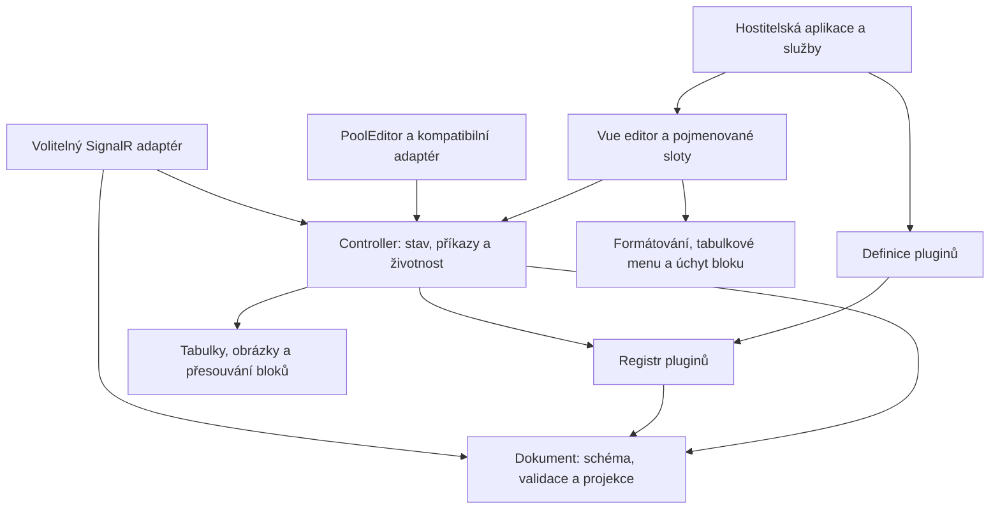

# Editor: architektura a pluginy

Pro první seznámení začněte [mapou skládání komponent](editor-composition.md),
[architektonickými rozhodnutími](editor-architecture-decisions.md) a
[návodem na vlastní plugin s živým příkladem](writing-a-plugin.md).
Tento dokument je podrobnější reference kontraktu.

Navazuje na audit z 4. 9. 2026. Editor má jedno místo konstrukce Tiptap instance, společné zpracování dokumentu a veřejný pluginový kontrakt. Nové funkce se připojují přes definici pluginu a služby dodané aplikací.

## Rozdělení odpovědností



| Oblast | Odpovědnost |
| --- | --- |
| `core/controller.ts` | Orchestrace stavu, příkazů, připojení pohledu a vlastnictví relace. |
| `core/plugins/` | Typované definice a volání příkazů, validace závislostí a ID, lifecycle a příspěvky UI. |
| `engine/editorFactory.ts` | Jediná produkční hranice konstrukce Tiptap editoru pro interaktivní i statickou cestu. |
| `engine/` | Společné schéma, validace rich obálky, vlastnictví polí pluginy, statický renderer a lazy projekce. |
| `features/table/` | Příkazy a samostatná geometrie, resize, hover a DOM overlay. |
| `features/drag/` | Operace s bloky, dekorace, drag session a scroll. Vue úchyt řeší vykreslení a interakci. |
| `features/images/` | Injektovaná služba uploadu, mapované cíle async operací a výběr souboru. |
| `vue/`, `ui/` | Vue vazba controlleru, společné ovladače, toolbar doplňků, sloty a fullscreen. |
| `legacy/` | Původní Markdown v-model, debounce a callbacky nad stejným controllerem. |
| `collab/` | Volitelná synchronizace; dohoda o schématu, transport, presence, hydratace, odesílání změn a snapshoty. |
| `plugins/youtrack/` | Samostatná referenční integrace používající veřejný `/core`. |
| `styles/` | Agregátor zachovávající pořadí stylů povrchu, obsahu, tabulek, přesunu, fullscreen a spolupráce. |

Headless `/core` neimportuje Vue, Yjs ani SignalR. Komponenty starého i nového API sdílejí obsahový engine a ovladače. Původní `PoolEditor` dál vrací Markdown a raw Tiptap callbacky; jeho rich režim proto není náhradou za bezeztrátový `MarkdownRichValue` nového API. Externě dodaný Y.Doc zůstává vlastnictvím aplikace.

## Typované příkazy a nabídky

```ts
import { defineMarkdownCommand, type MarkdownPlugin } from '@atlas/markdown/core'

export const insertNote = defineMarkdownCommand<{ text: string }>({
  id: 'notes.insert',
  apply: ({ text }) => ({ commands }) => commands.insertContent({ type: 'text', text }),
})

export const notesPlugin: MarkdownPlugin = {
  id: 'notes',
  apiVersion: 1,
  create: () => ({
    commands: [insertNote],
    actions: {
      slash: [{ id: 'notes.insert', label: 'Poznámka',
        keywords: ['note'], command: insertNote({ text: 'Poznámka' }) }],
      toolbar: [{ id: 'notes.insert', label: 'Poznámka',
        command: insertNote({ text: 'Poznámka' }), variants: ['document'] }],
    },
  }),
}
```

Příkaz se volá přes exportovanou factory: `controller.dispatch(insertNote({ text: 'Obsah' }))`. Volání drží ověřenou identitu registrovaného příkazu; samotné podvržené string ID nestačí. Argumenty se kopírují při vytvoření volání a musí podporovat `structuredClone`. Služby, DOM a callbacky patří do closure pluginové instance, nikoli do argumentů příkazu.

`query` nesmí měnit dokument ani spouštět síťové operace. Implementace dodržuje Tiptap kontrakt `dispatch`: kontrolu podmínek provádí vždy, vedlejší efekty pouze při provádění. Async picker se spouští až po aplikování transakce, nikoli během sestavování příkazu.

Slash menu používá stejný příkaz s `replaceRange`. Kontrola dostupnosti vidí dočasnou transakci s odstraněným dotazem. Při provedení je odstranění a synchronní vložení jeden undo krok. `variants` určuje dostupnost v document/compact povrchu; nezávisí na překladu názvu. Zkratky může plugin dodat přes `addKeyboardShortcuts` svého Tiptap extension.

Hledání ve slash nabídce nerozlišuje velikost písmen ani diakritiku (`/zminka` najde „Zmínka“, `/zmínka` najde „Zminka“). Pořadí: název začíná dotazem, slovo názvu začíná dotazem, klíčové slovo, dotaz kdekoli v názvu nebo klíčovém slově; uvnitř skupiny zůstává pořadí akcí, prázdný dotaz nic neřadí. `keywords` mají i akce vytvořené přes `defineMarkdownBlockModule({ keywords })`. Stejné porovnání nabízí `/core` jako `foldSearchText`, `rankSuggestion` a `rankSuggestions`.

`MarkdownAction.parameter: { label, command(text) }` rozšiřuje slash o text za mezerou. Slash se na mezeře zavře jako dosud, pokud ji nepředchází celý název akce nebo některé její klíčové slovo (bez ohledu na diakritiku). Pak zůstane otevřený, první řádek je „{label}: vyhledat „text““ a Enter spustí `command(text)` místo `command`; ostatní řádky se řadí podle celého dotazu. Dokud za mezerou nic není, platí běžná akce. Text je neprázdný a oříznutý; příkaz vždy projde `query`, takže nedostupný příkaz řádek nenabídne. Parametr se týká jen slash nabídky. Plugin Stránky jej používá k `/stránka vpn` (spustí `[[` s textem), YouTrack k `/úkol 123` (picker dostane `initialQuery`).

## Schéma, data a export

Plugin, který přidává nodes, marks nebo atributy, deklaruje `schemaVersion`. Tiptap extension s pouhými klávesovými zkratkami, ProseMirror pluginy nebo jiným chováním verzi schématu nepotřebuje a nevytváří závislost uloženého dokumentu. Metadata i vlastnictví atributů vycházejí přímo z deklarací schématu, takže nezávisí na pořadí pluginů. Vlastní nodes, marks a nové atributy používají stejnou sestavu při načtení, změně hodnoty, editaci a exportu. Rich obálka ukládá jen skutečně aktivní schema pluginy v `plugins: [{ id, version }]`; pluginové typy či atributy bez odpovídajících metadat se nepřijmou. Starší dokumenty obsahující pouze vestavěné uzly lze načíst i s nově instalovaným pluginem.

První verze kontraktu je aditivní. Odmítá duplicitní extension names i uvnitř `addExtensions`, překrývající se příspěvky atributů a globální `extendNodeSchema`/`extendMarkSchema`. Závislosti `requires` určují pořadí inicializace; chybějící závislost, cyklus a kolize příkazů nebo akcí selžou před připojením pohledu.

Vlastní uzly mají validaci atributů, `renderText` a Markdown serializer. Serializer pracuje synchronně s uloženými daty. `markdownLossy(document)` přesně určuje, zda převod zachovává význam pluginového obsahu. Obsahový plugin musí podporu profilu `markdown-safe` uvést výslovně v `profiles` a dodat tuto kontrolu. Transakce, která by v tomto profilu vytvořila ztrátový pluginový obsah, se necommitne; Tiptap command přitom zachovává běžnou návratovou sémantiku `run()`. `getValue()` stejný invariant kontroluje, takže nemůže potichu vrátit neúplný Markdown. Bez kontroly ztrátovosti je vlastní obsah povolen pouze v profilu `rich`, kde je rich JSON autoritativní. Instalace pluginu sama o sobě neznačí běžný text za ztrátový.

Rich JSON je autoritativní zdroj. Obálka i položky plugin metadata jsou uzavřené kontrakty; neznámá pole a jiné než čisté JSON hodnoty se odmítnou bez spuštění accessorů. Stejná kontrola blokuje pluginovou transakci s ne-JSON atributem a ověřuje každý rich výstup před předáním hostu. Nová verze obsahového pluginu deklaruje souvislé kroky `migrations: [{ from, to, migrate }]`; každý krok zvyšuje verzi právě o jedna. Codec je před validací spustí nad kopií dokumentu a původní hodnotu nemění. Samostatnou údržbu nebo import lze provést přes veřejné `migrateMarkdownValue(value, profile, plugins)`. Chybějící krok, chybějící plugin a dokument z novější verze se odmítnou. Fallback uzly ani změna sady pluginů za běhu nejsou součástí kontraktu.

```ts
const chartPluginV2: MarkdownPlugin = {
  id: 'charts', apiVersion: 1, schemaVersion: 2, profiles: ['rich'],
  migrations: [{ from: 1, to: 2, migrate: document => upgradeChartNodes(document) }],
  create: () => ({ extensions: [ChartNode] }),
}

const migrated = migrateMarkdownValue(storedValue, 'rich', [chartPluginV2])
```

U sdíleného Yjs dokumentu server záměrně odmítne jiné schéma ještě před hydratací. Host proto nejprve v údržbovém režimu načte dokument starým schématem, provede migraci a uloží nový snapshot i identitu schématu; teprve potom povolí klienty nové verze. Markdown a text mají oddělené lazy cache; čtení rich hodnoty nespouští jejich serializaci. Synchronizace používá stejnou projekční službu.

## Životnost a asynchronní práce

`create` běží pro každý controller zvlášť. Definice je opakovaně použitelná, mutable stav patří dovnitř factory. `onCreate` vrací cleanup celé editorové instance; `onAttach` vrací cleanup konkrétního připojeného pohledu. Controller při zničení abortuje životní signal a provede všechny cleanupy i při chybě jiného hooku. Chyba serializeru při odpojení nezanechá připojený DOM.

Statický `MarkdownRenderer` volá `onRender({ container, document, ownerDocument, signal })` až po vložení validovaného dokumentu do kontejneru. Hook je frameworkově neutrální a může například nahradit chart placeholder skutečným grafem. Vrací pouze synchronní cleanup. Rerender, chyba dalšího hooku i unmount nejdříve abortují signal a potom spustí všechny cleanupy v opačném pořadí; neplatný asynchronní cleanup se odmítne a částečný render se odstraní.
Příprava náhradního renderu probíhá mimo cílový DOM. Pokud nová hodnota neprojde validací nebo serializací, poslední validní náhled i jeho lifecycle zůstávají aktivní. Disposer je registrovaný před prvním externím hookem a generace se kontroluje po reentrantním callbacku, takže ani synchronní unmount z pluginu nezanechá aktivní lifecycle. Sdílený context a celý JSON snapshot dokumentu jsou zmrazené; jeho veřejný typ je `MarkdownReadonlyJSONContent`. `container` zůstává mutovatelný pro vlastní vykreslení.

Stav controlleru se doručuje přes uspořádanou frontu. Reentrantní změna se rozešle až po dokončení právě doručovaného snapshotu. Výjimka jednoho odběratele nepřeruší commit ani ostatní odběratele; host ji může zachytit přes `onSubscriberError(error, state)`. Připojení rezervuje view ještě před první externí notifikací a po každém pluginovém či session hooku ověřuje, že nebylo reentrantně zrušeno. Chyby úklidu se agregují s původní příčinou a každý prostředek má samostatný fallback teardown.

Upload přijímá `ImageUploadService(file, { signal })`. Cíl se mapuje přes transakce, takže změny před ním neposunou výsledek na špatné místo. Smazání cíle, readonly, odpojení nebo zničení operaci zruší. Picker YouTracku používá stejný princip ukotvení. Data a autentizaci dodává aplikace; zrušený nebo opožděný výsledek nesmí znovu otevřít editor ani ukrást fokus.

Hotové Vue UI poskytuje sloty `toolbar`, `before-content`, `inspector`, `status` s `{ controller, state }`. Vlastní toolbar přebírá vykreslení akcí přes `controller.actions.toolbar`. Výchozí toolbar řadí akce podle `priority`, drží stejně pojmenovanou skupinu pohromadě, vykreslí textovou, PrimeIcons nebo vestavěnou SVG ikonu a přebytek schová do přístupného rozbalovacího menu. Plugin může dodat frameworkově neutrální `panels` pro `inspector` nebo `status`; mount dostane kontejner, controller a abort signal a může vrátit cleanup. Host může oba výchozí povrchy stále nahradit slotem. Vue node views dostávají kontext `provide/inject` hosta.

Vlastní ovládací prvek bloku se do klávesnicové cesty úchytu (Alt+F10, pak Tab) zapojí přes `registerMarkdownBlockKeyboardHook(controller | editor, { id, controls(block) })` z `/core`. `controls` dostane `{ pos, node }` aktuálního vrchního bloku při každém vstupu na cestu a vrátí prvky (nebo nic). Tab z úchytu přejde na první prvek, další Tab na další; po posledním pokračuje lišta vybraných bloků nebo běžný Tab prohlížeče. Shift+Tab se vrací přes prvky k úchytu, Escape vrátí focus do editoru. Prvky mohou mít `tabindex="-1"` (mimo běžné Tab pořadí) a musí mít vlastní přístupný název; odpojené, zakázané a z jiného dokumentu se vynechají a výjimka hooku cestu nezastaví. Duplicitní `id` v jednom editoru je chyba, vrácený cleanup hook odregistruje.

Portál vykreslený mimo shell editoru plugin registruje přes `registerMarkdownOverlay(controller, element, { consumesEscape, modal })` z veřejného `/core`. Registrace vyžaduje připojený view, nevystavuje interní Tiptap editor a váže přesný kořen na jeho `ownerDocument`; vrácený cleanup se zavolá před odstraněním portálu. Fullscreen tak zahrne pouze overlaye patřící danému editoru, včetně situace, kdy několik editorů sdílí jeden portal root. Registrovaný nebo nativní modal přebírá fokus, Tab a Escape; obyčejný otevřený `<dialog>` se za modal nepovažuje. Jeho zavření vrátí řízení editoru. `variant`, `placeholder` a `imageUpload` jsou měnitelná konfigurace pohledu: compact varianta bezpečně ukončí fullscreen, zavře otevřenou slash nabídku a další otevření použije novou sadu akcí; placeholder se překreslí bez remountu; změna upload služby zruší rozpracované requesty i picker a další upload použije novou službu. Nastavení `fullscreenable=false` během fullscreen vrátí editor do vloženého povrchu.

## YouTrack a obsahové moduly

```ts
import { createYouTrackPlugin } from '@atlas/markdown/plugins/youtrack'
const plugins = [createYouTrackPlugin({
  client: youTrackClient,
  pickerHelpText: 'Uložený název a stav uvidí čtenáři dokumentu podle práv aplikace.',
})]
// youTrackClient.search(query, { signal }) -> Promise<{ id, key, title, url }[]>
```

`MarkdownEditor` s `profile="rich"` a `:plugins="plugins"` získá akci v toolbaru i `/` nabídce. Klient řeší API, oprávnění a přihlášení. Výchozí picker lze nahradit vlastním. Uzel uchovává ID, klíč, název, URL a volitelný uložený stav; Markdown/text poskytují čitelný fallback. Ukázka `/?story=plugins` používá lokální demo data, není připojením ke konkrétní instanci YouTracku.

Grafový modul je dostupný přes `@atlas/markdown/plugins/charts` a používá lazy Apache ECharts. Rich dokument ukládá vlastní verzovaná data a odkazy na zdrojové buňky; Markdown má čitelný fallback a přiznanou ztrátovost. Renderer a klient dat patří do pluginu/služby, asynchronní práce do lifecycle, nikoli serializace. `render` může volitelně vrátit `MarkdownModuleView<T>` s `update(context)` a `destroy()`, aby zachoval instanci při změně dat; stávající návrat cleanup funkce zůstává kompatibilní. Podrobnosti a příklad: [obsahové moduly](content-modules.md#runtime-který-zachovává-vykreslenou-instanci).

Výchozí YouTrack picker načte vlastní UI až při otevření; zrušení během načítání zabrání pozdnímu zobrazení. Používá `openMarkdownContextPopover` z veřejného `/core`: neblokující panel u místa vložení, stejný registr aktivních panelů, focus, Escape, zrušení kliknutím mimo a readonly lifecycle jako ostatní moduly. Vstupy a tlačítka sdílejí styl s editorem URL. Hledání má stavy načítání, prázdného výsledku a chyby s `Zkusit znovu`; opožděné odpovědi se ignorují.

`pickerHelpText` je volitelný text hostitele (nikoli HTML); knihovna neodvozuje ani neslibuje aplikační oprávnění. Vlastní `picker(context)` nadále vrací vybraný úkol nebo `null`. Kontext navíc poskytuje volitelné `editor`, `anchor`, `positionAnchor` a `helpText`, vedle existujících `signal`, `themeElement`, `registerOverlay` a `initialQuery`. Volání `pickYouTrackIssue` bez dvojice `editor`/`anchor` zachovává samostatný nativní dialog. Vlastní picker musí respektovat signal a uvolnit vlastní UI.

`openMarkdownContextPopover.positionAnchor` přijímá `MarkdownPopoverAnchor`: DOM element nebo virtuální `{ contextElement, getBoundingClientRect }`. Živý obdélník umožňuje stejnému panelu sledovat caret i při přeskládání dokumentu, bez vložení UI do uloženého obsahu. `anchor` nadále určuje životnost/spouštěč; nevolit celý editovatelný dokument, protože kliknutí do spouštěče se nepovažuje za kliknutí mimo panel.

Společné styly jsou v `styles/base.css`: `.md-picker-input`, `.md-picker-results`, `.md-picker-result`, `.md-btn`; `.md-picker` je samostatný dialog. Portál převezme tokeny při otevření přes `copyMarkdownOverlayTheme` (snapshot, ne živé sledování tématu). Motion používá stejné tokeny jako ostatní panely a respektuje `prefers-reduced-motion`.


## Spolupráce a provoz

Controller předává serveru profil a verze obsahových pluginů. Server identitu uloží před prvním snapshotem; nesoulad odmítne před vstupem do skupiny. Klient ji ověří před hydratací i zpracováním dříve doručených změn. UI změny bez změny schématu nepotřebují novou schema verzi.

Starší sdílené dokumenty mají explicitní legacy režim a automaticky se nepřeznačují. Převod vyžaduje koordinovanou migraci. Vlastní `IDocumentStore` musí pro nové verze implementovat trvalé svázání schématu; výchozí implementace zachová legacy kompatibilitu a nové relace odmítne. Podrobnosti: [collaboration-schema.md](collaboration-schema.md).

## Volitelný modul návrhů (`@atlas/markdown/assist`)

Návrhy u bloku a panel návrhu změny jsou samostatný volitelný vstup, ne součást core. Hostitel ho načte líně a zaregistruje jako běžný plugin: `createAssistPlugin({ sources })` přispívá jen rozšířením (ProseMirror plugin, dekorace, Alt+Enter) a stavovým panelem, bez `schemaVersion`. Zdroje (`MarkdownAssistSource.suggest(block, { signal })`) vracejí návrhy, jejichž `apply(context)` volá existující příkazy přes `context.dispatch(command, { replaceRange })` jako jeden krok Zpět. Kontrakt, hranice a pohyb popisuje [assist.md](assist.md); core ani pluginy modul nikdy neimportují.

## Ověřování hranic

`pnpm check` kontroluje transitivní importy `/core`, zákaz interních importů z referenčních pluginů, jediné místo konstrukce editoru, TypeScript, unit/integrační frontend testy, samostatného konzumenta `.tgz` a build galerie. Package smoke obsahuje negativní kontroly zákazu Vue/Yjs/SignalR v core. Browserové testy navíc ověřují tabulky, drag, fokus, fullscreen a pluginové ovládání v Chromium, Firefox a WebKit; backend má testy odmítnutí nekompatibilních klientů i zachování schématu po restartu.

`MarkdownRenderer` používá samostatnou statickou cestu bez editorového povrchu, toolbarů a globálních interakcí; po validaci a parsování ihned uvolní headless runtime. Následné změny se mají ověřovat na stejných kontraktech. Další optimalizace velmi velkých dokumentů nebo rozdělení na více distribuovaných balíčků patří k doloženým měřením a konkrétním požadavkům.

## Jednotné inline reference

Plugin může přidat `references: readonly MarkdownReferenceProvider[]` do svého `create()`. Registrace nemění schéma dokumentu. Každý provider má jedinečné `id`, zobrazovací `label` a `nodeType` existujícího inline atomu; jeden typ uzlu má jednoho vlastníka. Registr si pořídí zmrazenou kopii známých polí; metody zachovají původní objekt jako `this`, takže fungují i poskytovatelé implementovaní třídou.

```ts
import type { MarkdownReferenceProvider } from '@atlas/markdown/core'

const reference: MarkdownReferenceProvider = {
  id: 'tickets.reference',
  label: 'Úkol',
  nodeType: 'ticketReference', // uzel dodaný týmž pluginem
  read(node) {
    if (node.type !== 'ticketReference') return null
    const ticket = normalizeTicket(node.attrs)
    return { url: ticket.url, label: ticket.title }
  },
  matchUrl(url) {
    const parsed = new URL(url)
    return parsed.origin === 'https://tickets.example.com'
      && /^\/issue\/[A-Z]+-\d+$/.test(parsed.pathname)
  },
  async resolveUrl(url, { signal }) {
    const ticket = await client.resolve(url, { signal })
    return ticket ? ticketNode(ticket) : null
  },
}
// create() vrací { extensions: [TicketNode], references: [reference] }
```

`read` a `matchUrl` jsou synchronní, čisté funkce bez síťových požadavků. `read` dostane readonly JSON uzlu a vrací adresu a čitelný popisek. Rozpoznání routy/originu patří hostiteli. `matchUrl` ani uložený název nepřiznávají oprávnění. `resolveUrl` dostane abort signal a vrací jediný validní uzel deklarovaného typu, `null` při nedostupnosti, nebo vyhodí chybu. Plugin nedostává pozici, editor ani možnost asynchronně zapisovat.

Vybraná reference používá společnou lištu Otevřít odkaz, Kopírovat adresu, Upravit adresu a Převést na běžný odkaz. Změnu adresy resolver nejprve načte jako nový návrh; teprve Použít změní identitu i metadata. Pokud resolver chybí, akce se jmenuje Upravit jako běžný odkaz a výslovně převádí obsah na obyčejný odkaz.

Po vložení samostatné HTTP(S) URL na pozici kurzoru se nabídnou odpovídající typy reference; běžný odkaz již zůstává v dokumentu. Metadata se načítají až po výslovném výběru typu. Návrh se potvrdí tlačítkem Použít. Více matcherů znamená více viditelných voleb, nikoli skrytou prioritu. Chyba a Zrušit ponechají původní obsah. Neznámé adresy, soubory, kód a doslovné vložení mají dosavadní chování.

UI referencí se načítá až při prvním podporovaném vložení nebo výběru reference. Běžný odkaz se vloží synchronně i během načítání UI; změna dokumentu, výběru nebo životnosti pohledu mezitím zruší pozdní nabídku. Samotné načtení modulu nespouští resolver. Po otevření UI platí následující mapování cíle.

Core mapuje původní rozsah přes cizí úpravy a porovnává jeho obsah včetně atributů a značek. Změna cíle, zrušení, readonly, odpojení a zničení ruší práci; ignorují se také opožděné odpovědi resolveru, který abort nerespektoval. Použít vytváří samostatný krok historie, takže Zpět obnoví obyčejný odkaz bez odstranění okolního psaní.

YouTrack zapojíte pomocí `createYouTrackPlugin({ matchUrl, client })`, kde `client.resolve` zajišťuje autorizované načtení. Interní stránky používají `createPagesPlugin({ source: { search, matchUrl, resolveUrl } })`; host převede rozpoznanou URL na svoje ID a načte stránku přes vlastní API. Bez matcheru/resolveru zůstává dosavadní vyhledávání a ovládání uložených referencí. Stávající `source.resolve(id)` u stránek dál ověřuje čtenářskou navigaci a není nahrazen resolverem URL.

Galerie `/?story=plugins` předvádí oba skutečné pluginy s lokálními daty, pomalým a chybovým načtením. Backendová autorizace, přihlášení ani osobní práva v YouTracku nejsou součástí tohoto UI kontraktu.
