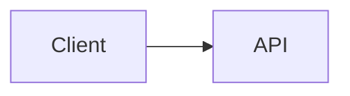

# Deployment Guide

See also [[Home]] and [[Release process|Release-Process]]. Relative link: [Runbook](Runbook) and [Runbook section](Runbook#rollback), same-page [jump](#rollback).

> [!NOTE]
> Deployments are frozen on Fridays.

> [!WARNING]
> Never deploy without a backup.

## Prerequisites

- [x] Access to the cluster
- [ ] VPN configured
  - [ ] nested task
- Plain bullet with ~~strikethrough~~ and **bold _nested italic_** and `inline code`

1. First
2. Second
   1. Nested ordered
3. Third

| Service | Port | Owner |
|:--------|-----:|:-----:|
| api     | 8080 | @team |
| worker  | —    | ops   |

### Architecture



Inline math $E = mc^2$ and block math:

$$
\sum_{i=1}^n i = \frac{n(n+1)}{2}
$$

#### Rollback

Bare URL https://example.com/docs and autolink <https://example.org>. Footnote reference[^1]. Emoji :rocket:.


<details>
<summary>Advanced options</summary>

Hidden **content** here.

</details>

Line one<br>line two  
hard break above.

```bash
kubectl rollout undo deployment/api
```

[^1]: The footnote text.
