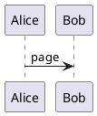

# Incident Policy
[[_TOC_]]

> Severity 1 incidents page the on-call engineer.
{.is-warning}

Contact the [on-call team](/ops/on-call) or read the [escalation matrix](../ops/escalation.md#matrix). Old Confluence link: [SLA](https://confluence.example.com/display/OPS/SLA). Same-wiki absolute: [Home](https://wiki.example.com/en/home). Reference link: [policy][pol].

Severity levels
===============

3. Starts at three
4. Continues

Term
: Definition list item

H~2~O and E=mc^2^ and <kbd>Ctrl</kbd>+<kbd>C</kbd>, a red warning, <mark>marked</mark>.

<table>
  <tr><th colspan="2">Merged header</th></tr>
  <tr><td>a</td><td>b</td></tr>
</table>

[Download the checklist](/assets/ops/checklist.pdf)

<!-- internal note: review yearly -->

    indented code block
    second line

Escaped \*not italic\* and a backslash hard break\
next line.

##### Level five heading

***

[pol]: https://example.com/policy "Policy"
