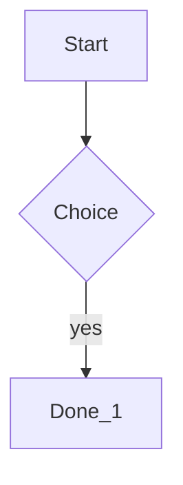

Constructs whose Markdown projection depends on the editor's serializer: escaping, marks, lists and blocks.

## Escaping and marks

Plain *stars*, _under_scores_, snake_case_name, [brackets], `code with ` backtick`` and a \ backslash.
Angle <brackets> & ampersand, #hash, 1. not a list, + plus and - minus.

**Bold with *italic inside* and more** then ***both*** and ~~strike **bold**~~ plus ==highlight== and ++underline++.

**"Quoted bold"**word and a **bold ** with trailing space.

Links: [titled](https://example.com/a_(b) "A \"title\""), bare https://example.com/path_x, <https://example.org>, <mailto:someone@example.com>, image-like !

[link after bang](https://example.com). Code link [`code`](https://example.com/code) and **[bold link](https://example.com/bold)**.

Line with hard break  
continued\
and again.

$E = mc^2$ opens this paragraph and `**literal**` stays.

## Lists

- Item one
- Item with **bold**  
  and a hard break
  - Nested *italic*
    1. Deep ordered

* Second bullet list
* Right after the first

0. Zero start
1. Next

7. Seven
8. Eight
9. Nine
10. Ten

1) Paren list
2) Second

- Loose item

- Another loose item

  With a second paragraph.

- [ ] Task
  with continuation
- [x] Done task
  - [ ] Nested task

## Blocks

> Quote first paragraph.
>
> **Bold** starts the second paragraph.
>
> > Nested quote.

> [!TIP]
> Tip text with `code`.
>
> Second tip paragraph.

> [!IMPORTANT] Heading-like title
> Important text.

> [!CAUTION]
> - List inside a callout

<details>
<summary>Disclosure *title* with [brackets]</summary>

- Inside disclosure

Paragraph inside.

</details>

| Left | Pipe \| cell | `code` |
|:-----|:------------:|-------:|
| **b** | a \| b | x |
| [l](https://example.com) | | last |

Term one
: First definition

```js
const a = `template ${b}`;
```

    indented code

***

## Heading with trailing hashes ##

### Heading *with* `code`

[[_TOC_]]



$$
f(x) = \left[ x^2 \right]_{0}^{1} * 2
$$

![Alt *text* [x]](images/pic.png "Pic title")
Text right after the image.

Last paragraph with a footnote[^note].

[^note]: Footnote with **bold**.
